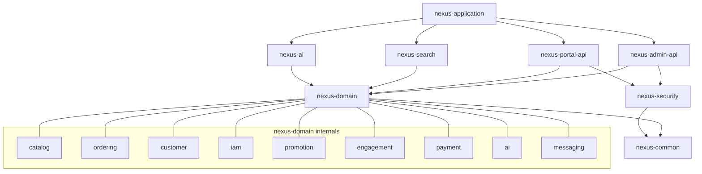
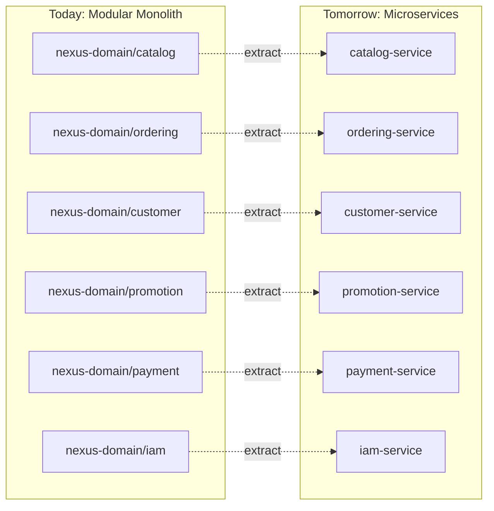

# NexusCore Backend Migration Plan — Modular Monolith

**Goal:** Restructure the NexusCore Spring Boot codebase from a **layered monolith** (grouped by technical layer) into a **modular monolith** (grouped by bounded context), aligned with the schema redesign in [`schema_redesign.md`](file:///home/aadarsh/Documents/NexusEngine/schema_redesign.md).

**Why this impresses FAANG interviewers:**
- Demonstrates DDD bounded-context thinking
- Shows you understand the monolith → microservice extraction path
- Each module has clear API boundaries that can become gRPC/REST contracts
- Package-private visibility enforces encapsulation without runtime overhead

> [!IMPORTANT]
> This plan covers **only** file/folder renames, splits, and merges. No code logic, database, or API changes are made here.

---

## Part 1 — Architecture Overview: Current vs. Target

### 1.1 Current Structure (Layered Monolith)

```
NexusCore/
├── nexus-common/          ← Shared utilities, API wrappers, exception handling
├── nexus-security/        ← JWT, Spring Security infra
├── nexus-data-jpa/        ← ALL entities + ALL repositories (single flat package)
│   ├── model/             ← 41 entity classes, no domain grouping
│   └── repository/        ← 41 repository interfaces, no domain grouping
├── nexus-admin/           ← Admin panel API (controller + service + dto, flat)
├── nexus-portal/          ← Customer portal API (controller + service + dto, flat)
├── nexus-search/          ← Elasticsearch product search
├── nexus-ai/              ← AI chat + embeddings
└── nexus-application/     ← Boot entry point
```

**Problems:**
1. `nexus-data-jpa` is a "God module" — every bounded context's entities in one flat package
2. `nexus-admin` has 22 services mixing catalog, orders, IAM, and promotions
3. `nexus-portal` has 15 services mixing members, orders, payments, and products
4. No package-level encapsulation: any module can reach into any entity
5. Naming uses old prefixes (`Pms`, `Oms`, `Ums`, `Sms`) that leak the mall project's origin

### 1.2 Target Structure (Modular Monolith)

```
NexusCore/
├── nexus-common/              ← Shared kernel (unchanged)
├── nexus-security/            ← Security infra (unchanged)
├── nexus-domain/              ← NEW: replaces nexus-data-jpa, split by context
│   ├── catalog/               ← Product, SKU, Brand, Category, Attribute
│   ├── ordering/              ← Order, Cart, Return, OrderLine
│   ├── customer/              ← Member, Address, Login events
│   ├── iam/                   ← Admin, Role, Permission, Menu
│   ├── promotion/             ← Coupon, FlashSale, Banner, Discounts
│   ├── engagement/            ← Review, ReviewMedia
│   ├── payment/               ← PaymentTransaction
│   ├── ai/                    ← ChatMessage, ProductEmbedding
│   └── messaging/             ← OutboxEvent
├── nexus-admin-api/           ← Replaces nexus-admin, split by context
├── nexus-portal-api/          ← Replaces nexus-portal, split by context
├── nexus-search/              ← Elasticsearch (unchanged structure)
├── nexus-ai/                  ← AI services (unchanged structure)
└── nexus-application/         ← Boot entry point (unchanged)
```



---

## Part 2 — Maven Module Changes

### 2.1 Rename `nexus-data-jpa` → `nexus-domain`

| Change | Details |
|---|---|
| Folder rename | `nexus-data-jpa/` → `nexus-domain/` |
| `artifactId` | `nexus-data-jpa` → `nexus-domain` |
| Parent POM `<module>` | Update reference |
| All dependent POMs | Update `<artifactId>nexus-data-jpa</artifactId>` → `nexus-domain` |

### 2.2 Rename `nexus-admin` → `nexus-admin-api`

| Change | Details |
|---|---|
| Folder rename | `nexus-admin/` → `nexus-admin-api/` |
| `artifactId` | `nexus-admin` → `nexus-admin-api` |
| Parent POM `<module>` | Update reference |

### 2.3 Rename `nexus-portal` → `nexus-portal-api`

| Change | Details |
|---|---|
| Folder rename | `nexus-portal/` → `nexus-portal-api/` |
| `artifactId` | `nexus-portal` → `nexus-portal-api` |
| Parent POM `<module>` | Update reference |

### 2.4 Updated Parent POM Modules

```xml
<modules>
    <module>nexus-common</module>
    <module>nexus-domain</module>        <!-- was nexus-data-jpa -->
    <module>nexus-security</module>
    <module>nexus-admin-api</module>     <!-- was nexus-admin -->
    <module>nexus-portal-api</module>    <!-- was nexus-portal -->
    <module>nexus-search</module>
    <module>nexus-ai</module>
    <module>nexus-application</module>
</modules>
```

---

## Part 3 — `nexus-domain` Internal Restructure (the Big One)

This is the most impactful change. The single flat `model/` and `repository/` packages become **bounded-context sub-packages**, each containing its own `entity/`, `repository/`, `enums/`, and `converter/` layers.

### 3.1 New Package Structure

```
nexus-domain/src/main/java/com/nexusengine/core/domain/
├── catalog/
│   ├── entity/
│   ├── repository/
│   ├── enums/
│   └── converter/
├── ordering/
│   ├── entity/
│   ├── repository/
│   ├── enums/
│   └── converter/
├── customer/
│   ├── entity/
│   ├── repository/
│   └── enums/
├── iam/
│   ├── entity/
│   ├── repository/
│   └── enums/
├── promotion/
│   ├── entity/
│   ├── repository/
│   └── enums/
├── engagement/
│   ├── entity/
│   ├── repository/
│   └── enums/
├── payment/
│   ├── entity/
│   ├── repository/
│   └── enums/
├── ai/
│   ├── entity/
│   └── repository/
├── messaging/
│   ├── entity/
│   ├── repository/
│   └── enums/
└── shared/
    ├── converter/
    └── types/
```

### 3.2 Entity File Renames & Moves

> Legend: `OLD_PATH` → `NEW_PATH` (`new class name`)

#### Catalog Context (was `pms` prefix)

| # | Current File | New File | New Class Name |
|---|---|---|---|
| 1 | `model/PmsBrand.java` | `domain/catalog/entity/Brand.java` | `Brand` |
| 2 | `model/PmsProduct.java` | `domain/catalog/entity/Product.java` | `Product` |
| 3 | `model/PmsSkuStock.java` | `domain/catalog/entity/ProductSku.java` | `ProductSku` |
| 4 | `model/PmsProductCategory.java` | `domain/catalog/entity/Category.java` | `Category` |
| 5 | `model/PmsProductAttributeCategory.java` | `domain/catalog/entity/ProductType.java` | `ProductType` |
| 6 | `model/PmsProductAttribute.java` | `domain/catalog/entity/AttributeDefinition.java` | `AttributeDefinition` |
| 7 | `model/PmsProductAttributeValue.java` | `domain/catalog/entity/ProductAttributeValue.java` | `ProductAttributeValue` |
| 8 | `model/PmsProductCategoryAttributeRelation.java` | `domain/catalog/entity/CategoryAttribute.java` | `CategoryAttribute` |
| 9 | `model/PmsProductGallery.java` | `domain/catalog/entity/ProductMedia.java` | `ProductMedia` |
| 10 | `model/PmsProductApprovalHistory.java` | `domain/catalog/entity/ProductApprovalEvent.java` | `ProductApprovalEvent` |
| 11 | `model/PmsProductAuditLog.java` | `domain/catalog/entity/ProductPriceChange.java` | `ProductPriceChange` |
| 12 | `model/PmsProductEmbedding.java` | `domain/ai/entity/ProductEmbedding.java` | `ProductEmbedding` |

#### Ordering Context (was `oms` prefix)

| # | Current File | New File | New Class Name |
|---|---|---|---|
| 13 | `model/OmsOrder.java` | `domain/ordering/entity/CustomerOrder.java` | `CustomerOrder` |
| 14 | `model/OmsOrderItem.java` | `domain/ordering/entity/OrderLine.java` | `OrderLine` |
| 15 | `model/OmsCartItem.java` | `domain/ordering/entity/CartItem.java` | `CartItem` |
| 16 | `model/OmsOrderOperateHistory.java` | `domain/ordering/entity/OrderStatusHistory.java` | `OrderStatusHistory` |
| 17 | `model/OmsOrderReturnApply.java` | `domain/ordering/entity/ReturnRequest.java` | `ReturnRequest` |
| 18 | `model/OmsOrderReturnReason.java` | `domain/ordering/entity/ReturnReason.java` | `ReturnReason` |
| 19 | `model/OmsCompanyAddress.java` | `domain/ordering/entity/MerchantAddress.java` | `MerchantAddress` |
| 20 | `model/OmsOrderSetting.java` | `domain/ordering/entity/OrderPolicy.java` | `OrderPolicy` |

#### Customer Context (was `ums` member prefix)

| # | Current File | New File | New Class Name |
|---|---|---|---|
| 21 | `model/UmsMember.java` | `domain/customer/entity/Member.java` | `Member` |
| 22 | `model/UmsMemberReceiveAddress.java` | `domain/customer/entity/MemberAddress.java` | `MemberAddress` |
| 23 | `model/UmsMemberLoginLog.java` | `domain/customer/entity/MemberLoginEvent.java` | `MemberLoginEvent` |
| 24 | `model/UmsMemberProductCategoryRelation.java` | `domain/customer/entity/MemberCategoryInterest.java` | `MemberCategoryInterest` |

#### IAM Context (was `ums` admin prefix)

| # | Current File | New File | New Class Name |
|---|---|---|---|
| 25 | `model/UmsAdmin.java` | `domain/iam/entity/AdminUser.java` | `AdminUser` |
| 26 | `model/UmsAdminLoginLog.java` | `domain/iam/entity/AdminLoginEvent.java` | `AdminLoginEvent` |
| 27 | `model/UmsAdminRoleRelation.java` | `domain/iam/entity/AdminUserRole.java` | `AdminUserRole` |
| 28 | `model/UmsRole.java` | `domain/iam/entity/Role.java` | `Role` |
| 29 | `model/UmsResource.java` | `domain/iam/entity/Permission.java` | `Permission` |
| 30 | `model/UmsResourceCategory.java` | `domain/iam/entity/PermissionGroup.java` | `PermissionGroup` |
| 31 | `model/UmsMenu.java` | `domain/iam/entity/ConsoleMenu.java` | `ConsoleMenu` |
| 32 | `model/UmsRoleMenuRelation.java` | `domain/iam/entity/RoleMenu.java` | `RoleMenu` |
| 33 | `model/UmsRoleResourceRelation.java` | `domain/iam/entity/RolePermission.java` | `RolePermission` |

#### Promotion Context (was `sms` prefix + promotional banners)

| # | Current File | New File | New Class Name |
|---|---|---|---|
| 34 | `model/SmsCoupon.java` | `domain/promotion/entity/Coupon.java` | `Coupon` |
| 35 | `model/SmsCouponHistory.java` | `domain/promotion/entity/MemberCoupon.java` | `MemberCoupon` |
| 36 | `model/SmsCouponProductRelation.java` | `domain/promotion/entity/CouponProduct.java` | `CouponProduct` |
| 37 | `model/SmsCouponProductCategoryRelation.java` | `domain/promotion/entity/CouponCategory.java` | `CouponCategory` |
| 38 | `model/SmsFlashPromotion.java` | `domain/promotion/entity/FlashSale.java` | `FlashSale` |
| 39 | `model/SmsFlashPromotionSession.java` | `domain/promotion/entity/FlashSaleSlot.java` | `FlashSaleSlot` |
| 40 | `model/SmsFlashPromotionProductRelation.java` | `domain/promotion/entity/FlashSaleItem.java` | `FlashSaleItem` |
| 41 | `model/SmsFlashPromotionLog.java` | `domain/promotion/entity/FlashSalePurchase.java` | `FlashSalePurchase` |
| 42 | `model/PromotionalBanner.java` | `domain/promotion/entity/Banner.java` | `Banner` |
| 43 | `model/PmsProductSpendDiscount.java` | `domain/promotion/entity/SpendThresholdDiscount.java` | `SpendThresholdDiscount` |
| 44 | `model/PmsProductVolumeDiscount.java` | `domain/promotion/entity/QuantityTierDiscount.java` | `QuantityTierDiscount` |

#### Engagement Context (reviews, new)

| # | Current File | New File | New Class Name |
|---|---|---|---|
| 45 | `model/PmsReview.java` | `domain/engagement/entity/ProductReview.java` | `ProductReview` |
| 46 | `model/PmsReviewAttachment.java` | `domain/engagement/entity/ReviewMedia.java` | `ReviewMedia` |

#### Payment Context (new)

| # | Current File | New File | New Class Name |
|---|---|---|---|
| 47 | `model/OmsPaymentTransaction.java` | `domain/payment/entity/PaymentTransaction.java` | `PaymentTransaction` |

#### AI Context

| # | Current File | New File | New Class Name |
|---|---|---|---|
| 48 | `model/AiChatConversation.java` | `domain/ai/entity/ChatMessage.java` | `ChatMessage` |

#### Messaging Context

| # | Current File | New File | New Class Name |
|---|---|---|---|
| 49 | `model/StagedEvent.java` | `domain/messaging/entity/OutboxEvent.java` | `OutboxEvent` |

#### Shared / Converters

| # | Current File | New File | Notes |
|---|---|---|---|
| 50 | `model/converter/IntegerToBooleanConverter.java` | `domain/shared/converter/IntegerToBooleanConverter.java` | Used across contexts |
| 51 | `model/converter/IntegerToDeletedAtConverter.java` | `domain/shared/converter/IntegerToDeletedAtConverter.java` | Used across contexts |

### 3.3 Repository File Renames & Moves

#### Catalog Repositories

| # | Current File | New File | New Interface Name |
|---|---|---|---|
| 1 | `repository/PmsBrandRepository.java` | `domain/catalog/repository/BrandRepository.java` | `BrandRepository` |
| 2 | `repository/PmsProductRepository.java` | `domain/catalog/repository/ProductRepository.java` | `ProductRepository` |
| 3 | `repository/PmsSkuStockRepository.java` | `domain/catalog/repository/ProductSkuRepository.java` | `ProductSkuRepository` |
| 4 | `repository/PmsProductCategoryRepository.java` | `domain/catalog/repository/CategoryRepository.java` | `CategoryRepository` |
| 5 | `repository/PmsProductAttributeCategoryRepository.java` | `domain/catalog/repository/ProductTypeRepository.java` | `ProductTypeRepository` |
| 6 | `repository/PmsProductAttributeRepository.java` | `domain/catalog/repository/AttributeDefinitionRepository.java` | `AttributeDefinitionRepository` |
| 7 | `repository/PmsProductAttributeValueRepository.java` | `domain/catalog/repository/ProductAttributeValueRepository.java` | `ProductAttributeValueRepository` |
| 8 | `repository/PmsProductCategoryAttributeRelationRepository.java` | `domain/catalog/repository/CategoryAttributeRepository.java` | `CategoryAttributeRepository` |
| 9 | `repository/PmsProductApprovalHistoryRepository.java` | `domain/catalog/repository/ProductApprovalEventRepository.java` | `ProductApprovalEventRepository` |
| 10 | `repository/PmsProductAuditLogRepository.java` | `domain/catalog/repository/ProductPriceChangeRepository.java` | `ProductPriceChangeRepository` |
| 11 | `repository/PmsProductEmbeddingRepository.java` | `domain/ai/repository/ProductEmbeddingRepository.java` | `ProductEmbeddingRepository` |

> [!NOTE]
> `PmsProductGallery` → `ProductMedia` — if `PmsProductGalleryRepository` doesn't exist yet, create `domain/catalog/repository/ProductMediaRepository.java`

#### Ordering Repositories

| # | Current File | New File | New Interface Name |
|---|---|---|---|
| 12 | `repository/OmsOrderRepository.java` | `domain/ordering/repository/CustomerOrderRepository.java` | `CustomerOrderRepository` |
| 13 | `repository/OmsOrderItemRepository.java` | `domain/ordering/repository/OrderLineRepository.java` | `OrderLineRepository` |
| 14 | `repository/OmsCartItemRepository.java` | `domain/ordering/repository/CartItemRepository.java` | `CartItemRepository` |
| 15 | `repository/OmsOrderOperateHistoryRepository.java` | `domain/ordering/repository/OrderStatusHistoryRepository.java` | `OrderStatusHistoryRepository` |
| 16 | `repository/OmsOrderReturnApplyRepository.java` | `domain/ordering/repository/ReturnRequestRepository.java` | `ReturnRequestRepository` |
| 17 | `repository/OmsOrderReturnReasonRepository.java` | `domain/ordering/repository/ReturnReasonRepository.java` | `ReturnReasonRepository` |
| 18 | `repository/OmsCompanyAddressRepository.java` | `domain/ordering/repository/MerchantAddressRepository.java` | `MerchantAddressRepository` |
| 19 | `repository/OmsOrderSettingRepository.java` | `domain/ordering/repository/OrderPolicyRepository.java` | `OrderPolicyRepository` |

#### Customer Repositories

| # | Current File | New File | New Interface Name |
|---|---|---|---|
| 20 | `repository/UmsMemberRepository.java` | `domain/customer/repository/MemberRepository.java` | `MemberRepository` |
| 21 | `repository/UmsMemberReceiveAddressRepository.java` | `domain/customer/repository/MemberAddressRepository.java` | `MemberAddressRepository` |
| 22 | `repository/UmsMemberLoginLogRepository.java` | `domain/customer/repository/MemberLoginEventRepository.java` | `MemberLoginEventRepository` |
| 23 | `repository/UmsMemberProductCategoryRelationRepository.java` | `domain/customer/repository/MemberCategoryInterestRepository.java` | `MemberCategoryInterestRepository` |

#### IAM Repositories

| # | Current File | New File | New Interface Name |
|---|---|---|---|
| 24 | `repository/UmsAdminRepository.java` | `domain/iam/repository/AdminUserRepository.java` | `AdminUserRepository` |
| 25 | `repository/UmsAdminLoginLogRepository.java` | `domain/iam/repository/AdminLoginEventRepository.java` | `AdminLoginEventRepository` |
| 26 | `repository/UmsAdminRoleRelationRepository.java` | `domain/iam/repository/AdminUserRoleRepository.java` | `AdminUserRoleRepository` |
| 27 | `repository/UmsRoleRepository.java` | `domain/iam/repository/RoleRepository.java` | `RoleRepository` |
| 28 | `repository/UmsResourceRepository.java` | `domain/iam/repository/PermissionRepository.java` | `PermissionRepository` |
| 29 | `repository/UmsResourceCategoryRepository.java` | `domain/iam/repository/PermissionGroupRepository.java` | `PermissionGroupRepository` |
| 30 | `repository/UmsMenuRepository.java` | `domain/iam/repository/ConsoleMenuRepository.java` | `ConsoleMenuRepository` |
| 31 | `repository/UmsRoleMenuRelationRepository.java` | `domain/iam/repository/RoleMenuRepository.java` | `RoleMenuRepository` |
| 32 | `repository/UmsRoleResourceRelationRepository.java` | `domain/iam/repository/RolePermissionRepository.java` | `RolePermissionRepository` |

#### Promotion Repositories

| # | Current File | New File | New Interface Name |
|---|---|---|---|
| 33 | `repository/SmsCouponRepository.java` | `domain/promotion/repository/CouponRepository.java` | `CouponRepository` |
| 34 | `repository/SmsCouponHistoryRepository.java` | `domain/promotion/repository/MemberCouponRepository.java` | `MemberCouponRepository` |
| 35 | `repository/SmsCouponProductRelationRepository.java` | `domain/promotion/repository/CouponProductRepository.java` | `CouponProductRepository` |
| 36 | `repository/SmsCouponProductCategoryRelationRepository.java` | `domain/promotion/repository/CouponCategoryRepository.java` | `CouponCategoryRepository` |
| 37 | `repository/SmsFlashPromotionRepository.java` | `domain/promotion/repository/FlashSaleRepository.java` | `FlashSaleRepository` |
| 38 | `repository/SmsFlashPromotionSessionRepository.java` | `domain/promotion/repository/FlashSaleSlotRepository.java` | `FlashSaleSlotRepository` |
| 39 | `repository/SmsFlashPromotionProductRelationRepository.java` | `domain/promotion/repository/FlashSaleItemRepository.java` | `FlashSaleItemRepository` |
| 40 | `repository/SmsFlashPromotionLogRepository.java` | `domain/promotion/repository/FlashSalePurchaseRepository.java` | `FlashSalePurchaseRepository` |
| 41 | `repository/PromotionalBannerRepository.java` | `domain/promotion/repository/BannerRepository.java` | `BannerRepository` |
| 42 | `repository/PmsProductSpendDiscountRepository.java` | `domain/promotion/repository/SpendThresholdDiscountRepository.java` | `SpendThresholdDiscountRepository` |
| 43 | `repository/PmsProductVolumeDiscountRepository.java` | `domain/promotion/repository/QuantityTierDiscountRepository.java` | `QuantityTierDiscountRepository` |

#### Engagement Repositories

| # | Current File | New File | New Interface Name |
|---|---|---|---|
| 44 | `repository/PmsReviewRepository.java` | `domain/engagement/repository/ProductReviewRepository.java` | `ProductReviewRepository` |
| 45 | `repository/PmsReviewAttachmentRepository.java` | `domain/engagement/repository/ReviewMediaRepository.java` | `ReviewMediaRepository` |

#### Payment Repository

| # | Current File | New File | New Interface Name |
|---|---|---|---|
| 46 | `repository/OmsPaymentTransactionRepository.java` | `domain/payment/repository/PaymentTransactionRepository.java` | `PaymentTransactionRepository` |

#### AI Repository

| # | Current File | New File | New Interface Name |
|---|---|---|---|
| 47 | `repository/AiChatConversationRepository.java` | `domain/ai/repository/ChatMessageRepository.java` | `ChatMessageRepository` |

#### Messaging Repository

| # | Current File | New File | New Interface Name |
|---|---|---|---|
| 48 | `repository/StagedEventRepository.java` | `domain/messaging/repository/OutboxEventRepository.java` | `OutboxEventRepository` |

### 3.4 JPA Configuration Update

Update `@EntityScan` and `@EnableJpaRepositories` base packages:

```java
// Before
@EntityScan("com.nexusengine.core.model")
@EnableJpaRepositories("com.nexusengine.core.repository")

// After
@EntityScan("com.nexusengine.core.domain")
@EnableJpaRepositories("com.nexusengine.core.domain")
```

### 3.5 Test File Renames

All tests in `nexus-data-jpa/src/test/` follow the same pattern. Move each test into its context's test package:

| Current Test Package | New Test Package |
|---|---|
| `repository/PmsBrandRepositoryTest.java` | `domain/catalog/repository/BrandRepositoryTest.java` |
| `repository/OmsOrderRepositoryTest.java` | `domain/ordering/repository/CustomerOrderRepositoryTest.java` |
| `repository/UmsMemberRepositoryTest.java` | `domain/customer/repository/MemberRepositoryTest.java` |
| `repository/UmsAdminRepositoryTest.java` | `domain/iam/repository/AdminUserRepositoryTest.java` |
| `repository/SmsCouponRepositoryTest.java` | `domain/promotion/repository/CouponRepositoryTest.java` |
| `repository/PmsReviewRepositoryTest.java` | `domain/engagement/repository/ProductReviewRepositoryTest.java` |
| `repository/OmsPaymentTransactionRepositoryTest.java` | `domain/payment/repository/PaymentTransactionRepositoryTest.java` |
| `repository/AiChatConversationRepositoryTest.java` | `domain/ai/repository/ChatMessageRepositoryTest.java` |
| `repository/StagedEventRepositoryTest.java` | `domain/messaging/repository/OutboxEventRepositoryTest.java` |
| `model/EntityValidationTest.java` | `domain/shared/EntityValidationTest.java` |

> [!TIP]
> Apply the same `OldName → NewName` pattern to every remaining test file. The full list has 35+ test files — all follow the same convention.

---

## Part 4 — `nexus-admin-api` Internal Restructure

### 4.1 Current Structure (Flat)

```
nexus-admin/src/main/java/com/nexusengine/core/
├── controller/     ← 22 controllers mixing all contexts
├── dto/            ← 30 DTOs mixing all contexts
├── service/        ← 22 service interfaces
├── service/impl/   ← 22 service implementations
└── validator/      ← 2 validator files
```

### 4.2 Target Structure (By Bounded Context)

```
nexus-admin-api/src/main/java/com/nexusengine/core/admin/
├── catalog/
│   ├── controller/
│   │   ├── BrandController.java              ← was PmsBrandController
│   │   ├── ProductController.java            ← was PmsProductController
│   │   ├── ProductSkuController.java         ← was PmsSkuStockController
│   │   ├── CategoryController.java           ← was PmsProductCategoryController
│   │   ├── ProductTypeController.java        ← was PmsProductAttributeCategoryController
│   │   └── AttributeController.java          ← was PmsProductAttributeController
│   ├── dto/
│   │   ├── BrandParam.java                   ← was PmsBrandParam
│   │   ├── ProductParam.java                 ← was PmsProductParam
│   │   ├── ProductQueryParam.java            ← was PmsProductQueryParam
│   │   ├── ProductResult.java                ← was PmsProductResult
│   │   ├── CategoryParam.java               ← was PmsProductCategoryParam
│   │   ├── CategoryWithChildrenItem.java     ← was PmsProductCategoryWithChildrenItem
│   │   ├── ProductTypeWithAttributes.java    ← was PmsProductAttributeCategoryItem
│   │   ├── AttributeParam.java              ← was PmsProductAttributeParam
│   │   └── AttributeInfo.java               ← was ProductAttrInfo
│   └── service/
│       ├── BrandService.java                 ← was PmsBrandService
│       ├── BrandServiceImpl.java             ← was PmsBrandServiceImpl
│       ├── ProductService.java               ← was PmsProductService
│       ├── ProductServiceImpl.java           ← was PmsProductServiceImpl
│       ├── ProductSkuService.java            ← was PmsSkuStockService
│       ├── ProductSkuServiceImpl.java        ← was PmsSkuStockServiceImpl
│       ├── CategoryService.java              ← was PmsProductCategoryService
│       ├── CategoryServiceImpl.java          ← was PmsProductCategoryServiceImpl
│       ├── ProductTypeService.java           ← was PmsProductAttributeCategoryService
│       ├── ProductTypeServiceImpl.java       ← was PmsProductAttributeCategoryServiceImpl
│       ├── AttributeService.java             ← was PmsProductAttributeService
│       └── AttributeServiceImpl.java         ← was PmsProductAttributeServiceImpl
├── ordering/
│   ├── controller/
│   │   ├── OrderController.java              ← was OmsOrderController
│   │   ├── ReturnRequestController.java      ← was OmsOrderReturnApplyController
│   │   ├── ReturnReasonController.java       ← was OmsOrderReturnReasonController
│   │   ├── OrderPolicyController.java        ← was OmsOrderSettingController
│   │   └── MerchantAddressController.java    ← was OmsCompanyAddressController
│   ├── dto/
│   │   ├── OrderQueryParam.java              ← was OmsOrderQueryParam
│   │   ├── OrderDetail.java                  ← was OmsOrderDetail
│   │   ├── OrderDeliveryParam.java           ← was OmsOrderDeliveryParam
│   │   ├── OrderReceiverInfoParam.java       ← was OmsReceiverInfoParam
│   │   ├── OrderMoneyInfoParam.java          ← was OmsMoneyInfoParam
│   │   ├── OrderStatusUpdateParam.java       ← was OmsUpdateStatusParam
│   │   ├── ReturnRequestQueryParam.java      ← was OmsReturnApplyQueryParam
│   │   └── ReturnRequestResult.java          ← was OmsOrderReturnApplyResult
│   └── service/
│       ├── OrderService.java                 ← was OmsOrderService
│       ├── OrderServiceImpl.java             ← was OmsOrderServiceImpl
│       ├── ReturnRequestService.java         ← was OmsOrderReturnApplyService
│       ├── ReturnRequestServiceImpl.java     ← was OmsOrderReturnApplyServiceImpl
│       ├── ReturnReasonService.java          ← was OmsOrderReturnReasonService
│       ├── ReturnReasonServiceImpl.java      ← was OmsOrderReturnReasonServiceImpl
│       ├── OrderPolicyService.java           ← was OmsOrderSettingService
│       ├── OrderPolicyServiceImpl.java       ← was OmsOrderSettingServiceImpl
│       ├── MerchantAddressService.java       ← was OmsCompanyAddressService
│       └── MerchantAddressServiceImpl.java   ← was OmsCompanyAddressServiceImpl
├── iam/
│   ├── controller/
│   │   ├── AdminUserController.java          ← was UmsAdminController
│   │   ├── RoleController.java               ← was UmsRoleController
│   │   ├── PermissionController.java         ← was UmsResourceController
│   │   ├── PermissionGroupController.java    ← was UmsResourceCategoryController
│   │   └── ConsoleMenuController.java        ← was UmsMenuController
│   ├── dto/
│   │   ├── AdminLoginParam.java              ← was UmsAdminLoginParam
│   │   ├── AdminUserParam.java               ← was UmsAdminParam
│   │   ├── UpdatePasswordParam.java          ← was UpdateAdminPasswordParam
│   │   └── MenuNode.java                     ← was UmsMenuNode
│   └── service/
│       ├── AdminUserService.java             ← was UmsAdminService
│       ├── AdminUserServiceImpl.java         ← was UmsAdminServiceImpl
│       ├── AdminUserCacheService.java        ← was UmsAdminCacheService
│       ├── AdminUserCacheServiceImpl.java    ← was UmsAdminCacheServiceImpl
│       ├── RoleService.java                  ← was UmsRoleService
│       ├── RoleServiceImpl.java              ← was UmsRoleServiceImpl
│       ├── PermissionService.java            ← was UmsResourceService
│       ├── PermissionServiceImpl.java        ← was UmsResourceServiceImpl
│       ├── PermissionGroupService.java       ← was UmsResourceCategoryService
│       ├── PermissionGroupServiceImpl.java   ← was UmsResourceCategoryServiceImpl
│       ├── ConsoleMenuService.java           ← was UmsMenuService
│       └── ConsoleMenuServiceImpl.java       ← was UmsMenuServiceImpl
├── promotion/
│   ├── controller/
│   │   ├── CouponController.java             ← was SmsCouponController
│   │   ├── CouponHistoryController.java      ← was SmsCouponHistoryController
│   │   ├── FlashSaleController.java          ← was SmsFlashPromotionController
│   │   ├── FlashSaleSlotController.java      ← was SmsFlashPromotionSessionController
│   │   └── BannerController.java             ← was PromotionalBannerController
│   ├── dto/
│   │   └── CouponParam.java                  ← was SmsCouponParam
│   └── service/
│       ├── CouponService.java                ← was SmsCouponService
│       ├── CouponServiceImpl.java            ← was SmsCouponServiceImpl
│       ├── CouponHistoryService.java         ← was SmsCouponHistoryService
│       ├── CouponHistoryServiceImpl.java     ← was SmsCouponHistoryServiceImpl
│       ├── FlashSaleService.java             ← was SmsFlashPromotionService
│       ├── FlashSaleServiceImpl.java         ← was SmsFlashPromotionServiceImpl
│       ├── BannerService.java                ← was PromotionalBannerService
│       └── BannerServiceImpl.java            ← was PromotionalBannerServiceImpl
├── ai/
│   ├── controller/
│   │   └── AdminChatController.java          ← kept
│   └── service/
│       └── AdminChatServiceImpl.java         ← kept
├── analytics/
│   ├── controller/
│   │   └── DashboardController.java          ← kept
│   └── service/
│       ├── DashboardService.java             ← kept
│       └── DashboardServiceImpl.java         ← kept
├── infra/
│   ├── controller/
│   │   └── S3Controller.java                 ← kept
│   ├── dto/
│   │   ├── S3PolicyResult.java
│   │   ├── S3CallbackResult.java
│   │   ├── BucketPolicyConfigDto.java
│   │   ├── MinioUploadDto.java
│   │   ├── OssCallbackParam.java
│   │   ├── OssCallbackResult.java
│   │   └── OssPolicyResult.java
│   └── service/
│       ├── S3Service.java
│       └── S3ServiceImpl.java
└── shared/
    └── validator/
        ├── FlagValidator.java
        └── FlagValidatorClass.java
```

### 4.3 Admin Test Restructure

Follow the same context-based grouping:

| Current | New |
|---|---|
| `controller/PmsBrandControllerTest.java` | `admin/catalog/controller/BrandControllerTest.java` |
| `controller/OmsOrderControllerTest.java` | `admin/ordering/controller/OrderControllerTest.java` |
| `controller/UmsAdminControllerTest.java` | `admin/iam/controller/AdminUserControllerTest.java` |
| `controller/SmsCouponControllerTest.java` | `admin/promotion/controller/CouponControllerTest.java` |
| `service/impl/UmsAdminServiceImplTest.java` | `admin/iam/service/AdminUserServiceImplTest.java` |
| `service/impl/S3ServiceImplIntegrationTest.java` | `admin/infra/service/S3ServiceImplIntegrationTest.java` |

---

## Part 5 — `nexus-portal-api` Internal Restructure

### 5.1 Current Structure (Flat)

```
nexus-portal/src/main/java/com/nexusengine/core/portal/
├── component/       ← 4 background processors
├── config/          ← 7 config files
├── controller/      ← 14 controllers mixing all contexts
├── dao/             ← 3 DAO interfaces
├── domain/          ← 17 domain DTOs mixing all contexts
├── service/         ← 15 service interfaces
├── service/impl/    ← 15 implementations
├── strategy/        ← 5 coupon strategy files
└── util/            ← 1 utility
```

### 5.2 Target Structure (By Bounded Context)

```
nexus-portal-api/src/main/java/com/nexusengine/core/portal/
├── catalog/
│   ├── controller/
│   │   ├── BrandController.java                  ← was PmsPortalBrandController
│   │   ├── ProductController.java                ← was PmsPortalProductController
│   │   └── ProductRecommendationController.java  ← was PmsProductRecommendationController
│   ├── dto/
│   │   ├── ProductDetail.java                    ← was PmsPortalProductDetail
│   │   ├── CategoryNode.java                     ← was PmsProductCategoryNode
│   │   └── PromotionProduct.java                 ← kept
│   ├── dao/
│   │   ├── ProductDao.java                       ← was PortalProductDao
│   │   └── HomeDao.java                          ← kept
│   └── service/
│       ├── BrandService.java                     ← was PmsPortalBrandService
│       ├── BrandServiceImpl.java                 ← was PmsPortalBrandServiceImpl
│       ├── ProductService.java                   ← was PmsPortalProductService
│       ├── ProductServiceImpl.java               ← was PmsPortalProductServiceImpl
│       ├── SemanticSearchService.java            ← was PmsProductSemanticSearchService
│       └── SemanticSearchServiceImpl.java        ← was PmsProductSemanticSearchServiceImpl
├── ordering/
│   ├── controller/
│   │   ├── CartController.java                   ← was OmsCartItemController
│   │   ├── OrderController.java                  ← was OmsPortalOrderController
│   │   ├── FlashOrderController.java             ← was OmsPortalFlashOrderController
│   │   └── ReturnRequestController.java          ← was OmsPortalOrderReturnApplyController
│   ├── dto/
│   │   ├── CartProduct.java                      ← kept
│   │   ├── CartPromotionItem.java                ← kept
│   │   ├── ConfirmOrderResult.java               ← kept
│   │   ├── ConfirmOrderResultCalcAmount.java     ← kept
│   │   ├── OrderDetail.java                      ← was OmsOrderDetail
│   │   ├── OrderParam.java                       ← kept
│   │   ├── ReturnApplyParam.java                 ← was OmsOrderReturnApplyParam
│   │   ├── FlashSaleOrderMessage.java            ← kept
│   │   └── QueueEnum.java                        ← kept
│   ├── dao/
│   │   └── OrderDao.java                         ← was PortalOrderDao
│   ├── component/
│   │   ├── FlashSaleOrderReceiver.java           ← kept
│   │   └── OrderTimeOutCancelTask.java           ← kept
│   └── service/
│       ├── CartService.java                      ← was OmsCartItemService
│       ├── CartServiceImpl.java                  ← was OmsCartItemServiceImpl
│       ├── OrderService.java                     ← was OmsPortalOrderService
│       ├── OrderServiceImpl.java                 ← was OmsPortalOrderServiceImpl
│       ├── ReturnRequestService.java             ← was OmsPortalOrderReturnApplyService
│       ├── ReturnRequestServiceImpl.java         ← was OmsPortalOrderReturnApplyServiceImpl
│       ├── PromotionCalculationService.java      ← was OmsPromotionService
│       ├── PromotionCalculationServiceImpl.java  ← was OmsPromotionServiceImpl
│       ├── FlashSaleOrderService.java            ← kept
│       └── FlashSaleOrderServiceImpl.java        ← kept
├── customer/
│   ├── controller/
│   │   ├── MemberController.java                 ← was UmsMemberController
│   │   └── MemberAddressController.java          ← was UmsMemberReceiveAddressController
│   ├── dto/
│   │   ├── MemberLoginParam.java                 ← was UmsMemberLoginParam
│   │   └── MemberDetails.java                    ← kept
│   └── service/
│       ├── MemberService.java                    ← was UmsMemberService
│       ├── MemberServiceImpl.java                ← was UmsMemberServiceImpl
│       ├── MemberCacheService.java               ← was UmsMemberCacheService
│       ├── MemberCacheServiceImpl.java           ← was UmsMemberCacheServiceImpl
│       ├── MemberAddressService.java             ← was UmsMemberReceiveAddressService
│       └── MemberAddressServiceImpl.java         ← was UmsMemberReceiveAddressServiceImpl
├── promotion/
│   ├── controller/
│   │   └── CouponController.java                 ← was UmsMemberCouponController
│   ├── dto/
│   │   ├── CouponHistoryDetail.java              ← was SmsCouponHistoryDetail
│   │   ├── FlashPromotionProduct.java            ← kept
│   │   └── HomeFlashPromotion.java               ← kept
│   ├── strategy/                                 ← Coupon discount strategies
│   │   ├── CouponDiscountStrategy.java
│   │   ├── CouponStrategyFactory.java
│   │   ├── FixedAmountStrategy.java
│   │   ├── FreeShippingStrategy.java
│   │   └── PercentageStrategy.java
│   └── service/
│       ├── MemberCouponService.java              ← was UmsMemberCouponService
│       ├── MemberCouponServiceImpl.java          ← was UmsMemberCouponServiceImpl
│       └── FlashSaleWarmupServiceImpl.java       ← kept
├── payment/
│   └── service/
│       ├── PaymentGatewayService.java            ← was RazorpayPaymentGatewayService
│       └── RazorpayPaymentGatewayServiceImpl.java ← kept
├── engagement/
│   ├── controller/
│   │   └── ReviewController.java                 ← was PmsPortalReviewController
│   ├── dto/
│   │   ├── ReviewParam.java                      ← kept
│   │   └── ReviewMediaParam.java                 ← kept
│   └── service/
│       ├── ReviewService.java                    ← was PmsPortalReviewService
│       └── ReviewServiceImpl.java                ← was PmsPortalReviewServiceImpl
├── ai/
│   ├── controller/
│   │   └── ChatbotController.java                ← kept
│   └── service/
│       └── PortalChatServiceImpl.java            ← kept
├── home/
│   ├── controller/
│   │   ├── HomeController.java                   ← kept
│   │   └── TestController.java                   ← kept
│   ├── dto/
│   │   └── HomeContentResult.java                ← kept
│   └── service/
│       ├── HomeService.java                      ← kept
│       └── HomeServiceImpl.java                  ← kept
├── messaging/
│   └── component/
│       └── StagedEventProcessor.java             ← rename to OutboxEventProcessor.java
├── config/                                       ← Cross-cutting configs stay flat
│   ├── JacksonConfig.java
│   ├── PortalNexusSecurityConfig.java
│   ├── PortalRabbitMqConfig.java
│   ├── PortalSpringDocConfig.java
│   ├── RateLimitConfig.java
│   ├── SpringTaskConfig.java
│   └── WebMvcConfig.java
├── component/
│   └── RateLimitInterceptor.java                 ← cross-cutting, stays here
└── util/
    └── DateUtil.java                             ← stays
```

### 5.3 Portal Test Restructure

| Current | New |
|---|---|
| `integration/OrderConcurrencyIntegrationTest.java` | `portal/ordering/integration/OrderConcurrencyIntegrationTest.java` |
| `integration/OrderLifecycleIntegrationTest.java` | `portal/ordering/integration/OrderLifecycleIntegrationTest.java` |
| `integration/CouponConcurrencyIntegrationTest.java` | `portal/promotion/integration/CouponConcurrencyIntegrationTest.java` |
| `integration/FlashSaleConcurrencyIntegrationTest.java` | `portal/promotion/integration/FlashSaleConcurrencyIntegrationTest.java` |
| `integration/StagedEventIntegrationTest.java` | `portal/messaging/integration/OutboxEventIntegrationTest.java` |
| `integration/config/TestcontainersConfig.java` | `portal/integration/config/TestcontainersConfig.java` (shared) |

---

## Part 6 — `nexus-search` Renames

The search module is small and already self-contained. Only file-level renames:

| Current File | New File | New Class Name |
|---|---|---|
| `controller/EsProductController.java` | `controller/ProductSearchController.java` | `ProductSearchController` |
| `dao/EsProductDao.java` | `dao/ProductSearchDao.java` | `ProductSearchDao` |
| `domain/EsProduct.java` | `domain/ProductDocument.java` | `ProductDocument` |
| `domain/EsProductAttributeValue.java` | `domain/ProductAttributeValueDoc.java` | `ProductAttributeValueDoc` |
| `domain/EsProductRelatedInfo.java` | `domain/ProductRelatedInfo.java` | `ProductRelatedInfo` |
| `repository/EsProductRepository.java` | `repository/ProductSearchRepository.java` | `ProductSearchRepository` |
| `service/EsProductService.java` | `service/ProductSearchService.java` | `ProductSearchService` |
| `service/impl/EsProductServiceImpl.java` | `service/impl/ProductSearchServiceImpl.java` | `ProductSearchServiceImpl` |
| `component/ProductChangeConsumer.java` | (keep) | (keep) |

---

## Part 7 — `nexus-ai` (No Structural Changes)

The `nexus-ai` module is already well-organized under `com.nexusengine.core.ai`:

```
nexus-ai/
├── config/
│   ├── AiAutoConfiguration.java
│   └── MockEmbeddingConfig.java
├── dto/
│   ├── ChatRequest.java
│   └── ChatResponse.java
├── memory/
│   └── JpaChatMemory.java
└── service/
    ├── NexusChatService.java
    └── AbstractNexusChatService.java
```

✅ No renames needed. Already context-scoped.

---

## Part 8 — Modules Unchanged

| Module | Status |
|---|---|
| `nexus-common` | ✅ No changes — it's truly shared infrastructure |
| `nexus-security` | ✅ No changes — already self-contained |
| `nexus-application` | ✅ No changes — just the boot entry point + unified security config |

---

## Part 9 — Migration Execution Order

> [!IMPORTANT]
> Execute these phases in order. Each phase should result in a **compiling, green-test codebase** before moving to the next.

### Phase 1: Domain Module Restructure (Highest Impact)
1. ✅ Rename folder `nexus-data-jpa/` → `nexus-domain/`
2. ✅ Update `artifactId` in POM and all dependent POMs
3. ✅ Create bounded-context sub-packages under `domain/`
4. ✅ Move and rename entity files (Part 3.2 — 51 files)
5. ✅ Move and rename repository files (Part 3.3 — 48 files)
6. ✅ Move converter files to `domain/shared/converter/`
7. ✅ Move and rename test files (Part 3.5)
8. ✅ Update `@EntityScan` / `@EnableJpaRepositories` base packages
9. ✅ Fix all import statements across all modules
10. Run full test suite

### Phase 2: Admin API Restructure
1. ✅ Rename folder `nexus-admin/` → `nexus-admin-api/`
2. ✅ Update `artifactId` and dependent POMs
3. ✅ Create context-scoped sub-packages (Part 4.2)
4. ✅ Move and rename controllers, services, DTOs (Part 4.2 — ~95 files)
5. ✅ Move and rename test files (Part 4.3)
6. ✅ Fix imports
7. Run full test suite

### Phase 3: Portal API Restructure
1. ✅ Rename folder `nexus-portal/` → `nexus-portal-api/`
2. ✅ Update `artifactId` and dependent POMs
3. ✅ Create context-scoped sub-packages (Part 5.2)
4. ✅ Move and rename controllers, services, DTOs, DAOs (Part 5.2 — ~85 files)
5. ✅ Move strategy files into `portal/promotion/strategy/`
6. ✅ Move and rename test files (Part 5.3)
7. ✅ Fix imports
8. Run full test suite

### Phase 4: Search Module Renames
1. ✅ Rename `Es*` classes to domain-friendly names (Part 6 — 8 files)
2. ✅ Fix imports
3. ✅ Run full test suite

### Phase 5: Cleanup
1. ✅ Remove any empty directories
2. ✅ Verify Flyway migration path is unchanged
3. ✅ Full build: `mvn clean verify`

---

## Part 10 — Why This Is Microservice-Ready

Each bounded-context package in `nexus-domain` is a future extraction candidate:



**What makes extraction easy:**
1. **Each context has its own entity package** — copy it into the new service
2. **Each context has its own repository package** — move JPA config with it
3. **Cross-context calls go through service interfaces** — replace with REST/gRPC client
4. **Cross-context FKs are already documented as seams** in `schema_redesign.md`
5. **Each DB schema maps 1:1 to a bounded context** — each service gets its own schema

> [!TIP]
> **Interview talking point:** "We structured it as a modular monolith first because premature microservice decomposition is the #1 cause of distributed-monolith anti-patterns. The bounded-context packages and DB schema boundaries give us documented seams we can cut along when traffic or team size demands it."

---

## Part 11 — Summary Statistics

| Metric | Before | After |
|---|---|---|
| Maven modules | 8 | 8 (renamed, not added) |
| Entity flat package size | 41 files in 1 package | 9 packages, max 12 files each |
| Repository flat package size | 41 files in 1 package | 9 packages, max 12 files each |
| Admin service flat size | 22 services in 1 package | 6 context packages |
| Portal service flat size | 15 services in 1 package | 7 context packages |
| Files with `Pms` prefix | 28 | 0 |
| Files with `Oms` prefix | 18 | 0 |
| Files with `Ums` prefix | 24 | 0 |
| Files with `Sms` prefix | 16 | 0 |
| Bounded contexts visible in package tree | 0 | 9 |
