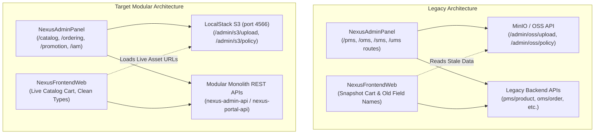
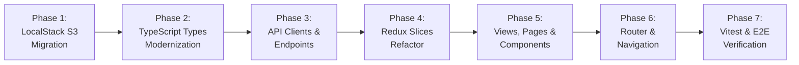

# NexusEngine Frontend Migration Plan — Admin Panel & Customer Web Storefront

**Target Applications:**
- `NexusAdminPanel` — Administrative Back-Office Portal (React 19, React Router 7, Material UI 7, Redux Toolkit, Vite 7)
- `NexusFrontendWeb` — Customer-Facing Storefront (React 19, React Router 7, Material UI 7, Redux Toolkit, Vite 7, Vitest, Razorpay)

**Companion Architecture Documents:**
- [`schema_redesign.md`](file:///home/aadarsh/Documents/NexusEngine/schema_redesign.md) — PostgreSQL 17 bounded-context schema redesign
- [`BackendMigrationPlan.md`](file:///home/aadarsh/Documents/NexusEngine/BackendMigrationPlan.md) — Spring Boot modular monolith architecture plan

---

## Executive Summary & Objectives

The NexusEngine frontend applications currently reflect the legacy schema and architecture of the original mall project:
1. **Legacy Naming Conventions:** Frontends rely heavily on obsolete `pms_`, `oms_`, `sms_`, and `ums_` acronyms across API routes, state slices, and file paths.
2. **Field Drift & Type Inconsistencies:** The frontends use legacy fields such as `pic`, `productSn`, `sale`, `deleteStatus`, `orderSn`, `totalAmount`, `payAmount`, `receiverName`, and `companyAddressId`, and handle database flags as `0` / `1` numeric integers rather than native TypeScript `boolean` types.
3. **Cart Snapshot Anti-Pattern:** The cart state and UI currently replicate 6 frozen snapshot properties (`productPic`, `productName`, `productBrand`, `productSn`, `productSkuCode`, `productAttr`) rather than joining live catalog data, causing stale pricing and visual drift.
4. **Object Storage Modernization:** Object storage has migrated from **MinIO / OSS** to **LocalStack S3** (`http://localhost:4566`), necessitating the elimination of all `minio`/`oss` naming and the adoption of standard AWS S3 presigned URL/policy contracts.

This migration plan provides a step-by-step roadmap to align both frontend applications with the new bounded-context architecture, eliminate legacy terminology, update all TypeScript definitions, refactor Redux slices, modernize page components, and update test suites while maintaining seamless end-to-end functionality.

---

## Part 1 — Architecture Overview: Current vs. Target



### 1.1 Structural Changes Across Frontends

| Dimension | Legacy State (`FrontendMigrationPlan1.md`) | Target State (`FrontendMigrationPlan.md`) |
|---|---|---|
| **Object Storage** | MinIO / Aliyun OSS (`oss.ts`, `MinioUploadResult`, `OssPolicy`) | **LocalStack AWS S3** (`s3.ts`, `S3UploadResult`, `S3PresignedPolicy`) |
| **Storage Endpoint** | `http://localhost:9000` (MinIO) or hybrid port 4566 with OSS DTOs | Dedicated LocalStack S3 (`http://localhost:4566`, bucket: `nexus-bucket`) |
| **Admin Route Namespaces** | `/pms/*`, `/oms/*`, `/sms/*`, `/ums/*` | `/catalog/*`, `/ordering/*`, `/promotion/*`, `/iam/*` |
| **API File Structure** | Flat files per legacy prefix (`product.ts`, `order.ts`, `admin.ts`) | Bounded-context folders (`catalog/`, `ordering/`, `customer/`, `iam/`, etc.) |
| **Cart Data Model** | 6 snapshot fields duplicated in cart items | Normalized: live catalog lookup via backend DTO join; no cart snapshots |
| **Boolean Types** | Numeric integers (`0` and `1`) | Native TypeScript `boolean` (`isPublished`, `isVisible`, `isFeatured`, etc.) |
| **Timestamp Types** | Inconsistent strings (`createTime`, `createDate`, `created_time`) | Standardized ISO-8601 strings mapped to `*_at` (`createdAt`, `updatedAt`, `paidAt`) |
| **Identifier Formats** | Jargon (`productSn`, `orderSn`) | Clear domain identifiers (`productCode`, `orderNumber`, `skuCode`) |

---

## Part 2 — LocalStack S3 Storage Migration (Eliminating MinIO / OSS Legacy)

> [!IMPORTANT]
> MinIO has been completely retired from the NexusEngine infrastructure in favor of LocalStack S3 running on port `4566`. All references to `MinIO`, `minio`, `OSS`, and `oss` across configuration, types, API clients, and UI components must be replaced with LocalStack S3 equivalents.

### 2.1 Storage Configuration & Proxy Settings

#### `NexusAdminPanel/src/utils/constant.ts`
```typescript
// Before
export const BASE_API = 'http://localhost:8080';
export const UPLOAD_BASE = 'http://localhost:4566'; // LocalStack S3 endpoint

// After
export const BASE_API = 'http://localhost:8080';
export const LOCALSTACK_S3_BASE = 'http://localhost:4566';
export const S3_BUCKET_NAME = 'nexus-bucket';
export const S3_PUBLIC_URL_PREFIX = `${LOCALSTACK_S3_BASE}/${S3_BUCKET_NAME}`;
```

#### `NexusAdminPanel/vite.config.ts`
```typescript
// Before
server: {
  proxy: {
    '/api': {
      target: 'http://localhost:8080',
      rewrite: (path) => path.replace(/^\/api/, ''),
    },
    '/s3': {
      target: 'http://localhost:4566',
    },
  },
}

// After
server: {
  proxy: {
    '/api': {
      target: 'http://localhost:8080',
      changeOrigin: true,
      rewrite: (path) => path.replace(/^\/api/, ''),
    },
    '/s3': {
      target: 'http://localhost:4566',
      changeOrigin: true,
      rewrite: (path) => path.replace(/^\/s3/, `/${S3_BUCKET_NAME}`),
    },
  },
}
```

### 2.2 S3 Type Definitions — `NexusAdminPanel/src/types/s3.d.ts` (replaces `oss.d.ts`)

```typescript
// Before (src/types/oss.d.ts)
export interface OssPolicy {
  accessKeyId: string;
  policy: string;
  signature: string;
  dir: string;
  host: string;
  callback: string;
}

export interface MinioUploadResult {
  url: string;
  name: string;
}

// After (src/types/s3.d.ts)
export interface S3PresignedPolicy {
  accessKeyId: string;
  policy: string;
  signature: string;
  dir: string;
  host: string;
  callback?: string;
  bucket: string;
  keyPrefix: string;
}

export interface S3UploadResult {
  url: string;
  key: string;
  bucket: string;
  etag?: string;
}
```

### 2.3 S3 Client API — `NexusAdminPanel/src/apis/s3.ts` (replaces `oss.ts`)

```typescript
import http from '../utils/http';
import { LOCALSTACK_S3_BASE, S3_BUCKET_NAME } from '../utils/constant';
import type { S3PresignedPolicy, S3UploadResult } from '../types/s3';

/**
 * Request S3 presigned policy/credentials from nexus-admin-api
 */
export const getS3UploadPolicy = (): Promise<S3PresignedPolicy> => {
  return http.get('/admin/s3/policy');
};

/**
 * Direct file upload via backend proxy (multipart/form-data)
 */
export const uploadFileDirect = (file: File, folder = 'media'): Promise<S3UploadResult> => {
  const formData = new FormData();
  formData.append('file', file);
  formData.append('folder', folder);
  return http.post('/admin/s3/upload', formData, {
    headers: { 'Content-Type': 'multipart/form-data' },
  });
};

/**
 * Client-side direct-to-S3 upload using LocalStack presigned policy
 */
export const uploadDirectToLocalStack = async (
  file: File,
  folder = 'uploads'
): Promise<string> => {
  const policy = await getS3UploadPolicy();
  const fileKey = `${policy.dir}/${Date.now()}_${file.name}`;
  
  const formData = new FormData();
  formData.append('key', fileKey);
  formData.append('AWSAccessKeyId', policy.accessKeyId);
  formData.append('policy', policy.policy);
  formData.append('signature', policy.signature);
  formData.append('file', file);

  const uploadEndpoint = policy.host || `${LOCALSTACK_S3_BASE}/${S3_BUCKET_NAME}`;
  await fetch(uploadEndpoint, {
    method: 'POST',
    body: formData,
  });

  return `${uploadEndpoint}/${fileKey}`;
};
```

### 2.4 Storefront Asset URL Resolution (`NexusFrontendWeb`)

In `NexusFrontendWeb`, images are received as fully-qualified or bucket-relative URLs from the backend. A utility helper standardizes asset URLs:

#### `NexusFrontendWeb/src/utils/media.ts`
```typescript
const LOCALSTACK_BASE = import.meta.env.VITE_S3_BASE_URL || 'http://localhost:4566';
const BUCKET_NAME = 'nexus-bucket';

export const resolveImageUrl = (urlOrPath: string | null | undefined): string => {
  if (!urlOrPath) return '/placeholder-product.png';
  if (urlOrPath.startsWith('http://') || urlOrPath.startsWith('https://')) {
    return urlOrPath;
  }
  // Convert local/relative paths to LocalStack S3 bucket path
  const sanitizedPath = urlOrPath.startsWith('/') ? urlOrPath.slice(1) : urlOrPath;
  return `${LOCALSTACK_BASE}/${BUCKET_NAME}/${sanitizedPath}`;
};
```

---

## Part 3 — Bounded Context Reorganization & Route Modernization

To match the modular monolith structure (`nexus-admin-api` and `nexus-portal-api`), both frontends abandon legacy Chinese mall prefixes in favor of explicit DDD bounded contexts:
- **`catalog`** (was `pms`): Products, SKUs, Categories, Brands, Attributes
- **`ordering`** (was `oms`): Orders, Cart, Returns, Deliveries, Policies
- **`customer`** (was `ums` member): Customer profiles, Addresses, History
- **`iam`** (was `ums` admin): Admins, Roles, Menus, Permissions
- **`promotion`** (was `sms`): Coupons, Flash Sales, Banners, Discounts
- **`engagement`** (was `pms` reviews): Reviews, Media, Moderation
- **`payment`** (was `oms` payment): Payment transactions, Razorpay
- **`analytics`** (was dashboard): Metrics, Sales Analytics
- **`infra`** (was oss): S3 management, File assets

### 3.1 NexusAdminPanel — Route Modernization

#### Route Mapping Table

| Legacy Path (`routeConfig.ts`) | Target Path | Context | Page Component |
|---|---|---|---|
| `/pms/product` | `/catalog/products` | Catalog | `ProductList.tsx` |
| `/pms/product/add` | `/catalog/products/new` | Catalog | `ProductAdd.tsx` |
| `/pms/product/update/:id` | `/catalog/products/:id/edit` | Catalog | `ProductUpdate.tsx` |
| `/pms/brand` | `/catalog/brands` | Catalog | `BrandList.tsx` |
| `/pms/brand/add` | `/catalog/brands/new` | Catalog | `BrandAdd.tsx` |
| `/pms/brand/update/:id` | `/catalog/brands/:id/edit` | Catalog | `BrandUpdate.tsx` |
| `/pms/productCate` | `/catalog/categories` | Catalog | `ProductCategoryList.tsx` |
| `/pms/productCate/add` | `/catalog/categories/new` | Catalog | `ProductCategoryAdd.tsx` |
| `/pms/productCate/update/:id` | `/catalog/categories/:id/edit` | Catalog | `ProductCategoryUpdate.tsx` |
| `/pms/productAttr` | `/catalog/attributes` | Catalog | `ProductAttrList.tsx` |
| `/pms/productAttr/productAttrList/:id` | `/catalog/attributes/:id/items` | Catalog | `ProductAttrItemList.tsx` |
| `/oms/order` | `/ordering/orders` | Ordering | `OrderList.tsx` |
| `/oms/orderDetail/:id` | `/ordering/orders/:id` | Ordering | `OrderDetail.tsx` |
| `/oms/deliverOrderList` | `/ordering/deliveries` | Ordering | `DeliverOrderList.tsx` |
| `/oms/orderSetting` | `/ordering/policies` | Ordering | `OrderSetting.tsx` |
| `/oms/returnApply` | `/ordering/return-requests` | Ordering | `ReturnApplyList.tsx` |
| `/oms/returnApplyDetail/:id` | `/ordering/return-requests/:id` | Ordering | `ReturnApplyDetail.tsx` |
| `/oms/returnReason` | `/ordering/return-reasons` | Ordering | `ReturnReasonList.tsx` |
| `/sms/coupon` | `/promotion/coupons` | Promotion | `CouponList.tsx` |
| `/sms/coupon/add` | `/promotion/coupons/new` | Promotion | `CouponAdd.tsx` |
| `/sms/coupon/update/:id` | `/promotion/coupons/:id/edit` | Promotion | `CouponUpdate.tsx` |
| `/sms/couponHistory/:id` | `/promotion/coupons/:id/history` | Promotion | `CouponHistory.tsx` |
| `/sms/flash` | `/promotion/flash-sales` | Promotion | `FlashList.tsx` |
| `/sms/flashSession/:id` | `/promotion/flash-sales/:id/slots` | Promotion | `FlashSessionList.tsx` |
| `/sms/flashProductRelation/:id` | `/promotion/flash-sales/:id/items` | Promotion | `FlashProductRelation.tsx` |
| `/sms/advertise` | `/promotion/banners` | Promotion | `AdvertiseList.tsx` |
| `/sms/advertise/add` | `/promotion/banners/new` | Promotion | `AdvertiseAdd.tsx` |
| `/sms/advertise/update/:id` | `/promotion/banners/:id/edit` | Promotion | `AdvertiseUpdate.tsx` |
| `/ums/admin` | `/iam/admins` | IAM | `AdminList.tsx` |
| `/ums/role` | `/iam/roles` | IAM | `RoleList.tsx` |
| `/ums/resource` | `/iam/permissions` | IAM | `ResourceList.tsx` |
| `/ums/resourceCategory` | `/iam/permission-groups` | IAM | `ResourceCategoryList.tsx` |
| `/ums/menu` | `/iam/menus` | IAM | `MenuList.tsx` |

### 3.2 NexusAdminPanel — API Directory Restructure

```
NexusAdminPanel/src/apis/
├── catalog/
│   ├── product.ts          (was product.ts)
│   ├── brand.ts            (was brand.ts)
│   ├── category.ts         (was productCate.ts)
│   ├── productType.ts      (was productAttrCate.ts)
│   ├── attribute.ts        (was productAttr.ts)
│   └── sku.ts              (was skuStock.ts & skuAttributes.ts)
├── ordering/
│   ├── order.ts            (was order.ts)
│   ├── returnRequest.ts    (was returnApply.ts)
│   ├── returnReason.ts     (was returnReason.ts)
│   ├── merchantAddress.ts  (was companyAddress.ts)
│   └── orderPolicy.ts      (was orderSetting.ts)
├── iam/
│   ├── adminUser.ts        (was admin.ts)
│   ├── role.ts             (was role.ts)
│   ├── menu.ts             (was menu.ts)
│   ├── permission.ts       (was resource.ts)
│   └── permissionGroup.ts  (was resourceCategory.ts)
├── promotion/
│   ├── coupon.ts           (was coupon.ts)
│   ├── flashSale.ts        (was flash.ts, flashSession.ts, flashProductRelation.ts)
│   └── banner.ts           (was homeAdvertise.ts)
├── analytics/
│   └── dashboard.ts        (was dashboard.ts)
└── infra/
    └── s3.ts               (was oss.ts — LocalStack S3)
```

### 3.3 NexusFrontendWeb — API Directory Restructure

```
NexusFrontendWeb/src/api/
├── catalog.ts    ← Products, categories, search, recommendations
├── ordering.ts   ← Cart (live), checkout, order history, returns
├── customer.ts   ← Auth, profile, address management
├── promotion.ts  ← Coupons, flash sales, promotional banners
├── engagement.ts ← Product reviews, ratings, review submission
├── payment.ts    ← Razorpay order creation and verification
└── ai.ts         ← AI shopping assistant chat
```

---

## Part 4 — TypeScript Interface & Type Definitions Migration

### 4.1 Catalog Context Types

#### Product Definition (`NexusAdminPanel/src/types/catalog.d.ts` & `NexusFrontendWeb/src/types/catalog.d.ts`)
```typescript
// Legacy Product Interface
export interface ProductLegacy {
  id: number;
  brandId: number;
  productCategoryId: number;
  name: string;
  pic: string;                    // Obsolete
  productSn: string;              // Obsolete
  deleteStatus: number;           // Obsolete (0/1 flag)
  publishStatus: number;          // Obsolete (0/1 flag)
  newStatus: number;              // Obsolete (0/1 flag)
  recommendStatus: number;        // Obsolete (0/1 flag)
  verifyStatus: number;           // Obsolete (integer code)
  sort: number;
  sale: number;                   // Obsolete
  price: number;
  promotionPrice: number;
  subTitle: string;
  description: string;
  keywords: string;               // Obsolete (CSV string)
  brandName: string;              // Denormalized
  productCategoryName: string;    // Denormalized
  skuStockList: SkuStock[];       // Obsolete naming
}

// Target Clean Product Interface
export interface Product {
  id: number;
  brandId: number;
  categoryId: number;
  productTypeId?: number;
  name: string;
  slug?: string;
  primaryImageUrl: string;
  productCode: string;
  isPublished: boolean;
  isNewArrival: boolean;
  isFeatured: boolean;
  approvalStatus: ApprovalStatus; // 0: PENDING, 1: APPROVED, 2: REJECTED
  unitsSold: number;
  price: number;
  salePrice?: number;
  subTitle?: string;
  description?: string;
  searchKeywords?: string[];      // Array instead of CSV
  brandName?: string;             // Resolved via query/join
  categoryName?: string;          // Resolved via query/join
  productSkuList: ProductSku[];
  mediaGallery?: ProductMedia[];
  attributeValues?: ProductAttributeValue[];
  createdAt: string;
  updatedAt: string;
  deletedAt?: string | null;
}

export type ApprovalStatus = 0 | 1 | 2;
```

#### SKU Definition (`ProductSku`)
```typescript
// Target Clean ProductSku Interface (was SkuStock)
export interface ProductSku {
  id: number;
  productId: number;
  skuCode: string;
  listPrice: number;              // was price
  salePrice?: number;             // was promotionPrice
  onHandQty: number;              // was stock
  reservedQty: number;            // was lockStock
  availableQty: number;           // computed on-hand - reserved
  lowStockThreshold: number;      // was lowStock
  imageUrl: string;               // was pic
  unitsSold: number;              // was sale
  skuAttributes: Record<string, any>; // was stringified json or spData
  version: number;
}
```

#### Brand Definition (`Brand`)
```typescript
export interface Brand {
  id: number;
  name: string;
  slug?: string;
  logoUrl: string;                // was logo
  bannerUrl?: string;             // was bigPic
  brandStory?: string;
  firstLetter?: string;
  displayOrder: number;           // was sort
  isVisible: boolean;             // was showStatus (0/1)
  isFactoryAuthorised?: boolean;  // was factoryStatus (0/1)
  createdAt?: string;
  updatedAt?: string;
}
```

#### Category Definition (`Category`)
```typescript
export interface Category {
  id: number;
  parentId: number;
  name: string;
  slug?: string;
  depth: number;                  // was level
  iconUrl?: string;               // was icon
  isInNavigation: boolean;        // was navStatus (0/1)
  isVisible: boolean;             // was showStatus (0/1)
  displayOrder?: number;
  children?: Category[];
}
```

---

### 4.2 Ordering Context Types

#### Customer Order (`CustomerOrder` — was `Order`)
```typescript
export interface CustomerOrder {
  id: number;
  memberId: number;
  couponId?: number | null;
  orderNumber: string;            // was orderSn
  currencyCode: string;           // 'INR'
  subtotalAmount: number;         // was totalAmount
  shippingAmount: number;         // was freightAmount
  promotionDiscountAmount: number;// was promotionAmount
  couponDiscountAmount: number;   // was couponAmount
  manualAdjustmentAmount: number; // was discountAmount
  grandTotalAmount: number;       // was payAmount
  paymentMethod: PaymentMethod;   // was payType (0: Unset, 1: Razorpay, 2: Stripe)
  status: OrderStatus;            // 0: PENDING_PAYMENT, 1: AWAITING_SHIPMENT, 2: SHIPPED, 3: COMPLETED, 4: CANCELLED
  orderType: 0 | 1;               // 0: STANDARD, 1: FLASH_SALE
  carrierName?: string;           // was deliveryCompany
  trackingNumber?: string;        // was deliverySn
  recipientName: string;          // was receiverName
  recipientPhone: string;         // was receiverPhone
  shippingPostalCode: string;     // was receiverPostCode
  shippingAddressLine: string;    // was receiverDetailAddress
  shippingCity: string;
  shippingState: string;
  shippingCountryCode: string;
  customerNote?: string;          // was note
  isReceiptConfirmed: boolean;    // was confirmStatus (0/1)
  paidAt?: string;                // was paymentTime
  shippedAt?: string;             // was deliveryTime
  deliveredAt?: string;           // was receiveTime
  reviewedAt?: string;            // was commentTime
  createdAt: string;              // was createTime
  updatedAt: string;              // was modifyTime
  orderLines: OrderLine[];        // was orderItemList
  statusHistory?: OrderStatusHistory[];
}

export type OrderStatus = 0 | 1 | 2 | 3 | 4;
export type PaymentMethod = 0 | 1 | 2;
```

#### Order Line Item (`OrderLine` — was `OrderItem`)
```typescript
export interface OrderLine {
  id: number;
  orderId: number;
  productId: number;
  skuId: number;                  // was productSkuId
  skuCode: string;
  productName: string;
  productImageUrl: string;        // was productPic
  brandName?: string;             // was productBrand
  categoryId?: number;            // was productCategoryId
  skuAttributes: Record<string, string>; // was productAttr string
  unitPrice: number;              // was productPrice
  quantity: number;               // was productQuantity
  promotionDiscountAmount: number;// was promotionAmount
  couponDiscountAmount: number;   // was couponAmount
  lineTotalAmount: number;        // was realAmount
}
```

#### Live Cart Item Model (`CartItem`)
> [!IMPORTANT]
> The database redesign intentionally drops the 6 snapshot columns from `cart_item` (`product_name`, `product_pic`, `product_brand`, `product_sn`, `product_sku_code`, `product_attr`). The cart is short-lived and must reflect live catalog data to prevent checkout discrepancies!

```typescript
// Legacy Cart Item (Stale Snapshots)
export interface LegacyCartItem {
  id: number;
  productId: number;
  productSkuId: number;
  quantity: number;
  price: number;
  productPic: string;     // Stale snapshot
  productName: string;    // Stale snapshot
  productBrand: string;   // Stale snapshot
  productSn: string;      // Stale snapshot
  productSkuCode: string; // Stale snapshot
  productAttr: string;    // Stale snapshot
  deleteStatus: number;   // Unnecessary soft-delete
}

// Target Cart Item: Core Record
export interface CartItemRecord {
  id: number;
  memberId: number;
  productId: number;
  skuId: number;
  quantity: number;
  unitPriceAtAdd: number;
  createdAt: string;
  updatedAt: string;
}

// Target Enriched Cart Item (Joined with Live Catalog Data by Backend)
export interface EnrichedCartItem {
  id: number;
  productId: number;
  skuId: number;
  quantity: number;
  unitPriceAtAdd: number;
  // Live catalog fields joined by nexus-portal-api
  name: string;
  productCode: string;
  primaryImageUrl: string;
  brandName?: string;
  skuCode: string;
  currentListPrice: number;
  currentSalePrice?: number;
  availableQty: number;
  skuAttributes: Record<string, any>;
  hasPriceChanged: boolean;
  isAvailable: boolean;
}
```

#### Return Request (`ReturnRequest` — was `ReturnApply`)
```typescript
export interface ReturnRequest {
  id: number;
  orderId: number;
  orderLineId: number;            // was productId
  memberId: number;               // was memberUsername string
  returnAddressId: number;        // was companyAddressId
  quantity: number;               // was productCount
  unitRefundAmount: number;       // was productRealPrice
  refundAmount: number;           // was returnAmount
  contactName: string;            // was returnName
  contactPhone: string;           // was returnPhone
  reasonId: number;               // was reason text
  customerComment?: string;       // was description
  evidenceUrls: string[];         // was proofPics CSV string
  status: ReturnStatus;           // 0: PENDING, 1: APPROVED, 2: COMPLETED, 3: REJECTED
  reviewNote?: string;            // was handleNote
  reviewedByAdminId?: number;     // was handleMan
  reviewedAt?: string;            // was handleTime
  receivedByAdminId?: number;     // was receiveMan
  receivedAt?: string;            // was receiveTime
  receiptNote?: string;           // was receiveNote
  createdAt: string;              // was createTime
}

export type ReturnStatus = 0 | 1 | 2 | 3;
```

---

### 4.3 Customer Context Types

#### Member Profile (`Member` — was `MemberInfo` / `UmsMember`)
```typescript
export interface Member {
  id: number;
  username: string;
  displayName: string;            // was nickname
  phoneE164: string;              // was phone
  email: string;
  avatarUrl: string;              // was icon
  gender: 0 | 1 | 2;              // 0: UNKNOWN, 1: MALE, 2: FEMALE
  birthDate?: string;             // was birthday (date string 'YYYY-MM-DD')
  bio?: string;                   // was personalizedSignature
  signupChannel?: number;         // was sourceType
  pointsBalance: number;          // was integration
  lifetimePointsEarned: number;   // was growth
  accountStatus: number;          // was status (0: SUSPENDED, 1: ACTIVE)
  createdAt: string;              // was createTime
  lastLoginAt?: string;
}
```

#### Member Address (`MemberAddress` — was `UmsMemberReceiveAddress`)
```typescript
export interface MemberAddress {
  id: number;
  memberId: number;
  recipientName: string;          // was name
  recipientPhone: string;         // was phoneNumber
  isDefault: boolean;             // was defaultStatus (0/1)
  addressLine: string;            // was detailAddress
  district?: string;              // was region
  city: string;
  state: string;                  // was province
  postalCode: string;             // was postCode
  countryCode: string;            // 'IN'
}
```

---

### 4.4 IAM Context Types

#### Admin User (`AdminUser` — was `Admin`)
```typescript
export interface AdminUser {
  id: number;
  username: string;
  displayName?: string;           // was nickName
  email: string;
  avatarUrl?: string;             // was icon
  note?: string;
  isEnabled: boolean;             // was status (0/1)
  roles: Role[];
  menus: ConsoleMenu[];
  lastLoginAt?: string;           // was loginTime
  createdAt: string;              // was createTime
}
```

#### Role, Menu & Permission
```typescript
export interface Role {
  id: number;
  name: string;
  description: string;
  isActive: boolean;              // was status (0/1)
  displayOrder: number;           // was sort
  createdAt: string;
}

export interface ConsoleMenu {
  id: number;
  parentId: number;
  title: string;
  routeName: string;              // was name
  icon: string;
  depth: number;                  // was level
  displayOrder: number;           // was sort
  isHidden: boolean;              // was hidden (0/1)
  children?: ConsoleMenu[];
}

export interface Permission {
  id: number;
  name: string;
  urlPattern: string;             // was url
  description: string;
  permissionGroupId: number;      // was categoryId
  createdAt: string;
}
```

---

### 4.5 Promotion Context Types

#### Coupon Definition (`Coupon`)
```typescript
export interface Coupon {
  id: number;
  discountType: 0 | 1 | 2;        // was type (0: FIXED_AMOUNT, 1: PERCENTAGE, 2: FREE_SHIPPING)
  name: string;
  code?: string;
  discountValue: number;          // was amount
  maxDiscountAmount?: number;
  minSpendAmount: number;         // was minPoint / minOrderAmount
  remainingQuantity: number;      // was count
  claimedCount: number;           // was receiveCount
  perMemberLimit: number;         // was perLimit
  applicabilityScope: 0 | 1 | 2;  // was useType (0: ALL, 1: CATEGORY, 2: PRODUCT)
  startsAt: string;               // was startTime
  endsAt: string;                 // was endTime
  isStackable: boolean;           // was stackable
  isPublic: boolean;              // was isPublic
  status?: CouponClaimStatus;
}

export type CouponClaimStatus = 0 | 1 | 2; // 0: UNUSED, 1: USED, 2: EXPIRED
```

#### Flash Sale (`FlashSale`, `FlashSaleSlot`, `FlashSaleItem`)
```typescript
export interface FlashSale {
  id: number;
  title: string;
  startsOn: string;               // was startDate (date string)
  endsOn: string;                 // was endDate
  isActive: boolean;              // was status (0/1)
  createdAt: string;
}

export interface FlashSaleSlot {
  id: number;
  label: string;                  // was name
  startsAtLocal: string;          // was startTime ('HH:mm:ss')
  endsAtLocal: string;            // was endTime
  isActive: boolean;              // was status (0/1)
}

export interface FlashSaleItem {
  id: number;
  flashSaleId: number;            // was flashPromotionId
  slotId: number;                 // was flashPromotionSessionId
  productId: number;
  skuId?: number;
  flashPrice: number;             // was flashPromotionPrice
  quantityAvailable: number;      // was flashPromotionCount
  perMemberLimit: number;         // was flashPromotionLimit
  displayOrder?: number;
}
```

#### Promotional Banner (`Banner` — was `HomeAdvertise`)
```typescript
export interface Banner {
  id: number;
  title: string;                  // was name
  placement: number;              // was type
  imageUrl: string;               // was pic
  targetUrl: string;              // was url
  startsAt: string;               // was startTime
  endsAt: string;                 // was endTime
  isActive: boolean;              // was status (0/1)
  clickCount: number;
  orderCount: number;
  internalNote?: string;          // was note
  displayOrder: number;           // was sort
}
```

---

### 4.6 Engagement & AI Context Types

```typescript
// Product Review & Media
export interface ProductReview {
  id: number;
  productId: number;
  memberId: number;
  authorDisplayName: string;      // was memberNickName
  authorAvatarUrl?: string;       // was memberIcon
  rating: number;                 // 1 - 5
  body: string;                   // was content
  helpfulCount: number;           // was likeCount
  mediaUrls: string[];            // was pics
  createdAt: string;              // was createTime
}

// AI Shopping Assistant Chat Message
export interface ChatMessage {
  id?: number;
  conversationId: string;         // was sessionId
  role: 'USER' | 'ASSISTANT' | 'SYSTEM' | 'TOOL';
  content: string;
  tokenCount?: number;            // was tokensUsed
  createdAt?: string;
}
```

---

## Part 5 — API Layer & HTTP Client Modernization

### 5.1 Admin Panel API Layer (`NexusAdminPanel/src/apis/`)

#### Example: Modernized `catalog/product.ts` (replaces `apis/product.ts`)
```typescript
import http from '../../utils/http';
import type { Product } from '../../types/catalog';

export interface ProductQueryParams {
  keyword?: string;
  pageNum: number;
  pageSize: number;
  isPublished?: boolean;          // was publishStatus: number
  approvalStatus?: number;        // was verifyStatus: number
  productCode?: string;           // was productSn: string
  categoryId?: number;            // was productCategoryId: number
  brandId?: number;
}

export const getProductList = (params: ProductQueryParams) =>
  http.get<{ list: Product[]; total: number }>('/admin/catalog/product/list', { params });

export const getProductDetail = (id: number) =>
  http.get<Product>(`/admin/catalog/product/${id}`);

export const createProduct = (data: Partial<Product>) =>
  http.post('/admin/catalog/product/create', data);

export const updateProduct = (id: number, data: Partial<Product>) =>
  http.put(`/admin/catalog/product/update/${id}`, data);

export const updatePublishStatus = (ids: number[], isPublished: boolean) =>
  http.post('/admin/catalog/product/update/publishStatus', { ids, isPublished });

export const updateFeaturedStatus = (ids: number[], isFeatured: boolean) =>
  http.post('/admin/catalog/product/update/featuredStatus', { ids, isFeatured });

export const deleteProduct = (ids: number[]) =>
  http.post('/admin/catalog/product/delete', { ids });
```

#### Example: Modernized `ordering/order.ts` (replaces `apis/order.ts`)
```typescript
import http from '../../utils/http';
import type { CustomerOrder } from '../../types/ordering';

export interface OrderQueryParams {
  orderNumber?: string;           // was orderSn
  recipientKeyword?: string;      // was receiverKeyword
  status?: number;
  orderType?: number;
  createdAtRange?: [string, string];
  pageSize: number;
  pageNum: number;
}

export const getOrderList = (params: OrderQueryParams) =>
  http.get<{ list: CustomerOrder[]; total: number }>('/admin/ordering/order/list', { params });

export const getOrderDetail = (id: number) =>
  http.get<CustomerOrder>(`/admin/ordering/order/${id}`);

export const updateOrderDelivery = (data: {
  orderId: number;
  carrierName: string;            // was deliveryCompany
  trackingNumber: string;         // was deliverySn
}) => http.post('/admin/ordering/order/update/delivery', data);

export const closeOrder = (ids: number[], note: string) =>
  http.post('/admin/ordering/order/update/close', { ids, note });
```

---

### 5.2 Storefront API Layer (`NexusFrontendWeb/src/api/`)

#### Modernized `api/ordering.ts`
```typescript
import request from '../utils/request';
import type { EnrichedCartItem, CustomerOrder } from '../types/ordering';

// Cart operations (Live Catalog integration)
export const getCartList = (): Promise<EnrichedCartItem[]> =>
  request.get('/portal/ordering/cart/list');

export const addToCart = (data: {
  productId: number;
  skuId: number;                  // was productSkuId
  quantity: number;
}): Promise<void> => request.post('/portal/ordering/cart/add', data);

export const updateCartQuantity = (id: number, quantity: number): Promise<void> =>
  request.put('/portal/ordering/cart/update/quantity', null, { params: { id, quantity } });

export const removeCartItem = (ids: number[]): Promise<void> =>
  request.post('/portal/ordering/cart/delete', ids);

export const clearCart = (): Promise<void> =>
  request.delete('/portal/ordering/cart/clear');

// Checkout & Order lifecycle
export const generateConfirmOrder = (cartIds?: number[]) =>
  request.post('/portal/ordering/order/generateConfirmOrder', { cartIds });

export const generateOrder = (data: {
  memberAddressId: number;        // was memberReceiveAddressId
  couponId?: number;
  paymentMethod: number;          // was payType
  usePoints?: number;             // was useIntegration
}) => request.post<{ orderId: number; orderNumber: string }>('/portal/ordering/order/generateOrder', data);

export const cancelOrder = (orderId: number) =>
  request.post('/portal/ordering/order/cancelUserOrder', { orderId });

export const confirmReceiveOrder = (orderId: number) =>
  request.post('/portal/ordering/order/confirmReceiveOrder', { orderId });
```

---

## Part 6 — State Management (Redux Toolkit) Restructure

### 6.1 NexusAdminPanel — Slices Modernization

#### `src/store/slices/userSlice.ts`
```typescript
import { createSlice, PayloadAction } from '@reduxjs/toolkit';
import type { AdminUser } from '../../types/iam';

interface UserState {
  adminUser: AdminUser | null;
  token: string | null;
  isAuthenticated: boolean;
}

const initialState: UserState = {
  adminUser: null,
  token: localStorage.getItem('admin_token') || null,
  isAuthenticated: !!localStorage.getItem('admin_token'),
};

export const userSlice = createSlice({
  name: 'user',
  initialState,
  reducers: {
    setAdminUser: (state, action: PayloadAction<AdminUser>) => {
      state.adminUser = action.payload;
      state.isAuthenticated = true;
    },
    setToken: (state, action: PayloadAction<string>) => {
      state.token = action.payload;
      localStorage.setItem('admin_token', action.payload);
      state.isAuthenticated = true;
    },
    logout: (state) => {
      state.adminUser = null;
      state.token = null;
      state.isAuthenticated = false;
      localStorage.removeItem('admin_token');
    },
  },
});
```

#### `src/store/slices/permissionSlice.ts`
```typescript
import { createSlice, PayloadAction } from '@reduxjs/toolkit';
import type { ConsoleMenu, Permission } from '../../types/iam';

interface PermissionState {
  menus: ConsoleMenu[];
  permissions: Permission[];
}

const initialState: PermissionState = {
  menus: [],
  permissions: [],
};

export const permissionSlice = createSlice({
  name: 'permission',
  initialState,
  reducers: {
    setMenus: (state, action: PayloadAction<ConsoleMenu[]>) => {
      // Filter out hidden menus (boolean check)
      state.menus = action.payload.filter((menu) => !menu.isHidden);
    },
    setPermissions: (state, action: PayloadAction<Permission[]>) => {
      state.permissions = action.payload;
    },
  },
});
```

---

### 6.2 NexusFrontendWeb — Slices Modernization

#### `src/store/slices/cartSlice.ts`
> [!NOTE]
> The modernized `cartSlice` stores enriched items received from the backend. When adding to cart, the client sends only `{ productId, skuId, quantity }`.

```typescript
import { createSlice, createAsyncThunk, PayloadAction } from '@reduxjs/toolkit';
import type { EnrichedCartItem } from '../../types/ordering';
import * as cartApi from '../../api/ordering';

interface CartState {
  items: EnrichedCartItem[];
  loading: boolean;
  totalSubtotal: number;
}

export const fetchCart = createAsyncThunk('cart/fetchCart', async () => {
  return await cartApi.getCartList();
});

const cartSlice = createSlice({
  name: 'cart',
  initialState: { items: [], loading: false, totalSubtotal: 0 } as CartState,
  reducers: {},
  extraReducers: (builder) => {
    builder
      .addCase(fetchCart.pending, (state) => {
        state.loading = true;
      })
      .addCase(fetchCart.fulfilled, (state, action: PayloadAction<EnrichedCartItem[]>) => {
        state.items = action.payload;
        state.loading = false;
        state.totalSubtotal = action.payload.reduce(
          (sum, item) => sum + (item.currentSalePrice ?? item.currentListPrice) * item.quantity,
          0
        );
      })
      .addCase(fetchCart.rejected, (state) => {
        state.loading = false;
      });
  },
});
export default cartSlice.reducer;
```

---

## Part 7 — UI Components & Views Modernization

### 7.1 NexusFrontendWeb — Component Refactoring

#### `ProductCard.tsx`
```tsx
// Before (ProductCard.tsx)
interface ProductCardProps {
  product: {
    id: number;
    pic: string;
    name: string;
    price: number;
    sale: number;
    subTitle?: string;
  };
}

export const ProductCard = ({ product }: ProductCardProps) => (
  <Card>
    <CardMedia component="img" image={product.pic} alt={product.name} />
    <CardContent>
      <Typography variant="h6">{product.name}</Typography>
      <Typography color="text.secondary">{product.subTitle}</Typography>
      <Typography variant="body1">₹{product.price}</Typography>
      <Typography variant="caption">{product.sale} sold</Typography>
    </CardContent>
  </Card>
);

// After (ProductCard.tsx)
import { resolveImageUrl } from '../utils/media';
import type { Product } from '../types/catalog';

interface ProductCardProps {
  product: Pick<Product, 'id' | 'name' | 'primaryImageUrl' | 'price' | 'salePrice' | 'unitsSold' | 'subTitle'>;
}

export const ProductCard = ({ product }: ProductCardProps) => (
  <Card sx={{ height: '100%', display: 'flex', flexDirection: 'column' }}>
    <CardMedia
      component="img"
      image={resolveImageUrl(product.primaryImageUrl)}
      alt={product.name}
      sx={{ height: 220, objectFit: 'cover' }}
    />
    <CardContent sx={{ flexGrow: 1 }}>
      <Typography variant="h6" noWrap>{product.name}</Typography>
      {product.subTitle && (
        <Typography variant="body2" color="text.secondary" noWrap>
          {product.subTitle}
        </Typography>
      )}
      <Box sx={{ mt: 1, display: 'flex', alignItems: 'baseline', gap: 1 }}>
        <Typography variant="h6" color="primary">
          ₹{product.salePrice ?? product.price}
        </Typography>
        {product.salePrice && product.salePrice < product.price && (
          <Typography variant="body2" sx={{ textDecoration: 'line-through', color: 'text.disabled' }}>
            ₹{product.price}
          </Typography>
        )}
      </Box>
      <Typography variant="caption" color="text.secondary">
        {product.unitsSold} units sold
      </Typography>
    </CardContent>
  </Card>
);
```

#### `Cart.tsx` (Eliminating Stale Snapshot Displays)
```tsx
// After: Rendering Enriched Cart Items with Stale Price Warning
export const Cart = () => {
  const { items, loading, totalSubtotal } = useAppSelector((state) => state.cart);
  const dispatch = useAppDispatch();

  return (
    <Container maxWidth="lg" sx={{ py: 4 }}>
      <Typography variant="h4" gutterBottom>Shopping Cart</Typography>
      {items.map((item) => (
        <Paper key={item.id} sx={{ p: 2, mb: 2, display: 'flex', alignItems: 'center', gap: 2 }}>
          <Avatar
            src={resolveImageUrl(item.primaryImageUrl)}
            variant="rounded"
            sx={{ width: 80, height: 80 }}
          />
          <Box sx={{ flexGrow: 1 }}>
            <Typography variant="h6">{item.name}</Typography>
            <Typography variant="body2" color="text.secondary">SKU: {item.skuCode}</Typography>
            {item.hasPriceChanged && (
              <Chip
                label="Price updated since added to cart"
                color="warning"
                size="small"
                sx={{ mt: 0.5 }}
              />
            )}
          </Box>
          <Typography variant="h6">
            ₹{(item.currentSalePrice ?? item.currentListPrice) * item.quantity}
          </Typography>
        </Paper>
      ))}
      <Box sx={{ display: 'flex', justifyContent: 'flex-end', mt: 3 }}>
        <Typography variant="h5">Total: ₹{totalSubtotal}</Typography>
      </Box>
    </Container>
  );
};
```

---

### 7.2 NexusAdminPanel — Component Refactoring

#### `ProductList.tsx` (Table Columns & Boolean Filters)
```tsx
// Before (ProductList.tsx)
// <Switch checked={row.publishStatus === 1} onChange={...} />
// <TableColumn prop="productSn" label="Product Code" />
// <TableColumn prop="sale" label="Sales" />

// After (ProductList.tsx)
const columns: GridColDef[] = [
  { field: 'id', headerName: 'ID', width: 80 },
  {
    field: 'primaryImageUrl',
    headerName: 'Image',
    width: 90,
    renderCell: (params) => (
      <Avatar src={resolveImageUrl(params.value)} variant="rounded" />
    ),
  },
  { field: 'name', headerName: 'Product Name', flex: 1 },
  { field: 'productCode', headerName: 'Product Code', width: 140 },
  { field: 'price', headerName: 'List Price (₹)', width: 120 },
  { field: 'unitsSold', headerName: 'Units Sold', width: 110 },
  {
    field: 'isPublished',
    headerName: 'Published',
    width: 110,
    renderCell: (params) => (
      <Switch
        checked={Boolean(params.value)}
        onChange={(_, checked) => handlePublishToggle(params.row.id, checked)}
      />
    ),
  },
  {
    field: 'isFeatured',
    headerName: 'Featured',
    width: 110,
    renderCell: (params) => (
      <Switch
        checked={Boolean(params.value)}
        onChange={(_, checked) => handleFeaturedToggle(params.row.id, checked)}
      />
    ),
  },
];
```

---

## Part 8 — Testing Strategy & Test Suites Update

### 8.1 Vitest Unit Tests (`NexusFrontendWeb`)

#### Updating `src/tests/ProductCard.test.tsx`
```typescript
import { render, screen } from '@testing-library/react';
import { ProductCard } from '../components/ProductCard';
import type { Product } from '../types/catalog';

describe('ProductCard', () => {
  const mockProduct: Pick<
    Product,
    'id' | 'name' | 'primaryImageUrl' | 'price' | 'salePrice' | 'unitsSold' | 'subTitle'
  > = {
    id: 101,
    name: 'Wireless Noise Canceling Headphones',
    primaryImageUrl: '/media/headphones.jpg',
    price: 9999,
    salePrice: 7999,
    unitsSold: 450,
    subTitle: 'Premium Sound Quality',
  };

  it('renders modern product fields with sale price and units sold', () => {
    render(<ProductCard product={mockProduct} />);

    expect(screen.getByText('Wireless Noise Canceling Headphones')).toBeInTheDocument();
    expect(screen.getByText('Premium Sound Quality')).toBeInTheDocument();
    expect(screen.getByText('₹7999')).toBeInTheDocument();
    expect(screen.getByText('₹9999')).toBeInTheDocument();
    expect(screen.getByText('450 units sold')).toBeInTheDocument();
  });
});
```

#### Updating `src/tests/cartSlice.test.ts`
```typescript
import cartReducer, { fetchCart } from '../store/slices/cartSlice';
import type { EnrichedCartItem } from '../types/ordering';

describe('cartSlice', () => {
  const mockCartItems: EnrichedCartItem[] = [
    {
      id: 1,
      productId: 201,
      skuId: 301,
      quantity: 2,
      unitPriceAtAdd: 1200,
      name: 'Mechanical Keyboard',
      productCode: 'KB-MECH-01',
      primaryImageUrl: '/images/kb.png',
      skuCode: 'KB-MECH-BLUE',
      currentListPrice: 1200,
      availableQty: 15,
      skuAttributes: { switch: 'Blue' },
      hasPriceChanged: false,
      isAvailable: true,
    },
  ];

  it('computes total subtotal using current list/sale price', () => {
    const state = cartReducer(
      { items: [], loading: false, totalSubtotal: 0 },
      { type: fetchCart.fulfilled.type, payload: mockCartItems }
    );

    expect(state.items).toHaveLength(1);
    expect(state.totalSubtotal).toBe(2400); // 1200 * 2
  });
});
```

---

## Part 9 — Phased Migration Execution Plan



### Phase 1: LocalStack S3 Storage Migration (Day 1)
- [x] In `NexusAdminPanel`, rename `src/apis/oss.ts` → `src/apis/s3.ts`.
- [x] Rename `src/types/oss.d.ts` → `src/types/s3.d.ts`.
- [x] Replace `MinioUploadResult` with `S3UploadResult` and `OssPolicy` with `S3PresignedPolicy`.
- [x] Update `src/utils/constant.ts` and `vite.config.ts` to route `/s3` requests to LocalStack (`http://localhost:4566`).
- [x] In `NexusFrontendWeb`, add `src/utils/media.ts` to resolve asset URLs against LocalStack S3.
- [x] Test file upload in Admin Panel Brand/Product forms to verify S3 bucket creation and image serving.

### Phase 2: TypeScript Types & DTO Modernization (Day 2)
- [x] Update `NexusAdminPanel/src/types/`:
  - [x] `product.d.ts` → modern `catalog.d.ts` (`primaryImageUrl`, `productCode`, `isPublished`, `productSkuList`)
  - [x] `order.d.ts` → modern `ordering.d.ts` (`orderNumber`, `subtotalAmount`, `orderLines`)
  - [x] `admin.d.ts`, `role.d.ts`, `menu.d.ts` → `iam.d.ts`
  - [x] `coupon.d.ts`, `flash.d.ts`, `homeAdvertist.d.ts` → `promotion.d.ts`
- [x] Update `NexusFrontendWeb/src/types/`:
  - [x] Modernize `catalog.d.ts`, `ordering.d.ts`, `customer.d.ts`, `promotion.d.ts`, `engagement.d.ts`.
- [x] Run `tsc --noEmit` to inspect compiler errors across the codebase.

### Phase 3: API Layer & HTTP Client Refactoring (Day 3)
- [x] In `NexusAdminPanel`:
  - [x] Create bounded-context sub-packages under `src/apis/` (`catalog/`, `ordering/`, `iam/`, `promotion/`, `analytics/`, `infra/`).
  - [x] Update endpoint routes (`/admin/catalog/*`, `/admin/ordering/*`, `/admin/iam/*`, `/admin/s3/*`).
- [x] In `NexusFrontendWeb`:
  - [x] Create context-scoped API files under `src/api/` (`catalog.ts`, `ordering.ts`, `customer.ts`, etc.).
  - [x] Update payload parameters to send modern field names (`memberAddressId`, `skuId`, `paymentMethod`).

### Phase 4: Redux Store Slices Refactor (Day 4)
- [x] In `NexusAdminPanel`:
  - [x] Update `userSlice.ts`, `permissionSlice.ts`, `orderSlice.ts`.
- [x] In `NexusFrontendWeb`:
  - [x] Update `cartSlice.ts` to remove snapshot state and store enriched live items.
  - [x] Update `authSlice.ts` to use `displayName`, `avatarUrl`, `phoneE164`.
  - [x] Update `homeSlice.ts` with modernized banner and product fields.

### Phase 5: UI Components & Views Modernization (Day 5 - 6)
- [x] Modernize `NexusAdminPanel` pages:
  - [x] `ProductList.tsx`, `ProductAdd.tsx`, `ProductUpdate.tsx`
  - [x] `OrderList.tsx`, `OrderDetail.tsx`
  - [x] `ReturnApplyList.tsx`, `ReturnApplyDetail.tsx`
  - [x] `CouponList.tsx`, `FlashList.tsx`, `BannerList.tsx`
  - [x] `AdminList.tsx`, `RoleList.tsx`, `MenuList.tsx`
- [x] Modernize `NexusFrontendWeb` views & components:
  - [x] `Home.tsx`, `ProductDetail.tsx`, `Cart.tsx`, `Checkout.tsx`, `Profile.tsx`
  - [x] `ProductCard.tsx`, `BannerCarousel.tsx`, `ReviewSection.tsx`, `ChatWidget.tsx`

### Phase 6: Router Configuration & Menu Navigation (Day 7)
- [x] Update `NexusAdminPanel/src/router/routeConfig.ts` to map `/catalog/*`, `/ordering/*`, `/promotion/*`, `/iam/*`.
- [x] Update menu tree rendering logic to consume `is_hidden: boolean` and new route paths.
- [x] Verify browser history, route guards, and 404 fallbacks.

### Phase 7: Testing, Linting & E2E Verification (Day 8)
- [x] Update all Vitest test suites (`ProductCard.test.tsx`, `Cart.test.tsx`, `Profile.test.tsx`, `cartSlice.test.ts`).
- [x] Execute `npm test` or `pnpm vitest run` in `NexusFrontendWeb`.
- [x] Verify full build succeeds without errors:
  - `cd NexusAdminPanel && npm run build`
  - `cd NexusFrontendWeb && npm run build`

---

## Part 10 — FAANG Interview Talking Points & Architectural Justification

When discussing this frontend migration in senior/staff full-stack engineering interviews, emphasize the following architectural decisions:

1. **Cloud Parity via LocalStack S3 vs. MinIO:**
   > *"We replaced MinIO with LocalStack S3 because LocalStack provides exact AWS S3 API compatibility. In production, we target AWS S3 with IAM roles and CloudFront CDN. MinIO required proprietary client libraries or S3-compatible shims that differed in presigned policy generation and CORS handling. By using LocalStack S3 in local development, our frontend upload code (presigned POST/PUT policies) is 100% identical between local dev, test containers, and production AWS."*

2. **Eliminating the Cart Snapshot Anti-Pattern:**
   > *"In the legacy mall architecture, cart items persisted frozen snapshots of product titles, prices, and images. Over time, when merchant pricing changed or items were discounted, customers experienced jarring price jumps at checkout, or completed orders with stale data. We refactored the cart model to store only `(memberId, skuId, quantity)`, joining live catalog data at read time. Order lines continue to freeze snapshots at purchase time (`ordering.order_line`), preserving legal and accounting integrity while ensuring carts remain evergreen."*

3. **Domain-Driven Design (DDD) in the Frontend:**
   > *"Frontend codebases often degrade into flat or technically-divided folders (`components/`, `api/`, `utils/`) where all domains are coupled. By reorganizing routes, APIs, and state into bounded contexts (`catalog`, `ordering`, `customer`, `iam`, `promotion`), the frontend mirrors our backend modular monolith. When a backend bounded context is eventually extracted into an autonomous microservice, the corresponding frontend API client and types can be extracted or packaged as an npm workspace package with zero friction."*

4. **Strict Type Safety & Zero Ambiguity Contracts:**
   > *"Replacing loose `number` flags (`0` and `1`) with native TypeScript `boolean` types and replacing ambiguous identifiers (`pic`, `productSn`, `orderSn`) with explicit names (`primaryImageUrl`, `productCode`, `orderNumber`) eliminated dozens of subtle runtime bugs and significantly improved developer velocity and self-documenting code quality."*

---

## Part 11 — Summary Metric Comparison

| Metric | Legacy Frontends | Modernized Frontends |
|---|---|---|
| **Storage Technology** | MinIO / OSS | **LocalStack AWS S3** |
| **Storage Ports / Endpoints** | Hybrid `9000` / `4566` with OSS DTOs | Unified `4566` LocalStack S3 |
| **Admin Route Namespaces** | 4 legacy (`/pms`, `/oms`, `/sms`, `/ums`) | 5 domain contexts (`/catalog`, `/ordering`, `/promotion`, `/iam`, `/analytics`) |
| **API Module Organization** | Flat per-file APIs | Bounded-context directory hierarchy |
| **Data Types for Flags** | Numeric `0` / `1` | Native `boolean` (`isPublished`, `isVisible`, etc.) |
| **Cart Stale Snapshots** | 6 duplicated properties per cart item | 0 snapshots; live catalog hydration |
| **Timestamp Format** | Inconsistent strings | Standard ISO-8601 strings (`*_at`) |
| **TypeScript Strictness** | Partial types with `any` fallbacks | Strict context-bound types matching DB schema |
