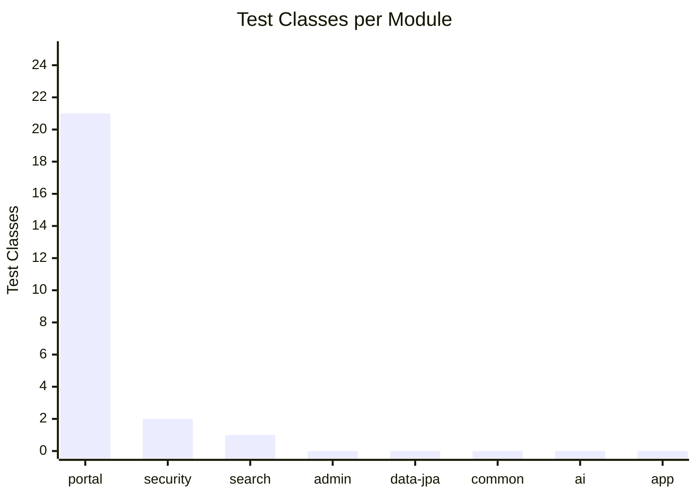
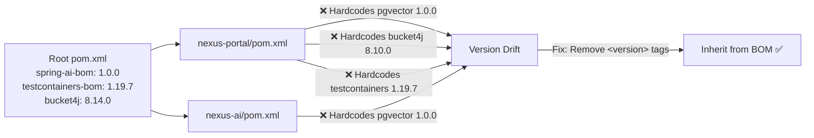
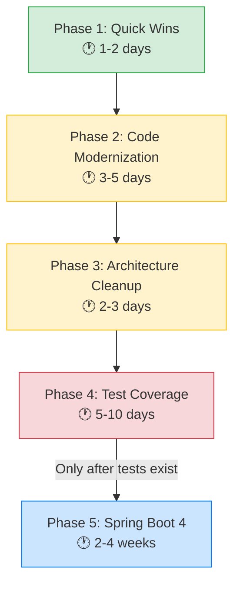

# NexusEngine Modernization Plan

> **Audit Date**: September 26, 2026  
> **Codebase**: `NexusCore` — 370 Java source files across 8 modules  
> **Current Stack**: Spring Boot 3.5.14 · Java 21 · Hibernate 6.6 · PostgreSQL 17 · Spring AI 1.0.0

---

## Table of Contents

1. [Current vs Latest Stable Versions](#1-current-vs-latest-stable-versions)
2. [Phase 1 — Quick Wins (No Breaking Changes)](#2-phase-1--quick-wins-no-breaking-changes)
3. [Phase 2 — Code Modernization](#3-phase-2--code-modernization)
4. [Phase 3 — Architecture & Configuration Cleanup](#4-phase-3--architecture--configuration-cleanup)
5. [Phase 4 — Test Coverage Expansion](#5-phase-4--test-coverage-expansion)
6. [Phase 5 — Major Framework Upgrade (Spring Boot 4)](#6-phase-5--major-framework-upgrade-spring-boot-4)
7. [Dependency Version Inconsistencies](#7-dependency-version-inconsistencies)
8. [Security & Production Hardening](#8-security--production-hardening)
9. [Migration Risk Matrix](#9-migration-risk-matrix)
10. [Recommended Execution Order](#10-recommended-execution-order)

---

## 1. Current vs Latest Stable Versions

| Dependency | Current Version | Latest Stable (Sept 2026) | Gap | Breaking? |
|---|---|---|---|---|
| **Spring Boot** | `3.5.14` | `3.5.16` (3.x line) / `4.1.1` (latest) | Minor patch / Major | ⚠️ 4.x is major |
| **Spring Framework** | `6.2.18` | `6.2.19` (6.x) / `7.0.9` (latest) | Minor / Major | ⚠️ 7.x is major |
| **Spring AI** | `1.0.0` | `1.1.8` (Boot 3.x) / `2.0.1` (Boot 4.x) | Minor | ✅ 1.1.x safe |
| **Spring Security** | `6.x` (via Boot) | `6.5.x` (6.x) / `7.1.1` (latest) | Minor | ⚠️ 7.x is major |
| **Hibernate ORM** | `6.6.49` | `6.6.x` (6.x) / `7.4.10` (latest) | Current / Major | ⚠️ 7.x is major |
| **Java** | `21 (LTS)` | `25 (LTS)` | 1 LTS generation | ✅ Non-breaking |
| **Lombok** | Not declared (inherited) | `1.18.48` | — | ✅ Safe |
| **MapStruct** | ❌ Not used | `1.6.3` | New adoption | ✅ New |
| **PostgreSQL JDBC** | `42.7.5` | `42.7.13` | Patch (security) | ✅ Safe |
| **Springdoc OpenAPI** | `2.8.17` | `2.9.1` (Boot 3.x) | Minor | ✅ Safe |
| **Testcontainers** | `1.19.7` | `2.0.5` | Major | ⚠️ Module renames |
| **Redisson** | `3.33.0` | `3.52.0` (3.x) / `4.7.0` (latest) | Minor / Major | ⚠️ 4.x is major |
| **Resilience4j** | `2.3.0` | `2.4.0` | Minor | ✅ Safe |
| **Flyway** | Via Boot (`10.x`) | `13.8.0` | Major | ⚠️ Modular drivers |
| **JUnit** | `5.x` (via Boot) | `5.14.4` / `6.1.3` | Minor / Major | ⚠️ 6.x is major |
| **PGVector Java** | `0.1.6` | Latest | Patch | ✅ Safe |
| **Maven** | `3.9.9` | `3.9.16` / `4.0.0-rc-7` | Patch | ✅ Safe |

---

## 2. Phase 1 — Quick Wins (No Breaking Changes)

> **Effort**: 1–2 days · **Risk**: Low · **Impact**: High

### 2.1 Bump Patch Versions (Zero-Risk)

Update these in `NexusCore/pom.xml`:

```xml
<!-- Security patches & bug fixes — no API changes -->
<postgresql.version>42.7.13</postgresql.version>       <!-- CVE fixes -->
<springdoc.version>2.9.1</springdoc.version>
<resilience4j.version>2.4.0</resilience4j.version>
<spring-ai.version>1.1.8</spring-ai.version>           <!-- Boot 3.x compatible -->
```

### 2.2 Fix Dependency Version Inconsistencies

Several child POMs hardcode versions instead of inheriting from the root BOM:

| File | Issue | Fix |
|---|---|---|
| `nexus-portal/pom.xml:66` | `spring-ai-starter-vector-store-pgvector` hardcodes `1.0.0` | Remove `<version>` tag |
| `nexus-ai/pom.xml:37` | Same as above | Remove `<version>` tag |
| `nexus-portal/pom.xml:53` | `bucket4j-core` hardcodes `8.10.0` (root says `8.14.0`) | Remove `<version>` tag |
| `nexus-portal/pom.xml:83,89,95` | Testcontainers hardcode `1.19.7` | Remove `<version>` tags (inherit from BOM) |

### 2.3 Fix JPA `@Data` Anti-Pattern

**File**: `nexus-data-jpa/.../model/OutboxEvent.java`

`@Data` on JPA entities generates `equals()`/`hashCode()` using mutable fields including database-generated IDs, which breaks `HashSet`/`HashMap` behavior after persistence.

```diff
- @Data
+ @Getter
+ @Setter
  @Entity
  @Table(name = "outbox_event")
  public class OutboxEvent {
```

### 2.4 Remove Deprecated Configuration

**File**: `nexus-application/src/main/resources/application.yml`

```diff
  mvc:
    pathmatch:
-     matching-strategy: ant_path_matcher
+     # Removed: Spring Boot 3 defaults to path_pattern_parser (faster, modern)
```

**Remove redundant Hibernate dialect** from `application.yml:29`, `application-dev.yml:23`, `application-prod.yml:22`:
```diff
  properties:
    hibernate:
-     dialect: org.hibernate.dialect.PostgreSQLDialect
+     # Removed: Hibernate 6+ auto-detects dialect from JDBC metadata
```

**Remove Swagger 2 / Springfox URL whitelist** from `application.yml:44-46`:
```diff
  secure:
    ignored:
      urls:
-       - /swagger-resources/**
-       - /v2/api-docs
        - /v3/api-docs/**
        - /swagger-ui/**
```

### 2.5 Remove Ghost MongoDB Configuration

`application-dev.yml:26-27` and `application-prod.yml:25-26` configure `spring.data.mongodb.uri`, but MongoDB dependencies are commented out. Remove the dead config.

---

## 3. Phase 2 — Code Modernization

> **Effort**: 3–5 days · **Risk**: Medium · **Impact**: High

### 3.1 Convert DTOs to Java Records

The project targets **Java 21** but uses **zero** Java records across 370 source files. All immutable request/response DTOs should be converted:

**Before** (`nexus-admin/dto/UmsAdminLoginParam.java`):
```java
@Data
@EqualsAndHashCode
public class UmsAdminLoginParam {
    @NotEmpty
    private String username;
    @NotEmpty
    private String password;
}
```

**After**:
```java
public record UmsAdminLoginParam(
    @NotEmpty String username,
    @NotEmpty String password
) {}
```

**Candidates** (≈30+ classes):
- `nexus-admin/dto/` — 20 DTO/Param classes
- `nexus-ai/dto/` — `ChatRequest`, `ChatResponse`
- `nexus-portal/domain/` — `OrderParam`, `ReviewParam`, `OmsOrderReturnApplyParam`, `ConfirmOrderResult`, `FlashSaleOrderMessage`

> [!TIP]
> Records automatically generate `equals()`, `hashCode()`, `toString()`, accessors, and a canonical constructor — eliminating Lombok entirely on these classes.

### 3.2 Migrate Legacy `java.util.Date` to `java.time`

**28 entity classes** use mutable `java.util.Date`. Migrate to `java.time.LocalDateTime` or `java.time.Instant`:

```diff
- import java.util.Date;
+ import java.time.LocalDateTime;

  @Column(name = "create_time")
- private Date createTime;
+ private LocalDateTime createTime;
```

**Affected entities include**: `PmsProduct`, `OmsOrder`, `SmsCoupon`, `OutboxEvent`, `UmsAdmin`, `UmsMember`, `PmsReview`, and 21 others.

> [!IMPORTANT]
> This requires a Flyway migration to alter column types from `timestamp without time zone` to confirm compatibility, though PostgreSQL `timestamp` maps cleanly to both `Date` and `LocalDateTime`. Test thoroughly.

### 3.3 Modernize `CommonResult` & `CommonPage` in `nexus-common`

These cross-cutting API classes have manual boilerplate (constructors, getters, setters) while the rest of the codebase uses Lombok:

**File**: `nexus-common/.../api/CommonResult.java` — Add Lombok:
```diff
+ @Getter
+ @Setter
  public class CommonResult<T> {
-     // ... 22 lines of manual getters/setters (lines 142-164)
  }
```

**File**: `nexus-common/.../api/CommonPage.java` — Add Lombok:
```diff
+ @Getter
+ @Setter
  public class CommonPage<T> {
-     // ... 38 lines of manual getters/setters (lines 72-110)
  }
```

### 3.4 Adopt MapStruct for Object Mapping

Add MapStruct `1.6.3` for compile-time type-safe entity ↔ DTO mapping, replacing manual field-by-field copying:

```xml
<!-- Root pom.xml -->
<mapstruct.version>1.6.3</mapstruct.version>

<dependency>
    <groupId>org.mapstruct</groupId>
    <artifactId>mapstruct</artifactId>
    <version>${mapstruct.version}</version>
</dependency>
```

Add annotation processor in `maven-compiler-plugin`:
```xml
<annotationProcessorPaths>
    <path>
        <groupId>org.projectlombok</groupId>
        <artifactId>lombok</artifactId>
    </path>
    <path>
        <groupId>org.projectlombok</groupId>
        <artifactId>lombok-mapstruct-binding</artifactId>
        <version>0.2.0</version>
    </path>
    <path>
        <groupId>org.mapstruct</groupId>
        <artifactId>mapstruct-processor</artifactId>
        <version>${mapstruct.version}</version>
    </path>
</annotationProcessorPaths>
```

### 3.5 Eliminate Field Injection

Replace `@Autowired` field injection with constructor injection:

**File**: `nexus-security/.../SecurityConfig.java` (5 `@Autowired` fields at lines 30–39)  
**File**: `nexus-application/.../UnifiedSecurityConfig.java` (lines 16–20)

```diff
- @Autowired
- private IgnoreUrlsConfig ignoreUrlsConfig;
- @Autowired
- private RestfulAccessDeniedHandler restfulAccessDeniedHandler;

+ private final IgnoreUrlsConfig ignoreUrlsConfig;
+ private final RestfulAccessDeniedHandler restfulAccessDeniedHandler;
+
+ public SecurityConfig(IgnoreUrlsConfig ignoreUrlsConfig,
+                        RestfulAccessDeniedHandler restfulAccessDeniedHandler, ...) {
+     this.ignoreUrlsConfig = ignoreUrlsConfig;
+     this.restfulAccessDeniedHandler = restfulAccessDeniedHandler;
+ }
```

> [!NOTE]
> With Lombok, you can simply add `@RequiredArgsConstructor` and make fields `private final`.

---

## 4. Phase 3 — Architecture & Configuration Cleanup

> **Effort**: 2–3 days · **Risk**: Medium · **Impact**: Medium

### 4.1 Consolidate Configuration YAML

Currently **4 independent sets** of `application*.yml` exist across modules with drift:

| Config | `nexus-application` | `nexus-portal` | `nexus-admin` | `nexus-search` |
|---|---|---|---|---|
| AI base-url | OpenAI | Gemini | — | — |
| Flyway baseline | `0` (dev) / `1` (prod) | `1` | — | — |
| S3 config | `spring.cloud.aws.s3` + custom `aws.s3` | — | — | — |

**Action**: Since `nexus-application` is the single runnable monolith, all YAML config should live exclusively in `nexus-application/src/main/resources/`. Remove duplicate YAML from library modules (`nexus-portal`, `nexus-admin`, `nexus-search`).

### 4.2 Adopt RFC 7807 `ProblemDetail` for Error Responses

Spring Boot 3+ natively supports the `ProblemDetail` standard. The current `GlobalExceptionHandler` has these issues:

1. **No fallback handler** — unexpected exceptions leak white-label error pages
2. **Broken validation formatting** — `"usernamecannot be empty"` (missing delimiter)
3. **Duplicate code** — `MethodArgumentNotValidException` and `BindException` handlers are identical
4. **Status conflation** — all `ApiException` returns HTTP 400, even for 401/403/404

```java
// Modern approach using ProblemDetail (Spring 6+)
@ExceptionHandler(ApiException.class)
public ProblemDetail handleApiException(ApiException e) {
    ProblemDetail pd = ProblemDetail.forStatusAndDetail(
        HttpStatus.valueOf(e.getErrorCode().getCode()),
        e.getMessage()
    );
    pd.setTitle(e.getErrorCode().name());
    return pd;
}
```

### 4.3 Simplify Logging Configuration

Spring Boot 3.4+ provides **native structured logging**, making the complex `logback-spring.xml` (189 lines with Janino conditionals) largely unnecessary:

```yaml
# application.yml — replaces most of logback-spring.xml
logging:
  structured:
    format:
      console: logstash    # or 'ecs' for Elastic Common Schema
```

**Also clean up**:
- Remove `<logger name="springfox" level="INFO"/>` (Springfox is gone)
- Remove hardcoded `<timeZone>Asia/Shanghai</timeZone>` — use UTC or system default
- Remove Janino dependency for conditional XML processing

---

## 5. Phase 4 — Test Coverage Expansion

> **Effort**: 5–10 days · **Risk**: Low · **Impact**: Critical

### Current Coverage (Severe Gaps)



| Module | Source Files | Test Files | Coverage |
|---|---|---|---|
| `nexus-portal` | 108 | 21 | ✅ Good |
| `nexus-security` | 17 | 2 | ⚠️ Partial |
| `nexus-search` | 13 | 1 | ⚠️ Minimal |
| **`nexus-admin`** | **107** | **0** | 🔴 **None** |
| **`nexus-data-jpa`** | **103** | **0** | 🔴 **None** |
| **`nexus-common`** | **14** | **0** | 🔴 **None** |
| **`nexus-ai`** | **6** | **0** | 🔴 **None** |
| **`nexus-application`** | **2** | **0** | 🔴 **None** |

### Priority Test Additions

1. **`nexus-admin`** (107 files, 0 tests) — This is the biggest gap. Add:
   - `@WebMvcTest` controller slice tests for all admin endpoints
   - Unit tests for service layer business logic
   - Integration tests for MinIO/S3 file operations

2. **`nexus-data-jpa`** (103 files, 0 tests) — Add:
   - `@DataJpaTest` repository tests with Testcontainers PostgreSQL
   - Entity validation tests
   - Flyway migration verification tests

3. **`nexus-common`** — Add:
   - Unit tests for `CommonResult` factory methods
   - Tests for `GlobalExceptionHandler` response formatting

4. **`nexus-ai`** — Add:
   - Integration tests for chat service with mocked `ChatClient`
   - Vector store query tests

> [!CAUTION]
> JaCoCo is configured to enforce 70% line / 60% branch coverage, but this threshold only applies to modules that actually run tests. Modules with zero tests silently pass.

---

## 6. Phase 5 — Major Framework Upgrade (Spring Boot 4)

> **Effort**: 2–4 weeks · **Risk**: High · **Impact**: Transformational  
> **Prerequisites**: Complete Phases 1–4 first

### What Changes in Spring Boot 4.1

| Area | Spring Boot 3.5 | Spring Boot 4.1 |
|---|---|---|
| **Spring Framework** | 6.2.x | 7.0.x |
| **Jakarta EE** | EE 9/10 | EE 11 (Servlet 6.1, JPA 3.2) |
| **Hibernate** | 6.6.x | 7.4.x |
| **Java Baseline** | 17+ | 17+ (25 recommended) |
| **Spring AI** | 1.x | 2.x (native GenAI starters) |
| **Spring Security** | 6.x | 7.x |
| **Jackson** | 2.x | 3.x |
| **Built-in Retry** | External (Resilience4j) | Native `RetryTemplate` in Spring Core |

### Migration Steps

1. **Upgrade to Spring Boot 3.5.16 first** (latest 3.x patch)
2. **Run `spring-boot-properties-migrator`** to identify deprecated properties
3. **Upgrade to Java 25 LTS** (recommended for Boot 4)
4. **Bump to Spring Boot 4.1.1**:
   ```xml
   <parent>
       <groupId>org.springframework.boot</groupId>
       <artifactId>spring-boot-starter-parent</artifactId>
       <version>4.1.1</version>
   </parent>
   ```
5. **Hibernate 7 migration**: Replace removed `save()`/`update()` calls with `persist()`/`merge()`
6. **Spring AI 2.x**: Swap `spring-ai-starter-model-openai` for `spring-ai-starter-model-google-genai` (native Gemini support without OpenAI compatibility layer!)
7. **Spring Security 7**: Upgrade via `6.5.x` deprecation runway first
8. **Testcontainers 2.x**: Update module coordinates per OpenRewrite recipes
9. **Redisson 4.x**: Update starter and remove deprecated codecs

> [!WARNING]
> Spring Boot 4 is a **major version upgrade**. The Undertow web server is removed, legacy `javax.*` references will fail compilation, and Hibernate 7 removes `save()`/`saveOrUpdate()`. **Do not attempt without comprehensive test coverage (Phase 4).**

---

## 7. Dependency Version Inconsistencies

These are bugs in the current build that should be fixed immediately:



---

## 8. Security & Production Hardening

> [!CAUTION]
> These issues exist in `application-prod.yml` and should be fixed before any production deployment.

| Issue | Location | Severity | Fix |
|---|---|---|---|
| Debug logging in prod | `application-prod.yml:60` | 🔴 High | Set to `INFO` or `WARN` |
| Default DB password `postgres` | `application-prod.yml:12` | 🔴 Critical | Require `${DB_PASSWORD}` env var |
| Default RabbitMQ `guest/guest` | `application-prod.yml:36-37` | 🔴 Critical | Require `${RABBITMQ_PASSWORD}` env var |
| Hardcoded `localhost:5174` URLs | `application-prod.yml:50-51` | ⚠️ Medium | Use `${FRONTEND_BASE_URL}` |
| Duplicate S3 config blocks | `application.yml:7-15, 99-111` | ⚠️ Medium | Consolidate to single block |

---

## 9. Migration Risk Matrix

| Change | Effort | Risk | Reward | Phase |
|---|---|---|---|---|
| Bump patch versions | ⬜ Trivial | 🟢 None | Security fixes | 1 |
| Fix POM version drift | ⬜ Trivial | 🟢 None | Build consistency | 1 |
| Remove deprecated YAML | ⬜ Trivial | 🟢 None | Cleaner config | 1 |
| Convert DTOs to Records | 🟨 Medium | 🟡 Low | Less boilerplate, immutability | 2 |
| Migrate `Date` → `java.time` | 🟨 Medium | 🟡 Medium | Modern API, no mutability bugs | 2 |
| Adopt MapStruct | 🟨 Medium | 🟡 Low | Type-safe mapping | 2 |
| Constructor injection | ⬜ Trivial | 🟢 None | Best practice | 2 |
| Consolidate YAML | 🟨 Medium | 🟡 Low | Single source of truth | 3 |
| RFC 7807 errors | 🟨 Medium | 🟡 Low | Standards compliance | 3 |
| Native structured logging | 🟨 Medium | 🟡 Low | Simpler config | 3 |
| Test coverage expansion | 🟥 Large | 🟢 None | Safety net for upgrades | 4 |
| Spring Boot 4 upgrade | 🟥 XL | 🔴 High | Future-proof, native Gemini | 5 |

---

## 10. Recommended Execution Order



> [!IMPORTANT]
> **Phase 4 (Test Coverage) is the critical gate.** Do not attempt the Spring Boot 4 upgrade without comprehensive tests across all modules — especially `nexus-admin` (107 source files, 0 tests) and `nexus-data-jpa` (103 source files, 0 tests).

---

*Generated by codebase audit on September 26, 2026. Versions verified against Maven Central, Spring official release notes, and project documentation.*

