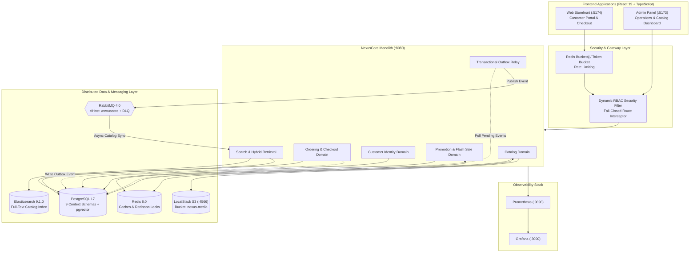
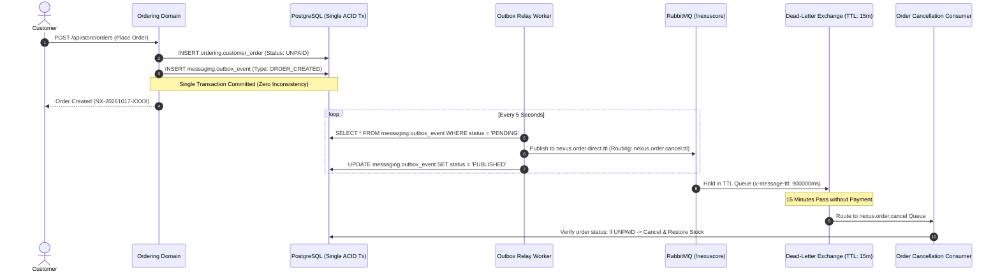
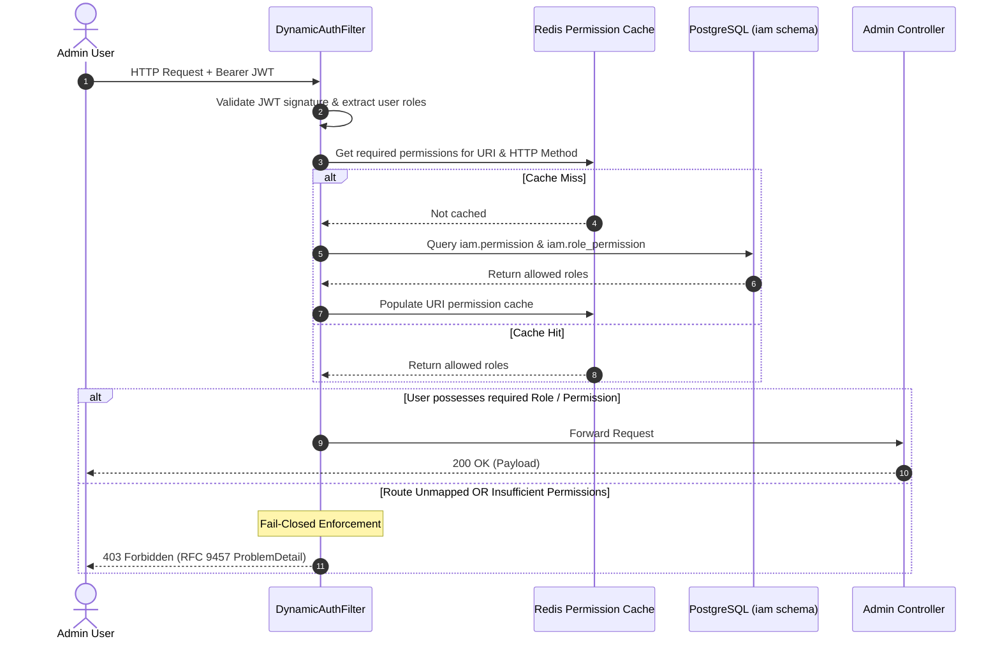
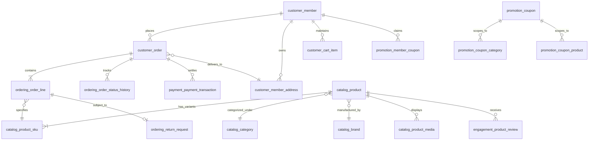

# NexusEngine

<div align="center">

[](https://openjdk.org/)
[](https://spring.io/projects/spring-boot)
[](https://www.typescriptlang.org/)
[](https://react.dev/)
[](https://www.postgresql.org/)
[](https://www.elastic.co/)
[](https://www.rabbitmq.com/)
[](https://redis.io/)
[](https://www.docker.com/)
[](LICENSE)

**An enterprise-grade, high-concurrency retail commerce platform architected as a modular micro-monolith.**  
Engineered with Domain-Driven Design (DDD), Transactional Outbox event messaging, dynamic fail-closed RBAC, and hybrid vector search.

[Architecture](#-system-architecture--design-patterns) •
[Domain Model](#-domain-driven-data-architecture) •
[Quickstart](#-one-command-quickstart) •
[Endpoints & Credentials](#-service-endpoints--credentials) •
[Developer Guide](#-developer-workflows)

</div>

---

## 🌟 Executive Summary

**NexusEngine** is a modern retail commerce platform designed to demonstrate FAANG-caliber systems engineering, high-throughput distributed transaction patterns, and strict architectural discipline. 

### Core Architectural Pillars
- **Modular Monolith with Domain-Driven Design (DDD)**: Eliminates distributed monolith anti-patterns by unifying domain contexts into distinct schemas (`catalog`, `ordering`, `customer`, `iam`, `promotion`, `engagement`, `payment`, `ai`, `messaging`) with strict JPA entity boundaries and zero cross-schema joins.
- **Transactional Outbox Pattern**: Guaranteed at-least-once event delivery for orders and catalog mutations via PostgreSQL transaction logs and background polling publishers over RabbitMQ.
- **Fail-Closed Dynamic RBAC**: Custom Spring Security filter intercepting requests against dynamic permissions in `iam.permission`, defaulting strictly to `403 Forbidden` for unmapped or unauthorized routes.
- **Hybrid Search Engine**: Combines BM25 tokenized keyword search (Elasticsearch 9) with high-dimensional vector embeddings (`pgvector` via Spring AI) for semantic product recommendations.
- **High-Concurrency Flash Sales**: Redis Lua-scripted atomic stock decrements and Redisson distributed locks preventing overselling under heavy load.
- **100% Pure TypeScript Frontends**: Dual Vite-powered applications—a customer storefront and an admin dashboard—built with React 19, Material UI 6, Redux Toolkit, and comprehensive type contracts matching backend DTOs.
- **Automated Observability**: Prometheus metrics collection, Grafana dashboard provisioning, and structured RFC 9457 `ProblemDetail` error responses.

---

## 🏗 System Architecture & Design Patterns

### 1. High-Level Macro Architecture



---

### 2. Transactional Outbox Pattern & Reliable Order Expiration

To prevent distributed two-phase commits (2PC) while guaranteeing message consistency, mutations to the `ordering` domain persist business state and an `outbox_event` in a single ACID transaction. The order expiration lifecycle leverages RabbitMQ dead-letter exchanges for zero-polling timeout enforcement:



---

### 3. Dynamic Fail-Closed RBAC Security Flow

All administrator endpoints are protected by an in-memory cached dynamic authorization manager that enforces zero trust: if an endpoint is not mapped to an explicit permission rule, access is **denied by default (fail-closed)**.



---

## 🗄 Domain-Driven Data Architecture

The underlying database uses PostgreSQL 17 structured across **9 discrete schemas** representing bounded contexts, fully managed and migrated by Flyway (`V1__baseline.sql`, `V2__reference_data.sql`, `V3__demo_catalog.sql`). Every single table and column is strictly wired and utilized end-to-end.

| Bounded Context | Schema | Core Entities & Tables | Domain Responsibility |
|---|---|---|---|
| **Catalog** | `catalog` | `product`, `product_sku`, `category`, `brand`, `attribute_definition`, `product_attribute_value`, `product_media`, `product_type`, `product_price_change`, `product_approval_event` | Product hierarchy, multi-attribute SKU variants, dynamic specification definitions, approval audit logs, and media gallery. |
| **Ordering** | `ordering` | `customer_order`, `order_line`, `cart_item`, `order_status_history`, `order_policy`, `merchant_address`, `return_request` | Shopping carts, checkout state transitions, return authorizations, carrier logistics tracking, and return address management. |
| **Customer** | `customer` | `member`, `member_address`, `member_login_event`, `member_category_interest` | Consumer identities, hashed passwords (BCrypt), delivery addresses, category interest graphs, and login telemetry. |
| **IAM** | `iam` | `admin`, `role`, `permission`, `admin_role`, `role_permission`, `admin_login_event` | Operator access control, dynamic permission routing rules, role hierarchies, and administrator audit trails. |
| **Promotion** | `promotion` | `coupon`, `coupon_category`, `coupon_product`, `member_coupon`, `banner`, `flash_sale`, `flash_sale_session`, `flash_sale_item`, `flash_sale_log` | Percentage and fixed voucher claiming, category/product discount scoping, promotional hero banners, and high-concurrency flash sales. |
| **Engagement** | `engagement` | `product_review`, `review_media`, `review_reply`, `product_comment` | Verified buyer star ratings, customer review image attachments, and administrative content moderation. |
| **Payment** | `payment` | `payment_transaction`, `payment_webhook_event` | Razorpay checkout transactions, idempotent webhook replay protection, and refund ledger records. |
| **AI** | `ai` | `vector_store` | High-dimensional product embeddings (Spring AI + `pgvector` HNSW indexes) for semantic similarity matching. |
| **Messaging** | `messaging` | `outbox_event` | Transactional outbox event store for asynchronous distributed event dispatching. |

### Core Entity Relationships



---

## 💻 Tech Stack Matrix

```text
┌────────────────────────────────────────────────────────────────────────┐
│                          NEXUSENGINE PLATFORM                          │
├───────────────────┬────────────────────────────────────────────────────┤
│ Language & Core   │ Java 25 LTS, Spring Boot 4.1.1                     │
│ Frontend Web      │ React 19, TypeScript 5.7, Vite, MUI v6, Redux      │
│ Admin Dashboard   │ React 19, TypeScript 5.7, Vite, MUI v6, Recharts   │
│ Relational Store  │ PostgreSQL 17 (pgvector extension, 9 schemas)      │
│ Full-Text Search  │ Elasticsearch 9.1.0 (Tokenized BM25 search)        │
│ Cache & Locks     │ Redis 8.0 Alpine, Redisson 4.7.0                   │
│ Event Broker      │ RabbitMQ 4.0 Management (/nexuscore vhost)         │
│ Object Storage    │ LocalStack S3 3.8.0 (Bucket: nexus-media)          │
│ Cloud & AI        │ Spring Cloud AWS 3.3.1, Spring AI (pgvector)       │
│ Payments          │ Razorpay SDK 1.4.6 (Webhook verification)          │
│ Resilience        │ Resilience4j 2.4.0 (Circuit Breaker, Rate Limiter) │
│ Database Tooling  │ Flyway 10 (Squashed V1-V3 Baseline Migrations)     │
│ Observability     │ Prometheus 3.1.0, Grafana 11.5.2, Actuator, Micrometer │
│ Code Quality      │ Spotless (Google Java Format), JaCoCo, Vitest      │
└───────────────────┴────────────────────────────────────────────────────┘
```

---

## 🚀 One-Command Quickstart

NexusEngine provides an automated, idempotent setup script that provisions all 11 Docker containers and seeds all database records, LocalStack media assets, and search indexes in a single command.

### Prerequisites
- **Docker** 24+ and **Docker Compose** v2+
- Optional for local compilation: **Java 25**, **Maven 3.9+**, **Node.js 20+**

### Single-Command Bootstrap

```bash
# Clone the repository
git clone https://github.com/aadarsh/NexusEngine.git
cd NexusEngine

# Execute single-command bootstrap (recommended)
make setup
```

*Alternatively, execute the bootstrap script directly or use standard Docker Compose:*
```bash
./resource_setup/setup.sh
# OR:
docker compose up -d --build
```

### What Happens Automatically Under the Hood
1. **Container Orchestration**: Spins up PostgreSQL, Redis, RabbitMQ, Elasticsearch, LocalStack, backend API, Storefront, Admin Panel, S3 UI, Prometheus, and Grafana.
2. **Deterministic RabbitMQ Setup**: Loads `resource_setup/rabbitmq/definitions.json` configuring `/nexuscore` virtual host, user permissions, and dead-letter exchanges.
3. **LocalStack S3 Bucket & Media Seeding**: LocalStack triggers `s3-init/01-init-s3.sh` on boot, creating the `nexus-media` bucket, CORS rules, public read policies, and syncing 2,190+ product and category image assets.
4. **Flyway Database Migrations**: `nexus-application` executes Flyway `V1` (9 schemas, 50 tables), `V2` (IAM roles & reference data), and `V3` (152 products, SKUs, brands, coupons, banners, reviews).
5. **Elasticsearch Auto-Indexing**: Spring Boot's `ProductSearchIndexInitializer` detects when the Elasticsearch `pms` index is unpopulated and automatically synchronizes all 152 catalog products into Elasticsearch.

---

## 🌐 Service Endpoints & Credentials

Once started, all services are operational at the following endpoints:

| Service | Port / URL | Credentials / Access | Notes |
|---|---|---|---|
| **Web Storefront** | http://localhost:5174 | *Public Access* | Modern consumer shopping experience |
| **Admin Panel** | http://localhost:5173 | **User:** `admin`<br/>**Password:** `macro123` | Full administrative operations suite |
| **Backend Core API** | http://localhost:8080 | [Swagger UI Docs](http://localhost:8080/swagger-ui.html) | RESTful API & Actuator endpoints |
| **LocalStack S3 Web GUI** | http://localhost:9001 | *Direct Access* | S3 Manager GUI for `nexus-media` |
| **LocalStack S3 API** | http://localhost:4566 | **Region:** `us-east-1` | S3 endpoint for images & uploads |
| **RabbitMQ Management** | http://localhost:15672 | **User:** `guest`<br/>**Password:** `guest` | VHost: `/nexuscore` |
| **Elasticsearch** | http://localhost:9200 | *Direct Access* | Index: `pms` |
| **Prometheus** | http://localhost:9090 | *Direct Access* | Metrics scraping & query engine |
| **Grafana Dashboards** | http://localhost:3000 | **User:** `admin`<br/>**Password:** `admin` | Pre-provisioned system dashboards |
| **PostgreSQL Database** | `localhost:5433` | **User:** `postgres`<br/>**Password:** `postgres`<br/>**DB:** `nexuscore` | Mapped from internal container port `5432` |
| **Redis Cache** | `localhost:6379` | *No password (DB: 0)* | Internal cache & distributed locks |

### Additional Pre-Configured Test Accounts
- **Customer User**: `customer1` / `macro123` (Name: Aarav Sharma, pre-seeded with orders & addresses)
- **Brand Admin (Samsung)**: `samsung_admin` / `macro123`
- **Brand Admin (Nike)**: `nike_admin` / `macro123`

---

## 🛠 Developer Workflows

### Makefile Command Reference

The root `Makefile` provides standardized targets for all common lifecycle tasks:

```bash
make help           # Display all available targets
make setup          # Complete single-command build, bootstrap, and verification
make up             # Start all containers in the background
make down           # Stop all running containers
make restart        # Clean restart of all services
make infra-up       # Start infrastructure only (Postgres, Redis, RabbitMQ, ES, LocalStack)
make infra-down     # Stop infrastructure containers
make ps             # Check health and status of all containers
make logs           # Follow live unified container logs
make test           # Run backend Maven tests + frontend Vitest suites
make test-backend   # Run backend verification suite (unit + Flyway testcontainers)
make test-frontend  # Run storefront Vitest test suite
make format-check   # Validate Spotless Google Java formatting
make clean          # Teardown stack and purge Docker volumes (full reset)
```

### Running Locally Outside Docker (IDE Mode)

If you prefer debugging the Java monolith or React applications natively in an IDE:

1. **Spin up local infrastructure dependencies:**
   ```bash
   make infra-up
   ```

2. **Run Spring Boot Backend:**
   ```bash
   cd NexusCore
   mvn spring-boot:run -pl nexus-application -Dspring-boot.run.profiles=dev
   ```

3. **Run Web Storefront:**
   ```bash
   cd NexusFrontendWeb
   npm install
   npm run dev
   ```

4. **Run Admin Panel:**
   ```bash
   cd NexusAdminPanel
   npm install
   npm run dev
   ```

---

## 💳 Payment Simulation (Razorpay Test Environment)

When completing orders on the Web Storefront (`:5174`), the checkout modal loads the Razorpay Sandbox. Use any of the following domestic test card details:

| Card Type | Card Number | Expiry | CVV | OTP Simulation |
|---|---|---|---|---|
| **Visa** | `4100 2800 0000 1007` | Future date (e.g. `12/28`) | `123` | Enter `123456` or click "Success" |
| **Mastercard** | `5555 5555 0008 1006` | Future date (e.g. `12/28`) | `123` | Enter `123456` or click "Success" |
| **RuPay** | `6527 6589 0000 1005` | Future date (e.g. `12/28`) | `123` | Enter `123456` or click "Success" |

---

## 📂 Repository Layout

```text
NexusEngine/
├── NexusCore/                          # Spring Boot Multi-Module Monolith (Java 25)
│   ├── nexus-application/              # Monolith boot application & profile configs
│   ├── nexus-admin-api/                # Admin RBAC REST controllers & services
│   ├── nexus-portal-api/               # Customer storefront REST controllers & services
│   ├── nexus-search/                   # Elasticsearch 9 indexing & hybrid search
│   ├── nexus-domain/                   # JPA Entities, Flyway migrations (V1-V3), Repositories
│   ├── nexus-security/                 # Spring Security 6 dynamic fail-closed RBAC & JWT filters
│   └── nexus-common/                   # RFC 9457 ProblemDetail handlers, Redis configs, utils
├── NexusFrontendWeb/                   # Customer Storefront (React 19, TypeScript, Vite, MUI v6)
├── NexusAdminPanel/                    # Admin Dashboard (React 19, TypeScript, Vite, MUI v6, Recharts)
├── resource_setup/                     # Infrastructure provisioning & initialization
│   ├── setup.sh                        # Single-command orchestrator & health verifier
│   ├── rabbitmq/                       # Declarative RabbitMQ config & definitions (/nexuscore)
│   ├── s3-init/                        # LocalStack S3 ready.d initialization script
│   └── s3-data/                        # Flat catalog, banner, and avatar media assets
├── grafana/                            # Grafana provisioning & telemetry dashboards
├── prometheus/                         # Prometheus scraping configuration
├── docker-compose.yml                  # Unified 11-container Docker Compose manifest
├── Makefile                            # Standardized developer CLI targets
└── CleanupAndMAkingFAANGInterviewReady.md # Engineering audit, architecture specs & ADRs
```

---

<div align="center">
  <sub>Built with precision for enterprise scalability, resilience, and operational clarity.</sub>
</div>
