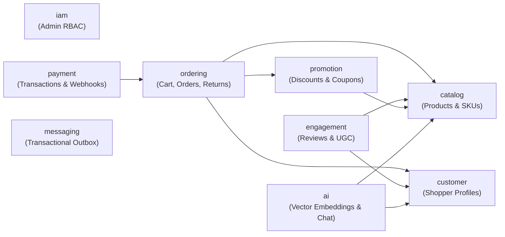

# ADR 0001: Bounded Context Database Schema Redesign & Data Architecture

- **Status:** Accepted
- **Date:** 2026-10-11
- **Deciders:** NexusEngine Engineering Team

---

## 1. Context and Problem Statement

NexusEngine's data tier was originally derived from the legacy *mall* e-commerce architecture. An audit of the live PostgreSQL database (`nexuscore`) and JPA persistence layer revealed critical data model flaws, anti-patterns, and lack of relational constraints:

### 1.1 Legacy Audit Findings (A1 – A18)

| ID | Problem Area | Observed Defect | Production Impact |
|---|---|---|---|
| **A1** | Redundant Namespacing | Tables duplicated schema names (e.g. `pms.pms_product`, `marketing.sms_coupon`). `sms_` prefix caused confusion with SMS notifications. | Confusing domain semantics; duplicated names. |
| **A2** | Schema Drift | Tables were partially renamed without renaming foreign keys, check constraints, or underlying sequences (`pms_product_ladder_pkey`, `outbox_event_id_seq` on `staged_event`). | Operational confusion, sequence collisions, unmaintainable DDL. |
| **A3** | Duplicate Foreign Keys | 6 duplicate FK constraints existed (e.g. `oms_order` referencing member twice, `oms_order_item` referencing order and product twice). | Double validation overhead on every insert/update transaction. |
| **A4** | Missing FK Indexes | 57 foreign key columns lacked indexes (e.g. `oms_order.member_id`, `oms_order_item.order_id`, `pms_sku_stock.product_id`). | Full table scans on joins, cascade deletes, and frequent user order lookups. |
| **A5** | Missing Invariant Constraints | Zero `CHECK` constraints across the schema. Allowed negative stock, rating = 99, and `end_time < start_time`. | Invalid state allowed at the persistence layer; complete reliance on application logic. |
| **A6** | Missing Business Keys | Only 2 unique constraints existed besides primary keys. `order_sn`, `username`, `email`, `sku_code`, and coupon `code` were not unique. | High risk of duplicate accounts, duplicate orders, and coupon race conditions. |
| **A7** | Ambiguous Timestamps | Timestamps stored as `timestamp without time zone` (37 columns). | Timezone shift and data corruption across client/server timezones (IST vs UTC). |
| **A8** | Inconsistent Timestamp Names | 4 inconsistent variants: `create_time`, `created_time` (reviews), `create_date` (cart), `created_at` (outbox). | Fragile ORM mappings, inconsistent DTO serialization. |
| **A9** | Chaotic Numeric Types | Monetary values used 3 different precisions: `numeric(19,2)`, `numeric(10,2)`, and `numeric(38,2)`. | Inconsistent rounding behavior and excessive storage allocation. |
| **A10** | 1NF & Datatype Violations | `birthday timestamp`, `proof_pics varchar(255)` (comma-separated strings), `input_list` (CSV), unstructured `payload text`. | First normal form violations, truncated URLs, lack of type safety. |
| **A11** | Integer Flags for Booleans | Boolean flags (`publish_status`, `delete_status`, `show_status`, `hidden`) stored as `integer` (`0` / `1`). | Type mismatches between PostgreSQL `boolean`, Java, and TypeScript. |
| **A12** | Zombie Columns | DB columns existed without entity mappings (`sms_coupon.version`, `staged_event.retry_count`, `ums_member.birthday`). | `@Version` optimistic locking failed silently; retries were never tracked. |
| **A13** | Overselling Vulnerability | Inventory decrements performed via read-modify-write in Java (`setStock(getStock() - qty)`) without `@Version` or atomic database locks. | Lost updates and overselling under concurrent checkout traffic. |
| **A14** | Unindexed Vector Embeddings | `ai.pms_product_embedding` lacked an Approximate Nearest Neighbor (ANN/HNSW) index. | Vector similarity queries (`<=>`) executed sequential scans over all embeddings. |
| **A15** | Unindexed Outbox Queries | Poller query `findByStatusOrderByCreatedAtAsc` on `staged_event` lacked composite indexes. | Degraded poller throughput as the transactional outbox grew. |
| **A16** | Flyway Drift | Flyway history versions did not match repository migration scripts (`V1`–`V11`). | Fresh database containers failed to initialize cleanly from baseline. |
| **A17** | Surrogate Join Table Keys | Join tables used surrogate `id` columns without composite unique constraints (`ums_role_menu_relation`, `sms_coupon_product_relation`). | Duplicate relation mappings possible; wasted index space. |
| **A18** | Stale Cart Snapshots | Mutable product details (`product_name`, `pic`, `brand`, `attr`) copied onto `oms_cart_item` rows. | Cart items displayed stale pricing and product attributes when catalog changed. |

---

## 2. Decision Drivers

1. **Strict Domain-Driven Design (DDD):** Data models must align to bounded contexts, establishing clear seams for potential microservice extraction.
2. **Database-Enforced Integrity:** The database engine must guarantee invariants (non-negative stock, valid date ranges, unique business identifiers) via native constraints.
3. **Concurrency Safety:** Prevent race conditions, lost updates, and overselling using atomic SQL operations and optimistic locking.
4. **Reproducibility:** A clean checkout must boot seamlessly via clean, deterministic Flyway migrations without external dumps or manual SQL interventions.

---

## 3. Decision Outcome & Principles

### 3.1 Bounded Context Schemas

The single monolithic database is partitioned into 9 logical PostgreSQL schemas, each representing an explicit bounded context:

| Old Schema | New Schema | Responsibility |
|---|---|---|
| `pms` | **`catalog`** | Products, SKUs, Categories, Brands, Attributes, Media |
| `orders` | **`ordering`** | Customer Orders, Order Items, Cart, Returns, Order Policies |
| `orders` (payment table) | **`payment`** | Payment Transactions, Provider Webhook Logs, Gateway Audits |
| `users` (members) | **`customer`** | Registered Members, Shipping Addresses, Member Login Events |
| `users` (staff) | **`iam`** | Admin Users, Roles, Permissions, Console Menus |
| `pms` (reviews) | **`engagement`** | Product Reviews, Ratings, Review Media |
| `marketing` | **`promotion`** | Coupons, Flash Sales, Banners, Volume Discounts |
| `ai` | **`ai`** | AI Chat History, Spring AI Vector Store |
| `messaging` | **`messaging`** | Transactional Outbox / Event Publication Registry |



### 3.2 Cross-Context Seams
- **Cross-context relationships are stored as IDs only** (e.g. `ordering.customer_order.member_id bigint`, not a database-level FK pointing across schemas). This decouples context lifecycles.
- **Intra-context relationships** retain strict relational foreign keys with B-tree indexes.

### 3.3 Global Datatype & Naming Rules (R1 – R10)

| Rule | Area | Requirement | Rationale |
|---|---|---|---|
| **R1** | Primary Keys | `id bigint GENERATED ALWAYS AS IDENTITY` | Standard SQL identity owned by the column; works natively with JPA `GenerationType.IDENTITY`. |
| **R2** | Timestamps | `timestamptz` named `*_at` | Absolute instants in time; mapped directly to Java `Instant` / ISO-8601 strings. |
| **R3** | Monetary Values | `numeric(12,2) CHECK (>= 0)` named `*_amount` | Supports values up to ₹9,999,999,999.99 with exact 2-decimal arithmetic; mapped to `BigDecimal`. |
| **R4** | Booleans | `boolean NOT NULL DEFAULT false` named `is_*` | 1 byte native type; mapped to Java `boolean` and TypeScript `boolean`. |
| **R5** | Status / Enums | `varchar(32)` or `smallint` with `CHECK (col IN (...))` | Invariants verified by DB; mapped to Java enums with `@Enumerated(STRING)`. |
| **R6** | Text & Identifiers | `varchar(n)` sized to domain for codes/slugs; `text` for descriptions | No arbitrary `varchar(255)` MySQL habits. |
| **R7** | Natural Keys | `citext` or lowercase constraint + `UNIQUE` for `email`/`username` | Case-insensitive uniqueness prevents duplicate accounts. |
| **R8** | FK Indexes | B-tree index on every foreign key column (`ix_<table>__<col>`) | Prevents full table scans on joins and parent deletes. |
| **R9** | Join Tables | Composite primary key `PRIMARY KEY (a_id, b_id)`, no surrogate `id` | Prevents duplicate associations and reduces index overhead. |
| **R10** | Quantities & Counters | `integer NOT NULL DEFAULT 0 CHECK (>= 0)` named `*_qty` or `*_count` | Prevents negative stock counts or quantities at the database level. |

### 3.4 Concurrency & Cart Lifecycle Patterns

1. **Atomic Stock Decrement (Fixing A13):**
   Stock updates must be executed using atomic SQL:
   ```sql
   UPDATE catalog.product_sku
   SET reserved_qty = reserved_qty + :quantity
   WHERE id = :skuId
     AND (on_hand_qty - reserved_qty) >= :quantity;
   ```
   If the update affects 0 rows, the operation fails immediately due to insufficient stock.
2. **Cart vs. Order Line Snapshots (Fixing A18):**
   - **`ordering.cart_item`:** Contains only references (`sku_id`, `quantity`, `member_id`). Prices and titles are resolved dynamically from `catalog` at read time to avoid stale cart state.
   - **`ordering.order_item`:** Deeply freezes snapshot values (`unit_price`, `product_name`, `sku_code`, `attributes_snapshot`) at the moment the order is placed to preserve legal purchase history.

---

## 4. Consequences

### Positive
- Strict data integrity enforced by PostgreSQL constraints (`CHECK`, `UNIQUE`, `NOT NULL`).
- Consistent and clean schema naming without redundant prefixes (`catalog.product`, `ordering.customer_order`).
- Clean bounded contexts allow future migration to independent microservices without schema disentanglement.
- Immunity to inventory overselling and timezone corruption bugs.

### Trade-Offs
- Requires clean Flyway baseline migration (`V1__baseline.sql`) and retirement of old un-migrated tables.
- Cross-context joins must be performed via application facades/DTO joins rather than SQL joins.
