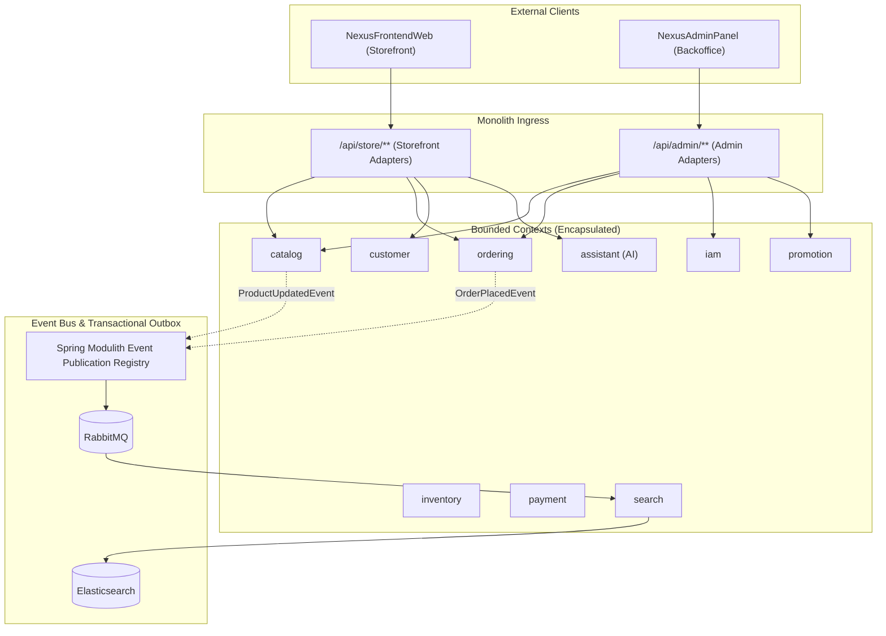

# ADR 0002: Modular Monolith Architecture with Spring Modulith

- **Status:** Accepted
- **Date:** 2026-10-11
- **Deciders:** NexusEngine Engineering Team

---

## 1. Context and Problem Statement

NexusEngine was originally split into 8 Maven modules (`nexus-common`, `nexus-domain`, `nexus-security`, `nexus-admin-api`, `nexus-portal-api`, `nexus-search`, `nexus-ai`, `nexus-application`). While appearing modular on the surface, an architectural audit identified several major anti-patterns:

1. **Shared God-Module Anti-Pattern:** `nexus-domain` held all JPA entities and repositories for all domains in one flat library. Every API module imported `nexus-domain` and freely reached across domain boundaries via wildcard imports (`import com.nexusengine.domain.*`).
2. **Duplicated Business Logic across Channels:** Features were divided by target audience (`admin-api` vs `portal-api`) rather than business capability. "Catalog" logic was duplicated across admin and storefront controllers with differing validation rules.
3. **Distributed Monolith:** `nexus-search` was configured as a separate standalone Spring Boot application, yet shared the same relational database and JPA entities as the primary application. This introduced deployment coordination overhead without independent data boundaries.
4. **Ad-Hoc Transactional Outbox:** Outbox events were tracked in a custom `messaging.outbox_event` table polled by an unindexed `@Scheduled` poller lacking `SKIP LOCKED`, risking race conditions under horizontal scaling.
5. **Non-Standard API Envelope:** APIs wrapped all responses in `CommonResult<T>` (`{code, message, data}`), returning HTTP 200 even for fatal errors, hiding failures from HTTP proxies and standard client libraries.

---

## 2. Decision Drivers

- **Domain-Driven Design (DDD):** Enforce strict bounded contexts and package-private encapsulation.
- **Architectural Fitness Functions:** Automated boundary verification at test time (`ApplicationModules.verify()`) to prevent code drift and illegal cross-context dependencies.
- **Operational Simplicity:** Single deployable container instead of a multi-process distributed monolith, avoiding orchestration complexity before scale demands it.
- **Reliable Eventual Consistency:** Transactional outbox pattern with at-least-once delivery guarantees for asynchronous side effects (search indexing, notifications).

---

## 3. Decision Outcome

### 3.1 Architecture Overview: Spring Modulith

NexusEngine adopts a **Modular Monolith** architecture powered by **Spring Modulith**. The backend is structured into clear bounded contexts within a single deployable application.



### 3.2 Bounded Context Structure

Each bounded context is organized into a public API package and an internal implementation package:

```
com.nexusengine.<context>/
├── api/                             <-- Public facade accessible to other modules
│   ├── <Context>Facade.java         <-- Strongly-typed Java interface
│   ├── dto/                         <-- Immutable Java Records (public contract)
│   └── events/                      <-- Domain events published across contexts
└── internal/                        <-- Package-private implementation (enforced)
    ├── domain/                      <-- Entities, value objects, domain logic
    ├── persistence/                 <-- Spring Data repositories
    ├── service/                     <-- Business logic & facade implementations
    └── web/                         <-- REST adapters
        ├── admin/                   <-- Admin-facing endpoints (/api/admin/...)
        └── store/                   <-- Storefront-facing endpoints (/api/store/...)
```

### 3.3 Communication Rules

1. **Synchronous Inter-Module Calls:** Modules must only call methods declared in another module's public `api/` interface. Entities and internal services are never exposed.
2. **Asynchronous Inter-Module Events:** For cross-context side effects, modules publish domain events using Spring's `ApplicationEventPublisher`. Consumer modules listen via `@ApplicationModuleListener`.
3. **Transactional Outbox:** Cross-context events use Spring Modulith's **Event Publication Registry** backed by PostgreSQL. Events are committed atomically within the publishing business transaction, ensuring zero message loss.
4. **Search Ingestion:** The standalone `nexus-search` service is integrated into the monolith as the `search` bounded context. When products are created, updated, or removed, `catalog` emits domain events. The `search` module listens, serializes documents, and updates Elasticsearch.

### 3.4 REST API & Error Standardization

- **Success Responses:** Plain typed DTO records with standard HTTP status codes (`200 OK`, `201 Created`, `204 No Content`).
- **Pagination:** Standard Spring Data `Pageable` parameters (`?page=0&size=20&sort=createdAt,desc`) returning Spring Data `PagedModel<T>`.
- **Error Responses:** RFC 9457 `ProblemDetail` with appropriate HTTP status codes (`400 Bad Request`, `401 Unauthorized`, `403 Forbidden`, `404 Not Found`, `409 Conflict`, `422 Unprocessable Entity`), including a unique `traceId` and contextual error codes.

---

## 4. Consequences

### Positive
- Strict compile-time and automated test-time boundary enforcement via `ApplicationModules.of(NexusApplication.class).verify()`.
- Entities never leak past the service boundary; presentation layer is fully decoupled from persistence models.
- Operational simplification: single jar, unified configuration, unified logging, and single JVM deployment.
- Clean path to extract any bounded context into an independent microservice in the future if organizational or scaling requirements warrant it.

### Trade-Offs
- Requires refactoring controllers to use typed DTO records rather than raw JPA entities.
- Inter-module data queries require facade lookups rather than direct SQL cross-table joins.
