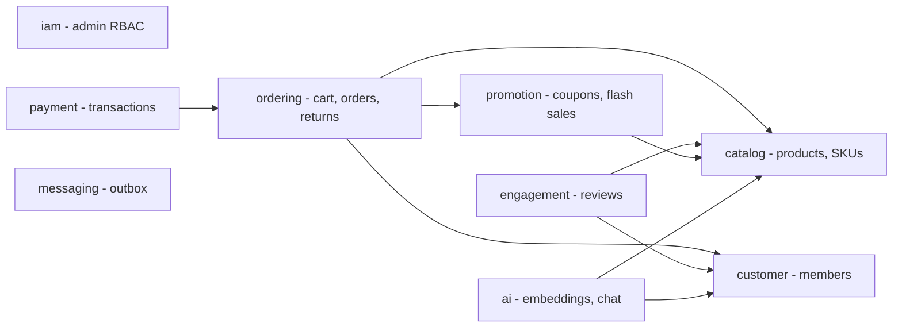

 # NexusCore DB Redesign: Old → New Mapping

**Source:** live DB `jdbc:postgresql://localhost:5433/nexuscore` (PG 17.11), cross-checked with the JPA entities in `NexusCore/nexus-data-jpa` and how `NexusFrontendWeb` and `NexusAdminPanel` use the API.

---

## 1. Audit findings (what's wrong today)

| # | Finding | Evidence | Impact |
|---|---|---|---|
| A1 | Table names copied from the *mall* project (`pms_`/`oms_`/`sms_`/`ums_`) are kept, even though the schemas already group the tables | `pms.pms_product`, `marketing.sms_coupon` | Every name says the same thing twice (`pms.pms_*`); the `sms_` prefix reads as "SMS messages" |
| A2 | Some tables were renamed but their constraints and sequences weren't | `pms_product_ladder_pkey`, `pms_product_full_reduction_pkey`, `outbox_event_id_seq` on `staged_event` | Confusing to work with; the schema clearly drifted over time |
| A3 | **6 duplicate FKs** | `oms_order` (member ×2), `oms_order_item` (order ×2, product ×2), `ums_member_receive_address` ×2, `sms_flash_promotion_product_relation` ×2 | Every write checks the same constraint twice |
| A4 | **57 FK columns have no index** | e.g. `oms_order.member_id`, `oms_order_item.order_id`, `pms_sku_stock.product_id` | "My orders", order detail and product → SKU lookups all scan the whole table; deleting a parent row scans the child table |
| A5 | **No CHECK constraints at all** | negative stock, rating = 99, `end_time < start_time` are all accepted | Data quality depends entirely on the app code |
| A6 | Only 2 unique constraints besides PKs | `order_sn`, `username`, `email`, `sku_code`, coupon `code` are **not unique** | Duplicate accounts, duplicate order numbers and coupon-code collisions are possible |
| A7 | Every timestamp is `timestamp without time zone` | 37 columns | Times shift by hours when servers or users are in different time zones (IST vs UTC) |
| A8 | Four different names for "created" | `create_time`, `created_time` (review), `create_date` (cart), `created_at` (outbox) | Inconsistent |
| A9 | Three money precisions | `numeric(19,2)`, `numeric(10,2)`, `numeric(38,2)` | Inconsistent; `numeric(38,2)` is far larger than needed |
| A10 | Wrong datatypes | `birthday timestamp`, `ip varchar(255)`, `user_agent varchar(255)`, `proof_pics varchar(255)` (comma-separated URLs), `input_list` (CSV), `payload text`, `metadata json` | Truncated data, 1NF violations, no type safety |
| A11 | 0/1 flags stored as `integer` | `delete_status`, `publish_status`, `show_status`, `hidden`, … (~20 columns) | Should be `boolean` |
| A12 | Columns that exist in the DB but no entity maps (they don't work) | `sms_coupon.version/stackable/is_public`, `staged_event.retry_count`, `ums_member.birthday/bonus_draws_remaining/personalized_signature`, `ums_admin_login_log.address/user_agent` | `@Version` on the coupon isn't mapped, so the version column does nothing; outbox retries are never counted |
| A13 | Stock is updated by reading the row, changing it in Java, and saving it back | `PortalOrderDao.updateSkuStock()` → `setStock(getStock() - qty)` with no `@Version` | **Lost updates and overselling** when orders run at the same time |
| A14 | The pgvector table has no ANN index | `ai.pms_product_embedding` (the HNSW index exists only on `vector_store`) | The `<=>` similarity query scans every row |
| A15 | The outbox poller's query has no index | `findByStatusOrderByCreatedAtAsc` on `staged_event` | Gets slower as the table grows |
| A16 | Flyway history doesn't match the repo | DB: V3 = "membership and admin", V9 = "coupon improvements"; repo: V3 = `product_desc_text`, V9 = `add_foreign_keys`, and V10/V11 aren't recorded. Config lists `catalog`/`system` schemas, but the DB uses `pms` and has no `system` | A fresh environment will **not** end up with the same schema |
| A17 | Join tables have a surrogate `id` and no unique pair | `ums_role_menu_relation`, `sms_coupon_product_relation`, … | The same pair can be inserted twice; the extra index is wasted |
| A18 | Snapshot data copied onto mutable rows | `oms_cart_item.product_name/pic/brand/sn/attr`, `sms_coupon_history.member_nickname` | Cart shows stale data; personal data is spread across tables |

> [!TIP]
> The largest table holds **552 rows**. That makes now the cheapest moment you'll ever have for a breaking schema redesign.

---

## 2. Design principles (useful to say out loud in an interview)

1. **Bounded contexts → schemas** (DDD). Each schema could become its own microservice later. Cross-context FKs are kept for now but documented as seams.
2. **No redundant prefixes.** The schema is the namespace (`catalog.product`, not `pms.pms_product`).
3. **Singular table names, `snake_case`**, and no SQL reserved words (`order` → `customer_order`).
4. **Column suffix conventions:** `_id` (FK), `_at` (timestamptz), `_on` (date), `is_` (boolean), `_amount` (money), `_count` / `_qty` (non-negative integers), `_url`, `_code`.
5. **Constraint naming:** `pk_<table>`, `fk_<table>__<column>`, `uq_<table>__<cols>`, `ck_<table>__<rule>`, `ix_<table>__<cols>`.
6. **Let the DB enforce invariants:** CHECK, UNIQUE, NOT NULL, partial unique indexes.
7. **Order lines keep a snapshot; carts don't.** An order line freezes price and name at purchase time. A cart always reads live catalog data.

### Bounded contexts

---

## 3. Schema mapping

| Old schema | New schema | Why |
|---|---|---|
| `pms` | **`catalog`** | "PMS" is jargon from the mall project; `catalog` is the standard e-commerce name for this context |
| `orders` | **`ordering`** | Named after the bounded context (as in Microsoft eShop's *Ordering* service), not a table |
| `orders` (payment table) | **`payment`** (new) | Payments have their own compliance and audit boundary (PCI) |
| `users` | **`customer`** + **`iam`** (split) | Shoppers and staff are different actors with different security needs |
| `pms` (reviews) | **`engagement`** (new) | User-generated content; scales and is moderated separately |
| `marketing` | **`promotion`** | More precise: everything here is a pricing incentive |
| `ai` | `ai` (kept) | Already clear |
| `messaging` | `messaging` (kept) | Already clear |
| `migration` | `migration` (kept) | Flyway history |
| `system` (in Flyway config, not in DB) | *remove from config* | Unused |

---

## 4. Global datatype rules

These rules apply to every table in section 5. They aren't repeated per row unless a column is renamed.

| Rule | Old | New | Why |
|---|---|---|---|
| R1 | `id bigint` + `nextval()` sequence | `id bigint GENERATED BY DEFAULT AS IDENTITY` | SQL-standard identity; the sequence is owned by the column. Works with JPA `GenerationType.IDENTITY` unchanged |
| R2 | `timestamp without time zone` | `timestamptz`, renamed `*_at` | Stores an absolute instant. Java side: `Instant` / `OffsetDateTime` |
| R3 | `numeric(19,2)`, `(10,2)`, `(38,2)` | `numeric(12,2)` + `CHECK (>= 0)` | Up to ₹9,999,999,999.99; one money type everywhere |
| R4 | 0/1 `integer` flags | `boolean NOT NULL DEFAULT …` named `is_*` | Says what it means; 1 byte instead of 4 |
| R5 | enum-like `integer` | `smallint` + `CHECK (col IN (…))` | Valid values enforced by the DB. Java: an enum plus an `AttributeConverter`, so the integer codes on the wire stay the same |
| R6 | `varchar(255)` everywhere | `varchar(n)` sized to the domain for identifiers; `text` for free-form prose | 255 is a MySQL habit. In PG, `text` and `varchar` perform the same; `n` documents the domain |
| R7 | `email`, `username` varchar | `citext` + UNIQUE | Case-insensitive uniqueness (`A@x.com` = `a@x.com`) |
| R8 | every FK column | b-tree index (unless it's the leading column of a PK or unique index) | Fixes A4 |
| R9 | join table with surrogate `id` | composite PK `(a_id, b_id)`, drop `id` | Fixes A17 |
| R10 | counters (`*_count`, `*_qty`) | `integer NOT NULL DEFAULT 0 CHECK (>= 0)` | Fixes A5 |

---

## 5. Table and column mapping

Legend: ✓ = name unchanged · **NEW** = column added · ~~DROP~~ = column removed · `id` rows are omitted (rule R1)

### 5.1 `catalog` (was `pms`)

#### `pms.pms_brand` → `catalog.brand`
| Old column | Old type | New column | New type | Notes |
|---|---|---|---|---|
| name | varchar(255) | name | varchar(100) NOT NULL **UNIQUE** | |
| show_status | integer | is_visible | boolean | R4 |
| logo | varchar(255) | logo_url | varchar(512) | |
| — | — | **slug** | varchar(120) UNIQUE | SEO-friendly URLs |
| — | — | **created_at / updated_at** | timestamptz | |

#### `pms.pms_product` → `catalog.product`
| Old column | Old type | New column | New type | Notes |
|---|---|---|---|---|
| brand_id | bigint | brand_id ✓ | bigint | + index |
| product_category_id | bigint | category_id | bigint NOT NULL | + index |
| product_attribute_category_id | bigint | product_type_id | bigint | |
| name | varchar(255) | name | varchar(200) NOT NULL | |
| pic | varchar(255) | primary_image_url | varchar(512) | |
| product_sn | varchar(255) | product_code | varchar(64) **UNIQUE** | SPU code |
| delete_status | integer | deleted_at | timestamptz NULL | Soft delete that also records when; queries use a partial index `WHERE deleted_at IS NULL` |
| publish_status | integer | is_published | boolean | |
| new_status | integer | is_new_arrival | boolean | |
| recommend_status | integer | is_featured | boolean | |
| verify_status | integer | approval_status | smallint CHECK (0,1,2) | PENDING / APPROVED / REJECTED |
| sale | integer | units_sold | integer CHECK ≥ 0 | |
| keywords | varchar(255) | search_keywords | text[] + GIN | Was a comma-separated string (1NF) |
| brand_name | varchar(255) | ~~DROP~~ | — | Copy of `brand.name`; build `brandName` in a DTO or `@Formula` |
| description | text | description ✓ | text | |
| promotion_type | integer | promotion_type ✓ | smallint CHECK | |
| — | — | **slug** | varchar(220) UNIQUE | |
| — | — | **created_at / updated_at** | timestamptz | Product has **no timestamps at all** today |
| — | — | **version** | integer | `@Version` optimistic locking |

#### `pms.pms_sku_stock` → `catalog.product_sku`
| Old column | Old type | New column | New type | Notes |
|---|---|---|---|---|
| product_id | bigint | product_id ✓ | bigint NOT NULL | + index |
| sku_code | varchar(255) | sku_code ✓ | varchar(64) NOT NULL **UNIQUE** | |
| price | numeric(19,2) | list_price | numeric(12,2) CHECK ≥ 0 | |
| promotion_price | numeric(19,2) | sale_price | numeric(12,2) CHECK (≤ list_price) | |
| stock | integer | on_hand_qty | integer CHECK ≥ 0 | |
| lock_stock | integer | reserved_qty | integer CHECK (0 ≤ reserved_qty ≤ on_hand_qty) | Stock held for unpaid orders |
| — | — | **available_qty** | integer `GENERATED ALWAYS AS (on_hand_qty - reserved_qty) STORED` | |
| low_stock | integer | low_stock_threshold | integer | |
| pic | varchar(255) | image_url | varchar(512) | |
| sale | integer | units_sold | integer CHECK ≥ 0 | |
| sku_attributes | jsonb | sku_attributes ✓ | jsonb | |
| — | — | **version** | integer | Fixes A13 (overselling) |

> [!IMPORTANT]
> Along with the CHECK constraint, change stock updates to a single atomic statement: `UPDATE catalog.product_sku SET reserved_qty = reserved_qty + :q WHERE id = :id AND on_hand_qty - reserved_qty >= :q`. If it reports 0 rows updated, the item is out of stock. This is the textbook interview answer to "how do you prevent overselling?"

#### `pms.pms_product_category` → `catalog.category`
| Old column | Old type | New column | New type | Notes |
|---|---|---|---|---|
| parent_id | bigint | parent_id ✓ | bigint | self-FK + index |
| name | varchar(255) | name | varchar(100) NOT NULL | |
| level | integer | depth | smallint | Optional: replace with an `ltree` `path` for subtree queries |
| product_count | integer | ~~DROP~~ | — | Denormalized counter that drifts; compute with `COUNT` or a materialized view |
| product_unit | varchar(255) | ~~DROP~~ | — | Unnecessary column |
| nav_status | integer | is_in_navigation | boolean | |
| show_status | integer | is_visible | boolean | |
| sort | integer | ~~DROP~~ | — | Unnecessary column |
| icon | varchar(255) | icon_url | varchar(512) | |
| keywords | varchar(255) | ~~DROP~~ | — | Unnecessary column |
| description | varchar(255) | ~~DROP~~ | — | Unnecessary column |
| — | — | **slug** | varchar(120) UNIQUE | |

#### `pms.pms_product_attribute_category` → `catalog.product_type`
| Old column | Old type | New column | New type | Notes |
|---|---|---|---|---|
| name | varchar(255) | name | varchar(100) UNIQUE | Also called an "attribute set" (e.g. "Smartphone") |
| attribute_count | integer | ~~DROP~~ | — | Derived |
| param_count | integer | ~~DROP~~ | — | Derived |

#### `pms.pms_product_attribute` → `catalog.attribute_definition`
| Old column | Old type | New column | New type | Notes |
|---|---|---|---|---|
| product_attribute_category_id | bigint | product_type_id | bigint | |
| name | varchar(255) | name | varchar(100) | |
| select_type | integer | selection_mode | smallint CHECK (0,1,2) | NONE / SINGLE / MULTI |
| input_type | integer | input_mode | smallint CHECK (0,1) | FREE_TEXT / PICK_LIST |
| input_list | varchar(255) | allowed_values | text[] | Was CSV (1NF violation) |
| sort | integer | display_order | integer | |
| type | integer | kind | smallint CHECK (0,1) | SPEC (defines SKU variants) / PARAM (descriptive only) |

#### `pms.pms_product_attribute_value` → `catalog.product_attribute_value`
| Old column | Old type | New column | New type | Notes |
|---|---|---|---|---|
| product_id | bigint | product_id ✓ | bigint NOT NULL | |
| product_attribute_id | bigint | attribute_id | bigint NOT NULL | |
| value | varchar(255) | value ✓ | text | **UNIQUE (product_id, attribute_id)** |

#### `pms.pms_product_category_attribute_relation` → `catalog.category_attribute`
| Old column | Old type | New column | New type | Notes |
|---|---|---|---|---|
| id | bigint | ~~DROP~~ | — | R9 |
| product_category_id | bigint | category_id | bigint | composite **PK (category_id, attribute_id)** |
| product_attribute_id | bigint | attribute_id | bigint | + index |

#### `pms.pms_product_gallery` → `catalog.product_media`
| Old column | Old type | New column | New type | Notes |
|---|---|---|---|---|
| product_id | bigint | product_id ✓ | bigint | + index |
| media_type | varchar(50) | media_type ✓ | varchar(10) CHECK IN ('IMAGE','VIDEO') | |
| media_url | varchar(255) | url | varchar(512) NOT NULL | |
| sort_order | integer | display_order | integer | |

#### `pms.pms_product_spend_discount` → `promotion.spend_threshold_discount`
| Old column | Old type | New column | New type | Notes |
|---|---|---|---|---|
| product_id | bigint | product_id ✓ | bigint | Moved to `promotion`: it's a pricing incentive, not catalog data |
| full_price | numeric(19,2) | min_spend_amount | numeric(12,2) | "Spend ₹X…" |
| reduce_price | numeric(19,2) | discount_amount | numeric(12,2) CHECK (< min_spend_amount) | "…get ₹Y off" |

#### `pms.pms_product_volume_discount` → `promotion.quantity_tier_discount`
| Old column | Old type | New column | New type | Notes |
|---|---|---|---|---|
| product_id | bigint | product_id ✓ | bigint | |
| count | integer | min_quantity | integer CHECK > 0 | `count` is a SQL function name |
| discount | numeric(19,2) | discount_rate | numeric(5,4) CHECK (0 < x ≤ 1) | A rate, not money |
| price | numeric(19,2) | tier_unit_price | numeric(12,2) | UNIQUE (product_id, min_quantity) |

#### `pms.pms_product_approval_history` → `catalog.product_approval_event`
| Old column | Old type | New column | New type | Notes |
|---|---|---|---|---|
| product_id | bigint | product_id ✓ | bigint | + index |
| create_time | timestamp | created_at | timestamptz | |
| reviewer_name | varchar(255) | reviewer_admin_id | bigint FK → `iam.admin_user` | Store a reference, not a name string |
| status | integer | decision | smallint CHECK | |
| detail | varchar(255) | comment | text | |

#### `pms.pms_product_audit_log` → `catalog.product_price_change`
| Old column | Old type | New column | New type | Notes |
|---|---|---|---|---|
| product_id | bigint | product_id ✓ | bigint | + index |
| — | — | **sku_id** | bigint | Prices live on the SKU, so the change should point at it |
| price_old / price_new | numeric(19,2) | old_list_price / new_list_price | numeric(12,2) | |
| sale_price_old / sale_price_new | numeric(19,2) | old_sale_price / new_sale_price | numeric(12,2) | |
| operate_man | varchar(255) | changed_by_admin_id | bigint FK | |
| create_time | timestamp | changed_at | timestamptz | |

### 5.2 `engagement` (new; reviews moved out of `pms`)

#### `pms.pms_review` → `engagement.product_review`
| Old column | Old type | New column | New type | Notes |
|---|---|---|---|---|
| product_id | bigint | product_id ✓ | bigint | index (product_id, created_at DESC) |
| member_id | bigint | member_id ✓ | bigint | + index |
| parent_id | bigint | parent_review_id | bigint | self-FK for replies |
| rating | integer | rating ✓ | smallint **CHECK (1–5)** | Replies have NULL |
| content | varchar(255) | body | text CHECK (length ≤ 5000) | 255 characters is too short for a review |
| like_count | integer | helpful_count | integer CHECK ≥ 0 | |
| dislike_count | integer | not_helpful_count | integer CHECK ≥ 0 | |
| status | integer | moderation_status | smallint CHECK | |
| created_time | timestamp | created_at | timestamptz | Fixes A8 |
| — | — | **updated_at** | timestamptz | |
| — | — | — | — | **Partial UNIQUE (product_id, member_id) WHERE parent_review_id IS NULL**: one review per product per member |

#### `pms.pms_review_attachments` → `engagement.review_media`
| Old column | Old type | New column | New type | Notes |
|---|---|---|---|---|
| review_id | bigint | review_id ✓ | bigint | + index |
| media_type | varchar(255) | media_type ✓ | varchar(10) CHECK | |
| media_url | varchar(255) | url | varchar(512) | |
| thumbnail_url | varchar(255) | thumbnail_url ✓ | varchar(512) | |
| sort_order | integer | display_order | integer | |

### 5.3 `ordering` (was `orders`)

#### `orders.oms_cart_item` → `ordering.cart_item`
| Old column | Old type | New column | New type | Notes |
|---|---|---|---|---|
| member_id | bigint | member_id ✓ | bigint NOT NULL | |
| product_id | bigint | product_id ✓ | bigint NOT NULL | |
| product_sku_id | bigint | sku_id | bigint NOT NULL | **UNIQUE (member_id, sku_id)** allows `INSERT … ON CONFLICT DO UPDATE SET quantity = quantity + EXCLUDED.quantity` |
| quantity | integer | quantity ✓ | integer CHECK > 0 | |
| price | numeric(19,2) | unit_price_at_add | numeric(12,2) | Lets the UI warn "price changed since you added this" |
| product_pic, product_name, product_brand, product_sn, product_sku_code, product_attr | varchar(255) ×6 | ~~DROP~~ | — | A cart shows live data; fill these in from catalog via a DTO/join (A18) |
| product_category_id | bigint | ~~DROP~~ | — | Can be looked up from the product |
| create_date | timestamp | created_at | timestamptz | |
| modify_date | timestamp | updated_at | timestamptz | |
| delete_status | integer | ~~DROP~~ | — | Cart rows are short-lived: delete them outright |

#### `orders.oms_order` → `ordering.customer_order`
> `order` is a SQL reserved word, so the table is named `customer_order` to avoid quoting it everywhere.

| Old column | Old type | New column | New type | Notes |
|---|---|---|---|---|
| member_id | bigint | member_id ✓ | bigint NOT NULL | index (member_id, created_at DESC) for "My Orders" |
| coupon_id | bigint | coupon_id ✓ | bigint | + index |
| order_sn | varchar(255) | order_number | varchar(32) NOT NULL **UNIQUE** | |
| create_time | timestamp | created_at | timestamptz NOT NULL | |
| total_amount | numeric(19,2) | subtotal_amount | numeric(12,2) | |
| freight_amount | numeric(19,2) | shipping_amount | numeric(12,2) | |
| promotion_amount | numeric(19,2) | promotion_discount_amount | numeric(12,2) | |
| coupon_amount | numeric(19,2) | coupon_discount_amount | numeric(12,2) | |
| discount_amount | numeric(19,2) | manual_adjustment_amount | numeric(12,2) | Discount applied by an admin |
| pay_amount | numeric(19,2) | grand_total_amount | numeric(12,2) | CHECK that it equals subtotal + shipping − discounts |
| — | — | **currency_code** | char(3) DEFAULT 'INR' | Needed because both Stripe and Razorpay are integrated |
| pay_type | integer | payment_method | smallint CHECK | |
| status | integer | status ✓ | smallint CHECK (0–4) | 0 PENDING_PAYMENT, 1 AWAITING_SHIPMENT, 2 SHIPPED, 3 COMPLETED, 4 CANCELLED (codes taken from `OmsPortalOrderServiceImpl`) |
| order_type | integer | order_type ✓ | smallint CHECK (0,1) | STANDARD / FLASH_SALE |
| delivery_company | varchar(255) | carrier_name | varchar(50) | |
| delivery_sn | varchar(255) | tracking_number | varchar(64) | |
| receiver_name | varchar(255) | recipient_name | varchar(100) | |
| receiver_phone | varchar(255) | recipient_phone | varchar(16) | E.164 |
| receiver_post_code | varchar(255) | shipping_postal_code | varchar(16) | |
| receiver_detail_address | varchar(255) | shipping_address_line | varchar(500) | |
| — | — | **shipping_city / shipping_state / shipping_country_code** | varchar / char(2) | Missing today: the address snapshot is incomplete |
| note | varchar(255) | customer_note | text | |
| confirm_status | integer | is_receipt_confirmed | boolean | |
| delete_status | integer | deleted_at | timestamptz NULL | |
| payment_time | timestamp | paid_at | timestamptz | |
| delivery_time | timestamp | shipped_at | timestamptz | |
| receive_time | timestamp | delivered_at | timestamptz | |
| comment_time | timestamp | reviewed_at | timestamptz | |
| modify_time | timestamp | updated_at | timestamptz | |
| — | — | **version** | integer | Optimistic locking for status changes (payment webhook vs. timeout job) |

**Index change:** replace `idx_oms_order_create_time_status (create_time, status)` with a **partial index `(created_at) WHERE status = 0`**. It exactly matches the `getTimeOutOrders` auto-cancel job and is much smaller.

#### `orders.oms_order_item` → `ordering.order_line`
| Old column | Old type | New column | New type | Notes |
|---|---|---|---|---|
| order_id | bigint | order_id ✓ | bigint NOT NULL | + index |
| product_id | bigint | product_id ✓ | bigint | + index |
| product_sku_id | bigint | sku_id | bigint | + index |
| — | — | **sku_code** | varchar(64) | Snapshot |
| product_name | varchar(255) | product_name ✓ | varchar(200) | Kept on purpose: the order line freezes what was bought |
| product_pic | varchar(255) | product_image_url | varchar(512) | Snapshot |
| product_brand | varchar(255) | brand_name | varchar(100) | Snapshot |
| product_category_id | bigint | category_id | bigint | |
| product_attr | varchar(255) | sku_attributes | jsonb | Same type as `product_sku.sku_attributes` |
| product_price | numeric(19,2) | unit_price | numeric(12,2) | |
| product_quantity | integer | quantity | integer CHECK > 0 | |
| promotion_name | varchar(255) | promotion_name ✓ | varchar(100) | |
| promotion_amount | numeric(19,2) | promotion_discount_amount | numeric(12,2) | |
| coupon_amount | numeric(19,2) | coupon_discount_amount | numeric(12,2) | |
| real_amount | numeric(19,2) | line_total_amount | numeric(12,2) | |

#### `orders.oms_order_operate_history` → `ordering.order_status_history`
| Old column | Old type | New column | New type | Notes |
|---|---|---|---|---|
| order_id | bigint | order_id ✓ | bigint | index (order_id, created_at) |
| — | — | **from_status** | smallint | Every row becomes a complete state transition |
| order_status | integer | to_status | smallint | |
| operate_man | varchar(255) | actor_ref | varchar(64) | |
| — | — | **actor_type** | smallint CHECK | CUSTOMER / ADMIN / SYSTEM |
| note | varchar(255) | note ✓ | text | |
| create_time | timestamp | created_at | timestamptz | |

#### `orders.oms_order_return_apply` → `ordering.return_request`
| Old column | Old type | New column | New type | Notes |
|---|---|---|---|---|
| order_id | bigint | order_id ✓ | bigint NOT NULL | |
| product_id | bigint | order_line_id | bigint FK → order_line | Returns apply to one order line, not a product in general |
| — | — | **member_id** | bigint FK | Replaces the `member_username` string |
| member_username | varchar(255) | ~~DROP~~ | — | |
| order_sn | varchar(255) | ~~DROP~~ | — | Look it up through `order_id` |
| company_address_id | bigint | return_address_id | bigint FK → merchant_address | |
| product_pic / product_name / product_brand / product_attr / product_price | varchar / numeric | ~~DROP~~ | — | Already stored on `order_line` |
| product_count | integer | quantity | integer CHECK > 0 | |
| product_real_price | numeric(19,2) | unit_refund_amount | numeric(12,2) | |
| return_amount | numeric(19,2) | refund_amount | numeric(12,2) | |
| return_name | varchar(255) | contact_name | varchar(100) | |
| return_phone | varchar(255) | contact_phone | varchar(16) | |
| reason | varchar(255) | reason_id | bigint FK → return_reason | Normalized: reasons can be reported on |
| description | varchar(255) | customer_comment | text | |
| proof_pics | varchar(255) | evidence_urls | text[] | Two URLs already overflow 255 characters |
| status | integer | status ✓ | smallint CHECK (0–3) | PENDING / APPROVED / COMPLETED / REJECTED |
| handle_time | timestamp | reviewed_at | timestamptz | |
| handle_man | varchar(255) | reviewed_by_admin_id | bigint FK | |
| handle_note | varchar(255) | review_note | text | |
| receive_time | timestamp | received_at | timestamptz | |
| receive_man | varchar(255) | received_by_admin_id | bigint FK | |
| receive_note | varchar(255) | receipt_note | text | |
| create_time | timestamp | created_at | timestamptz | |

#### `orders.oms_order_return_reason` → `ordering.return_reason`
| Old column | Old type | New column | New type |
|---|---|---|---|
| name | varchar(255) | label | varchar(100) UNIQUE |
| sort | integer | display_order | integer |
| status | integer | is_active | boolean |
| create_time | timestamp | created_at | timestamptz |

#### `orders.oms_company_address` → `ordering.merchant_address`
| Old column | Old type | New column | New type | Notes |
|---|---|---|---|---|
| address_name | varchar(255) | label | varchar(100) | |
| send_status | integer | is_default_ship_from | boolean | Partial UNIQUE `WHERE is_default_ship_from` (at most one default) |
| receive_status | integer | is_default_return_to | boolean | Same |
| name | varchar(255) | contact_name | varchar(100) | |
| phone | varchar(255) | contact_phone | varchar(16) | |
| state | varchar(255) | state ✓ | varchar(100) | |
| city | varchar(255) | city ✓ | varchar(100) | |
| detail_address | varchar(255) | address_line | varchar(500) | |
| — | — | **postal_code / country_code** | varchar(16) / char(2) | |

#### `orders.oms_order_setting` → `ordering.order_policy`
| Old column | Old type | New column | New type | Notes |
|---|---|---|---|---|
| id | bigint | id | smallint **CHECK (id = 1)** | Enforces a single settings row |
| flash_order_overtime | integer | flash_payment_timeout_min | integer CHECK > 0 | Unit now in the name (the code multiplies by 60·1000) |
| normal_order_overtime | integer | payment_timeout_min | integer CHECK > 0 | |
| confirm_overtime | integer | auto_confirm_receipt_days | integer | |
| finish_overtime | integer | auto_complete_days | integer | |
| comment_overtime | integer | review_window_days | integer | |

### 5.4 `payment` (new)

#### `orders.oms_payment_transaction` → `payment.payment_transaction`
| Old column | Old type | New column | New type | Notes |
|---|---|---|---|---|
| order_id | bigint | order_id ✓ | bigint NOT NULL | index exists ✓ |
| — | — | **provider** | varchar(20) CHECK IN ('STRIPE','RAZORPAY') | |
| transaction_id | varchar(255) | provider_txn_id | varchar(128) | **UNIQUE (provider, provider_txn_id)** |
| — | — | **idempotency_key** | varchar(64) UNIQUE | Stops duplicate charges when a webhook is retried |
| transaction_type | varchar(50) | txn_type | varchar(20) CHECK ('CHARGE','REFUND') | |
| amount | numeric(38,2) | amount ✓ | numeric(12,2) CHECK > 0 | |
| — | — | **currency_code** | char(3) | |
| status | varchar(50) | status ✓ | varchar(20) CHECK | |
| webhook_payload | jsonb | provider_payload | jsonb | |
| create_time | timestamp | created_at | timestamptz | |
| — | — | **updated_at** | timestamptz | |

### 5.5 `customer` (from `users`)

#### `users.ums_member` → `customer.member`
| Old column | Old type | New column | New type | Notes |
|---|---|---|---|---|
| username | varchar(255) | username ✓ | citext NOT NULL **UNIQUE** | |
| password | varchar(255) | password_hash | varchar(100) | Says it's a hash, not a password |
| nickname | varchar(255) | display_name | varchar(50) | |
| phone | varchar(255) | phone_e164 | varchar(16) UNIQUE | |
| email | varchar(255) | email ✓ | citext **UNIQUE** | |
| status | integer | account_status | smallint CHECK | ACTIVE / SUSPENDED / CLOSED (room to grow) |
| icon | varchar(255) | avatar_url | varchar(512) | |
| gender | integer | gender ✓ | smallint CHECK (0,1,2) | |
| birthday | timestamp | birth_date | **date** | A birthday has no time component (A10) |
| personalized_signature | varchar(255) | bio | varchar(280) | |
| source_type | integer | signup_channel | smallint CHECK | |
| points | integer | points_balance | integer CHECK ≥ 0 | |
| lifetime_points | integer | lifetime_points_earned | integer CHECK ≥ 0 | |
| bonus_draws_remaining | integer | ~~DROP~~ | — | No entity maps it (A12) |
| create_time | timestamp | created_at | timestamptz | |
| — | — | **updated_at / last_login_at** | timestamptz | |

#### `users.ums_member_receive_address` → `customer.member_address`
| Old column | Old type | New column | New type | Notes |
|---|---|---|---|---|
| member_id | bigint | member_id ✓ | bigint NOT NULL | + index |
| name | varchar(255) | recipient_name | varchar(100) | |
| phone_number | varchar(255) | recipient_phone | varchar(16) | |
| default_status | integer | is_default | boolean | **Partial UNIQUE (member_id) WHERE is_default**: at most one default address per member |
| post_code | varchar(255) | postal_code | varchar(16) | |
| province | varchar(255) | state | varchar(100) | |
| city | varchar(255) | city ✓ | varchar(100) | |
| region | varchar(255) | district | varchar(100) | |
| detail_address | varchar(255) | address_line | varchar(500) | |
| — | — | **country_code** | char(2) DEFAULT 'IN' | |

#### `users.ums_member_login_log` → `customer.member_login_event`
| Old column | Old type | New column | New type | Notes |
|---|---|---|---|---|
| member_id | bigint | member_id ✓ | bigint | + index |
| create_time | timestamp | occurred_at | timestamptz | **BRIN index**: tiny and well suited to an append-only log. Partition by month as it grows |
| ip | varchar(255) | ip_address | **inet** | Validated and supports subnet queries |
| login_type | integer | login_method | smallint CHECK | |
| province | varchar(255) | region | varchar(100) | |
| city | varchar(255) | city ✓ | varchar(100) | |

#### `users.ums_member_product_category_relation` → `customer.member_category_interest`
| Old column | Old type | New column | New type | Notes |
|---|---|---|---|---|
| id | bigint | ~~DROP~~ | — | R9: **PK (member_id, category_id)** |
| member_id | bigint | member_id ✓ | bigint | |
| product_category_id | bigint | category_id | bigint | + index |
| — | — | **created_at** | timestamptz | |

### 5.6 `iam` (from `users`)

#### `users.ums_admin` → `iam.admin_user`
| Old column | Old type | New column | New type |
|---|---|---|---|
| username | varchar(255) | username ✓ | citext NOT NULL UNIQUE |
| password | varchar(255) | password_hash | varchar(100) |
| icon | varchar(255) | avatar_url | varchar(512) |
| email | varchar(255) | email ✓ | citext UNIQUE |
| status | integer | is_enabled | boolean |
| create_time | timestamp | created_at | timestamptz |
| login_time | timestamp | last_login_at | timestamptz |

#### `users.ums_admin_login_log` → `iam.admin_login_event`
| Old column | Old type | New column | New type | Notes |
|---|---|---|---|---|
| admin_id | bigint | admin_user_id | bigint | + index |
| create_time | timestamp | occurred_at | timestamptz | BRIN |
| ip | varchar(255) | ip_address | inet | |
| address | varchar(255) | geo_location | varchar(100) | Map it in the entity (A12) |
| user_agent | varchar(255) | user_agent ✓ | **text** | Real user-agent strings often exceed 255 characters |

#### `users.ums_role` → `iam.role`
| Old column | Old type | New column | New type | Notes |
|---|---|---|---|---|
| name | varchar(255) | name ✓ | varchar(50) UNIQUE | |
| description | varchar(255) | description ✓ | text | |
| admin_count | integer | ~~DROP~~ | — | Denormalized counter |
| status | integer | is_active | boolean | |
| sort | integer | display_order | integer | |
| create_time | timestamp | created_at | timestamptz | |

#### `users.ums_resource` → `iam.permission`
| Old column | Old type | New column | New type |
|---|---|---|---|
| name | varchar(255) | name ✓ | varchar(100) |
| url | varchar(255) | url_pattern | varchar(200) UNIQUE |
| description | varchar(255) | description ✓ | text |
| category_id | bigint | permission_group_id | bigint (+ index) |
| create_time | timestamp | created_at | timestamptz |

#### `users.ums_resource_category` → `iam.permission_group`
| Old column | Old type | New column | New type |
|---|---|---|---|
| name | varchar(255) | name ✓ | varchar(100) UNIQUE |
| sort | integer | display_order | integer |
| create_time | timestamp | created_at | timestamptz |

#### `users.ums_menu` → `iam.console_menu`
| Old column | Old type | New column | New type |
|---|---|---|---|
| parent_id | bigint | parent_id ✓ | bigint (+ index) |
| title | varchar(255) | title ✓ | varchar(50) |
| name | varchar(255) | route_name | varchar(100) UNIQUE |
| icon | varchar(255) | icon ✓ | varchar(50) |
| level | integer | depth | smallint |
| sort | integer | display_order | integer |
| hidden | integer | is_hidden | boolean |
| create_time | timestamp | created_at | timestamptz |

#### Join tables (R9: drop `id`, add composite PK + reverse index)
| Old | New | New PK |
|---|---|---|
| `users.ums_admin_role_relation` (admin_id, role_id) | `iam.admin_user_role` (admin_user_id, role_id) | (admin_user_id, role_id) |
| `users.ums_role_menu_relation` (role_id, menu_id) | `iam.role_menu` (role_id, menu_id) | (role_id, menu_id) |
| `users.ums_role_resource_relation` (role_id, resource_id) | `iam.role_permission` (role_id, permission_id) | (role_id, permission_id) |

### 5.7 `promotion` (was `marketing`)

#### `marketing.sms_coupon` → `promotion.coupon`
| Old column | Old type | New column | New type | Notes |
|---|---|---|---|---|
| type | integer | discount_type | smallint CHECK (0,1,2) | FIXED_AMOUNT / PERCENTAGE / FREE_SHIPPING (from `CouponStrategyFactory`) |
| name | varchar(255) | name ✓ | varchar(100) | |
| code | varchar(255) | code ✓ | varchar(32) | **Partial UNIQUE WHERE code IS NOT NULL** (it's only a non-unique index today) |
| amount | numeric(19,2) | discount_value | numeric(12,2) | Holds either an amount or a percentage, depending on `discount_type` |
| max_discount_amount | numeric(10,2) | max_discount_amount ✓ | numeric(12,2) | |
| min_order_amount | numeric(19,2) | min_spend_amount | numeric(12,2) | |
| count | integer | remaining_quantity | integer CHECK ≥ 0 | |
| receive_count | integer | claimed_count | integer CHECK ≥ 0 | |
| per_limit | integer | per_member_limit | smallint CHECK > 0 | |
| use_type | integer | applicability_scope | smallint CHECK (0,1,2) | ALL / CATEGORY / PRODUCT |
| start_time | timestamp | starts_at | timestamptz | CHECK (ends_at > starts_at) |
| end_time | timestamp | ends_at | timestamptz | |
| version | integer | version ✓ | integer | Map it with `@Version` (A12) |
| stackable | boolean | is_stackable | boolean | Map it |
| is_public | boolean | is_public ✓ | boolean | Map it |
| — | — | **created_at** | timestamptz | |

#### `marketing.sms_coupon_history` → `promotion.member_coupon`
> The old name suggests a log, but each row is really a **coupon issued to a member's wallet**.

| Old column | Old type | New column | New type | Notes |
|---|---|---|---|---|
| coupon_id | bigint | coupon_id ✓ | bigint | + index |
| member_id | bigint | member_id ✓ | bigint | index (member_id, status) exists ✓ |
| coupon_code | varchar(255) | ~~DROP~~ | — | Already on `coupon` |
| member_nickname | varchar(255) | ~~DROP~~ | — | Personal data copied into another table |
| get_type | integer | acquisition_channel | smallint CHECK | ADMIN_GRANT / SELF_CLAIM |
| use_status | integer | status | smallint CHECK (0,1,2) | UNUSED / USED / EXPIRED |
| create_time | timestamp | claimed_at | timestamptz | |
| use_time | timestamp | redeemed_at | timestamptz | |
| order_id | bigint | order_id ✓ | bigint | + index |
| order_sn | varchar(255) | ~~DROP~~ | — | Look it up through `order_id` |

#### Coupon join tables (R9)
| Old | New | New PK |
|---|---|---|
| `marketing.sms_coupon_product_relation` (coupon_id, product_id) | `promotion.coupon_product` | (coupon_id, product_id) |
| `marketing.sms_coupon_product_category_relation` (coupon_id, product_category_id) | `promotion.coupon_category` (coupon_id, category_id) | (coupon_id, category_id) |

#### `marketing.sms_flash_promotion` → `promotion.flash_sale`
| Old column | Old type | New column | New type |
|---|---|---|---|
| title | varchar(200) | title ✓ | varchar(200) |
| start_date | date | starts_on | date (CHECK ends_on ≥ starts_on) |
| end_date | date | ends_on | date |
| status | integer | is_active | boolean |
| create_time | timestamp | created_at | timestamptz |

#### `marketing.sms_flash_promotion_session` → `promotion.flash_sale_slot`
| Old column | Old type | New column | New type |
|---|---|---|---|
| name | varchar(200) | label | varchar(100) |
| start_time | time | starts_at_local | time (CHECK ends > starts) |
| end_time | time | ends_at_local | time |
| status | integer | is_active | boolean |
| create_time | timestamp | created_at | timestamptz |

#### `marketing.sms_flash_promotion_product_relation` → `promotion.flash_sale_item`
| Old column | Old type | New column | New type | Notes |
|---|---|---|---|---|
| flash_promotion_id | bigint | flash_sale_id | bigint | Existing UNIQUE (sale, slot, product) ✓ |
| flash_promotion_session_id | bigint | slot_id | bigint | + index |
| product_id | bigint | product_id ✓ | bigint | |
| — | — | **sku_id** | bigint | Flash prices should be per SKU, not per product |
| flash_promotion_price | numeric(10,2) | flash_price | numeric(12,2) CHECK ≥ 0 | |
| flash_promotion_count | integer | quantity_available | integer CHECK ≥ 0 | |
| flash_promotion_limit | integer | per_member_limit | smallint CHECK > 0 | |

#### `marketing.sms_flash_promotion_log` → `promotion.flash_sale_purchase`
| Old column | Old type | New column | New type | Notes |
|---|---|---|---|---|
| member_id | bigint | member_id ✓ | bigint | index (member_id, product_id) exists ✓ |
| product_id | bigint | product_id ✓ | bigint | |
| flash_promotion_id | bigint | flash_sale_id | bigint | + index |
| session_id | bigint | slot_id | bigint | + index |
| order_id | bigint | order_id ✓ | bigint | + index |
| quantity | integer | quantity ✓ | integer CHECK > 0 | |
| status | varchar(50) | status ✓ | varchar(16) CHECK | |
| create_time | timestamp | created_at | timestamptz | |
| — | — | **idempotency_key** | varchar(64) UNIQUE | The MQ consumer (`FlashSaleOrderReceiver`) can receive the same message twice |

#### `marketing.promotional_banner` → `promotion.banner`
| Old column | Old type | New column | New type |
|---|---|---|---|
| name | varchar(255) | title | varchar(100) |
| type | integer | placement | smallint CHECK |
| pic | varchar(255) | image_url | varchar(512) |
| url | varchar(255) | target_url | varchar(512) |
| start_time / end_time | timestamp | starts_at / ends_at | timestamptz (CHECK ends > starts) |
| status | integer | is_active | boolean |
| click_count / order_count | integer | click_count / order_count ✓ | integer CHECK ≥ 0 |
| note | varchar(255) | internal_note | text |
| sort | integer | display_order | integer |

### 5.8 `ai`

#### `ai.ai_chat_conversation` → `ai.chat_message`
> Each row holds one message (it has a `role`), not a whole conversation. The `ai_` prefix also repeats the schema name.

| Old column | Old type | New column | New type | Notes |
|---|---|---|---|---|
| member_id | bigint | member_id ✓ | bigint | index exists ✓ |
| session_id | varchar(100) | conversation_id | varchar(64) | Composite index (conversation_id, created_at) replaces `idx_chat_session` |
| role | varchar(20) | role ✓ | varchar(16) CHECK IN ('USER','ASSISTANT','SYSTEM','TOOL') | |
| content | text | content ✓ | text | |
| model | varchar(50) DEFAULT 'gemini-pro' | model_name | varchar(50) (no default) | The hard-coded default is out of date; let the app set it |
| tokens_used | integer | token_count | integer CHECK ≥ 0 | |
| create_time | timestamp | created_at | timestamptz | |

#### `ai.pms_product_embedding` → `ai.product_embedding`
| Old column | Old type | New column | New type | Notes |
|---|---|---|---|---|
| product_id | bigint PK | product_id ✓ | bigint PK, FK `ON DELETE CASCADE` | |
| embedding | vector(768) | embedding ✓ | vector(768) NOT NULL | **HNSW index `vector_cosine_ops`** (the query uses `<=>`) fixes A14 |
| — | — | **model_name** | varchar(50) | Tracks which embedding model produced the vector, so re-embedding is safe when the model changes |
| — | — | **embedded_at** | timestamptz | |

#### `ai.vector_store` → `ai.vector_store` (kept; Spring AI owns this table)
| Old column | Old type | New column | New type | Notes |
|---|---|---|---|---|
| metadata | json | metadata ✓ | **jsonb** + GIN (`jsonb_path_ops`) | Needed for metadata filtering |

> [!NOTE]
> Both `vector_store` and `product_embedding` store product vectors, and both are empty. Pick **one**. Spring AI's `vector_store` is simpler if all retrieval goes through Spring AI.

### 5.9 `messaging`

#### `messaging.staged_event` → `messaging.outbox_event`
> Use the standard name for the **Transactional Outbox** pattern; the sequence is already called `outbox_event_id_seq`.

| Old column | Old type | New column | New type | Notes |
|---|---|---|---|---|
| aggregate_type | varchar(255) | aggregate_type ✓ | varchar(64) | |
| aggregate_id | varchar(255) | aggregate_id ✓ | varchar(64) | |
| type | varchar(255) | event_type | varchar(100) | |
| payload | text | payload ✓ | **jsonb** | |
| status | varchar(255) | status ✓ | varchar(16) CHECK IN ('PENDING','PUBLISHED','FAILED') | |
| retry_count | integer | attempt_count | smallint | **Map it in the entity**: retries aren't counted today (A12) |
| created_at | timestamp | created_at ✓ | timestamptz NOT NULL DEFAULT now() | |
| — | — | **next_attempt_at / published_at** | timestamptz | Exponential backoff |
| — | — | **last_error** | text | |
| — | — | — | — | **Partial index (created_at) WHERE status = 'PENDING'**; the poller should use `FOR UPDATE SKIP LOCKED` so several pollers can run safely (A15) |

---

## 6. How to roll it out without breaking the React apps

The entities are serialized directly to JSON. The frontends use names like `productSn`, `deleteStatus`, `pic` and `orderSn` in **up to 18 files**. So the work is split into phases:

| Phase | Scope | Frontend impact |
|---|---|---|
| ✅ **1. DB-only rename** | Change only `@Table(schema, name)` and `@Column(name)`; keep the Java field names | **None** |
| ✅ **2. Types and constraints** | timestamptz, boolean, smallint, CHECK/UNIQUE/indexes, `@Version` | None if converters keep the existing JSON values (e.g. `AttributeConverter<Integer, Boolean>`) |
| ✅ **3. Drops and denormalization fixes** | Remove the cart snapshot columns, `brand_name`, the counters | Needs DTOs on the backend; the API stays the same |
| **4. (Optional) API naming** | Rename Java fields and JSON keys | Frontend changes required |

### Things that will break under `ddl-auto: validate`
- **`smallint` columns** need the entity field to be `Short`, or `@JdbcTypeCode(SqlTypes.SMALLINT)` on an `Integer` field.
- **`timestamptz` columns** need entity fields of type `Instant` or `OffsetDateTime` instead of `LocalDateTime`.
- `PmsProduct`'s `@Formula` refers to `pms.pms_sku_stock`. Update it to `catalog.product_sku`.
- The native query in `PmsProductEmbeddingRepository` refers to `ai.pms_product_embedding`.

### Flyway (A16)
The history no longer matches the repo. For a migration project the clean fix is to **squash everything into one `V1__baseline.sql`** generated from the new design. Archive V1–V11, reset `migration.flyway_schema_history`, and drop `system`/`catalog` from `spring.flyway.schemas` unless you adopt them as named here.

> [!TIP]
> `ALTER TABLE … SET SCHEMA` and `RENAME` only change catalog metadata, so they finish instantly with no data copy. Type changes do rewrite the table, which is trivial at fewer than 1k rows.

---

## 7. Decisions needed from you
1. **Schema names:** OK with `catalog / ordering / payment / customer / iam / promotion / engagement / ai / messaging`?
2. **`customer_order` vs `sales_order`** as the name for the orders table?
3. **Money:** `numeric(12,2)` (recommended, no Java change) or Stripe-style `bigint` minor units (`amount_minor`)?
4. **Join tables:** composite PKs (needs `@IdClass` changes in 8 entities) or keep `id` and add UNIQUE pairs?
5. **How far to go:** Phases 1–2 only, or also Phase 3?
